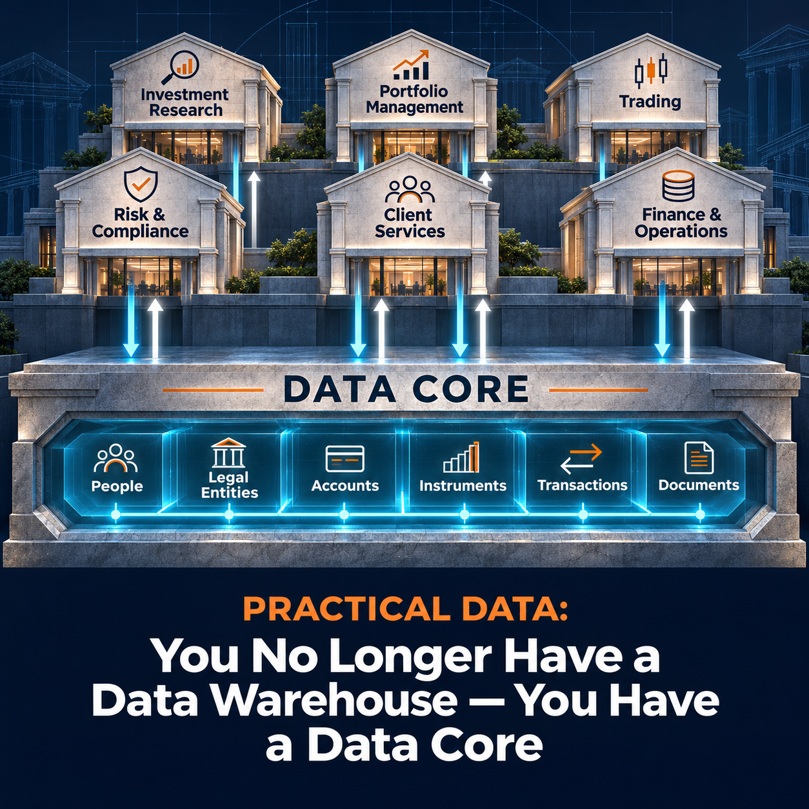

# Practical Data: You No Longer Have a Data Warehouse — You Have a Data Core

Your reporting team needs a reliable view of a customer. So do your call center, digital product, and the AI assistant answering questions about that customer. Why should each have to assemble it again?

We believe the same work that makes data reusable for analytics should make it reusable across the business. That changes the role of the traditional data warehouse.

A modern data platform should no longer simply receive data, transform it, and serve reports. Properly designed, it becomes a data core: a central clearinghouse that can consume information from many sources, transform it into well-defined business information objects, evaluate its quality, reconcile identity, and publish it in contracted forms for many different consumers.

The distinction matters because the architecture is no longer serving analytics alone. Operational systems, digital products, integration flows, automation, and AI increasingly need the same trusted business information.

## From warehouse to data core

Traditional data warehouses were optimized around analytical consumption. Data moved inward from operational systems, was transformed for reporting, and was then consumed through BI and analytical tools.

That model becomes restrictive when the same information is needed across the business. If every operational platform, AI service, integration, and analytical workload independently reconstructs customer, product, account, transaction, or other core business information, the organization creates multiple competing versions of the same business.

A data core changes the role of the central data capability. It becomes the place where business information is assembled and governed so it can be reused.

## A central clearinghouse for business information

A data core consumes relevant sources in their own structures, turns them into well-defined business information objects, evaluates quality, resolves identity, and publishes the resulting information through explicit contracts.

The core is an architectural capability that can span multiple platforms. Its value comes from creating a common representation of the business and making that representation available consistently. Buying a platform with “data core” on the label will not create that capability for you.

Business information should become the strategic asset. Analytics should consume it, rather than defining it.

Take a travel company. A person might appear as a prospect in marketing, a traveler in the reservation system, and a caller in the contact center. Those are roles and interactions associated with a Person. The core needs a durable definition of that subject, its identifiers, its relationships, and its history. A booking dashboard, a service application, and an AI assistant can then consume products based on that same definition.

That does not give every consumer access to everything known about the person. Each product exposes the information appropriate to its purpose and access rules.

## Bronze, Silver, Gold, and Products

We usually start target-state warehouse architecture conversations with four responsibilities.

**Sourcing Layer (aka RAW or BRONZE)** acquires source information under a defined sourcing contract and preserves the source representation needed for traceability. Its data model is the source model.

**Transformation Layer (aka NORMALIZED or SILVER)** transforms each individual source into the designed target logical model, keeping the records from each source separate. Design the Gold model first: Silver should already use the structures and definitions needed in Gold, with data from a single source.

**Consolidation Layer (aka CONSOLIDATED or GOLD)** brings those normalized sources together. It applies matching, reconciliation, and survivorship rules to create a shared representation of subjects such as Person, Legal Entity, Account, or Transaction. That representation includes relationships and history; “everything known about a subject” does not mean cramming it into one physical row.

**Consumer Layer (aka PRODUCTS or PLATINUM)** packages information to meet specific business data consumer demands or answer specific questions. A product may support analytics, an operational integration, an AI service, or a customer experience. Its design follows the consumer's need.

The target logical model should be designed for longevity. Individual consumer demands belong in the products built from it. Otherwise, each new dashboard or application starts reshaping the organization's definition of its own data.

Read more about how we usually start conversations about target-state data architecture designs for data warehouses.

## Contracts at both ends

A reliable data core needs contracts on both sides of the architecture.

At the Sourcing Layer boundary, sourcing contracts define what the core expects from a source: structure, meaning, identifiers, quality expectations, ownership, and how changes will be communicated.

At the Consumer Layer boundary, publishing contracts define what consumers can rely on: what each record represents, which identifiers and relationships it uses, how current the data is, who can access it, and how the product will change. Consumers integrate with the product rather than depending on internal warehouse tables.

For the travel company, a contact-center product might provide a person's current contact details and upcoming bookings. A financial reporting product may need historical booking values as they stood at month-end. Both use the same underlying subjects, with different content and delivery commitments.

Together, the contracts create a controlled clearinghouse without coupling every producer directly to every consumer.

## Not every source needs every layer

A common mistake is to turn medallion architecture into a mandatory sequence. Not every source needs to pass mechanically through every layer.

A source that already conforms to the target logical model may need validation rather than another structural transformation. It still needs traceability, quality checks, and identity reconciliation before joining the consolidated view. A familiar schema is not evidence that two records represent the same person.

The objective is to preserve the responsibilities of the architecture, not to maximize the number of transformations or physical copies. Consolidation across sources still belongs in Gold; consumer-specific packaging still belongs in Platinum.

Near-real-time integration exposes the cost of forcing every event through unnecessary batch-oriented stages: it recreates the latency problems associated with traditional warehouses.

## The warehouse does not have to be slow

The historical criticism of enterprise data warehouses is justified: many became slow, cumbersome, batch-oriented environments that were poorly suited to operational use.

Streaming and event-driven processing can reduce the delay between acquiring information and publishing it. The architecture needs to be designed around the latency each product requires, including the time needed for matching and quality checks. A well-designed logical model alone does not make a nightly batch operationally current.

Near-real-time does not require abandoning governance. It requires moving governance into reusable models, identity rules, contracts, and automated quality controls rather than relying on slow manual processes.

## Integration becomes a product of the core

Once trusted business information exists in the data core, it can support system integration as well as analytics. A product can be designed specifically for an operational consumer, allowing a platform to source a governed business object rather than reconstructing it from multiple upstream systems.

The data platform stops being merely the place where information goes after operational activity has happened. It becomes part of how the organization distributes trusted information between systems.

The operational applications still own their transactions and workflows. A reservation system still makes a booking. The core supplies reusable information to those systems and incorporates the resulting changes. Product contracts need to make those responsibilities clear, particularly where information flows back toward a source.

## AI makes the change more urgent

AI increases demand for reusable business context. Models and agents need more than access to tables. They need to know what business objects mean, how they are identified, which relationships matter, and which information is authoritative.

That context should be part of the same governed data definition used to design the core. The subject models describe how the information is organized; the semantic definitions explain what it means, how roles and relationships work, and which business rules apply. Schemas, documentation, validation rules, and ontology representations should be maintained from that common definition.

For the travel company, AI needs to understand that a person making a booking may be different from the person traveling. Access to a table called Customer will not explain that distinction.

We argue for one common data definition, including the context AI needs, rather than maintaining a separate semantic layer that gradually drifts away from the data it describes. The core can provide consistent definitions and controlled products; AI still needs its queries and answers checked against them.

## What does this change about the technology stack?

When the same core supports reporting, integration, and AI, reconsider how much duplicated data management sits across the technology stack. The comparison with Master Data Management in our warehouse architecture article is particularly relevant here.

A core also needs data operations: people and processes to review uncertain matches, correct information, approve changes, and resolve quality exceptions. A pipeline can detect a problem without being able to decide the correct business answer. Those interventions need ownership, history, and a controlled route back into the data.

The warehouse, MDM, and integration labels can obscure how much of this work is shared. Before buying another platform, map the capabilities you actually need, including operational maintenance and product delivery, against what you already have. Separate products may still be justified, but separate definitions of the same business subject are a cost you will keep paying.

## The destination is a business information core

The useful question is no longer whether the organization has a data warehouse, lakehouse, or another named platform pattern. The question is whether it has a durable capability for turning fragmented source data into trusted business information and publishing that information for reuse.

We would start the next architecture conversation with the information the business needs to reuse, the common definition behind it, and the contracts through which it will be consumed. Then decide which technologies should deliver those responsibilities.

If your warehouse already does this, give it the responsibility it has earned: treat it as the organization's data core.
