# CPG Manufacturing and Supply Chain Data Model Design Document

This **Data Model Design Document** by **M&A Operating System** provides a single traceable review of one scoped area of a business: the business requirements that area works to, how those requirements translate into data requirements, and how those data requirements translate into a data model design. Every part of the design traces back to the requirement that made it necessary and to the source that evidences it, so that each statement can be followed in either direction. It is written in plain English for the business audience accountable for the area — the people best placed to say whether what it describes is true of their business, and who decide whether this design is recorded in a centralised Data Design Authority as the governed definition the organisation builds and reports on.

## Version

|  |  |
|---|---|
| Domain | CPG Manufacturing and Supply Chain |
| Document date | 18 November 2026 |
| Package reference (the working files this document is produced from) | cpg-manufacturing |
| Method version | 31.5 |
| Edition | Lite |

**In brief.** This design covers how a food and beverage manufacturer makes its product, in its own factories and through outside manufacturers: the materials it receives, the factory down to the shop floor, how each product is made, the batches that result, the tests and problems that follow, and how any batch is traced back to its ingredients and forward to where it went. The full summary, the questions it answers and the counts are in section 1.3. In this document, DDA means the Data Design Authority, the central register where the company's data model is kept.

## Table of Contents

- [1 Introduction](#1-introduction)
  - [1.1 About M&A Operating System](#11-about-ma-operating-system)
  - [1.2 About the MAOS Practical Data Modelling Approach](#12-about-the-maos-practical-data-modelling-approach)
  - [1.3 Summary of Findings](#13-summary-of-findings)
- [2 Scope](#2-scope)
  - [2.1 The business](#21-the-business)
  - [2.2 In scope](#22-in-scope)
  - [2.3 Out of scope](#23-out-of-scope)
  - [2.4 Shared with other models](#24-shared-with-other-models)
  - [2.5 Assumptions](#25-assumptions)
  - [2.6 Open questions](#26-open-questions)
- [3 Business Requirements](#3-business-requirements)
- [4 Data Requirements](#4-data-requirements)
- [5 Data Model](#5-data-model)
  - [5.1 Diagrams](#51-diagrams)
    - [5.1.1 Domains Data Model](#511-domains-data-model)
    - [5.1.2 Roles Data Model](#512-roles-data-model)
    - [5.1.3 Concept Models by Domain](#513-concept-models-by-domain)
  - [5.2 Subject Domains](#52-subject-domains)
  - [5.3 Canonical Roles](#53-canonical-roles)
  - [5.4 Role–Verb–Role Relationships](#54-roleverbrole-relationships)
  - [5.5 Concepts](#55-concepts)
  - [5.6 Lookups and Values](#56-lookups-and-values)
- [6 Outstanding Decisions](#6-outstanding-decisions)
  - [6.1 Decisions still open](#61-decisions-still-open)
  - [6.2 Where the design departs from DDA's principles](#62-where-the-design-departs-from-ddas-principles)
- [Appendix A — Sources](#appendix-a--sources)
- [Appendix E — Business Test Cases](#appendix-e--business-test-cases)

**What this edition leaves out.** This is the lite edition, written for the business owner and the data steward. The full edition adds *Source Validation*, *Existing Model Findings*, *Conformance to DDA Standards*, *Exceptions*, *DDA Domain Definitions*, *Standards*, *New Subject Domains* and the *Data Dictionary* of every attribute. Nothing here is abridged: whole sections are left out, never part of a table. Ask for the full edition to read any of them.

## 1 Introduction

### 1.1 About M&A Operating System

#### M&A Operating System — AI & Data Advisory Practice

**M&A Operating System (MAOS) helps organizations turn data into measurable business outcomes.**

Our **AI & Data Advisory Practice** works with senior business, data, analytics, and technology leaders to improve how their organizations use information to grow revenue, understand customers, make better decisions, reduce operating cost, manage risk, and enable analytics and AI.

Most organizations do not lack data. They struggle to turn the data they already have into information the business can consistently trust and use. Customer information is fragmented, reports disagree, data is repeatedly copied and transformed, and business definitions vary across teams. Analytics and AI initiatives then inherit the same problems.

We start with the business outcome and work backwards to the information, architecture, governance, operating model, and technology changes required to achieve it. That may mean improving customer identity to support segmentation and personalization, creating more reliable management information, simplifying complex data flows, or establishing the trusted business context required for AI.

Our work typically includes:

- Improving customer identity, segmentation, personalization, and revenue-growth capabilities
- Solving complex data management and data content design issues for Legal Entity, Beneficial Owner, People, Securities, Product Definition and transactional data
- Creating more consistent, timely, and trusted information for reporting, analytics, forecasting, and decision-making
- Designing and maintaining business-aligned data models for operational, analytical, and AI needs
- Resolving data quality, reliability, and performance issues caused by complex data flows, fragmented connectivity, duplication, and uncontrolled data propagation
- Establishing trusted views of customers, legal entities, products, accounts, agreements, and other critical business subjects
- Simplifying data architectures and reducing unnecessary movement, duplication, and technology complexity
- Establishing practical data governance, ownership, and AI readiness aligned to business priorities

Our goal is not simply to modernize data technology. It is to make information work better for the business.

**The value of a data program should ultimately be measured by what the business can do better because of it.**

#### Find Out More

To learn more about how M&A Operating System can help your organization turn data into measurable business outcomes, visit [maoperatingsystem.com](https://www.maoperatingsystem.com).

For a direct conversation about your data, analytics, or AI priorities, contact [cdao-advisory@maoperatingsystem.com](mailto:cdao-advisory@maoperatingsystem.com).

### 1.2 About the MAOS Practical Data Modelling Approach

#### About the M&A Operating System Practical Data Modelling Approach

The **M&A Operating System Practical Data Modelling Approach** is our proprietary, business-led methodology for translating business outcomes and challenges into data requirements and approved logical data models.

We engage business stakeholders and data-consuming groups to understand what they expect data services to make possible. Their needs are captured as plain-English business requirements, then translated through a controlled, traceable sequence of analysis and design activities. The methodology deliberately avoids overly technical terminology and modelling techniques, presenting the information in a business-readable, plain-English form. The resulting data modelling document follows the same sequence, allowing business stakeholders and data practitioners to understand, challenge, and approve the design.

#### The Five-Step Process

##### Step 1 — Gather and Approve Business Requirements

We identify the outcomes stakeholders expect, the challenges they need to solve, and the business activities that data services must support. These are documented as plain-English requirements and approved as the scope and source of knowledge for the design.

##### Step 2 — Identify Actors, Objects, and Roles

Using **Subject-Based Data Modelling**, we identify the actors, roles, and objects in the business lifecycle and map them to domains representing the immutable subjects of the data. Domains describe the enduring people, organizations, things, places, and other subjects the business needs to understand—not the specific reason they appear in a single process.

Actors and objects are aligned to their underlying mastered subjects. Roles describe the capacity in which a subject participates in a relationship, process, or context. The same subject can perform several roles without being modelled repeatedly.

##### Step 3 — Identify Relationships

We identify the relationships between actors and objects and express them as clear business verbs—such as owns, manages, supplies, purchases, or is party to. This makes their meaning understandable and reviewable by business and data stakeholders.

##### Step 4 — Identify Lifecycle Events

We identify the events that actors, roles, and objects pass through as they live their natural lives and interact within business processes. These events include when an object is created, changed, activated, transferred, or retired; a subject assumes or ceases a role; or a relationship is established, modified, or ended. This determines what data must be captured at each stage.

##### Step 5 — Design Logical Data Models

The approved requirements, subjects, roles, relationships, and lifecycle events form the logical data model, documented through four connected components:

- **Data Domains** — governed groupings representing the immutable subjects of the data
- **Data Concepts** — the unique logical elements that make up the data known and recorded about each subject
- **Data Relationships** — the business connections between concepts, including the roles they perform
- **Data Attributes** — the individual data elements that describe each concept or relationship

Each component remains traceable to the requirement that established its need. The completed document provides the shared record business stakeholders and data practitioners use to review and approve the data requirements and model design.

### 1.3 Summary of Findings

This design covers how a food and beverage manufacturer makes its product, in its own factories and through outside manufacturers. It holds the materials the organisation receives and the suppliers they come from, the factory and the places inside it down to the shop floor, the machines in those places, the way each product is made, the production runs and the batches they make, the testing, problems, corrections and release that follow, and the stock held at the organisation's own sites. Food and beverage is the one subgroup in scope; household, personal care, pet care and beauty are left for a later extension.

Tracing is the thread through it. A batch is the one thing a trace starts from and ends at, so every link that matters for a recall, a complaint or a failed test points at a batch: what went into it, what came out of it, what was found against it, what was complained of and who was exposed. The links carry the quantity the recipe called for and the quantity actually used, so the design says how far a batch departed from its recipe. The design is shown with three markets' traceability duties: the United States, the United Kingdom and the European Union (assumption SCA006).

The design has stated limits. The chain of what goes into what stops at anything bought in already made, where only what the supplier declares is known, with who declared it (assumption SCA003, and test cases SCN037 and SCN038 in Appendix E). What a product is made from, what it must be and what its pack says belong to the CPG - Product Definition model (assumption SCA004). Costs are not held (assumption SCA007). Whether finished output is identified individually or only by batch is an open question (SCQ001), and the design supports both.

**What the business can answer with this design**

- How much more or less of each input did this batch use than the recipe specified?
- Did this supplier hold a valid assessment on the day a delivery was received?
- Which of this batch's stated properties were tested here, and which were taken on the supplier's word?
- Who carried out each step of this batch, and were they qualified on that day?
- Who released this batch, when, and on what basis?
- Which complaints concern this batch, and what else was made from the same inputs?
- Was this batch ever stored outside its permitted conditions?
- How many units are in a case of this product, and how many cases on a pallet?

This design creates 42 concepts, 48 roles, 29 relationships and eight lists of values in DDA, extends one existing domain (Locations) with the structure of a factory, adds seven values to one existing list, and reuses six existing domains and six existing concepts. It refers to one concept, Product, that CPG - Product Definition creates and owns. It proposes two new domains.

|  | Count |
|---|---|
| Business requirements | 57 |
| Data requirements | 28 |
| Areas of the business covered (domains) | 9 (7 already in DDA, 2 proposed) |
| Roles, meaning the part something plays in a relationship | 48 |
| Relationships between roles | 31 |
| Concepts, meaning groups of related facts | 49 |
| Lists of allowed values | 9 |
| Business test cases | 30 pass · 2 with a limit accepted |
| Sources | 38 |

## 2 Scope

### 2.1 The business

A manufacturer of food and beverage products. It receives materials, makes, packs and tests product, and releases it for despatch, through its own factories and through outside manufacturers. What a product is and what goes into it is held by CPG - Product Definition; this model holds the logistics of making finished products from those ingredients.

The subgroup in scope is food and beverage.

### 2.2 In scope

| ID | In scope |
|---|---|
| SCI001 | Receiving materials from suppliers, and assessing the suppliers |
| SCI003 | Defining how products are made — the steps, the settings and the recipes |
| SCI004 | The places in each factory down to the shop floor, and the machines in them |
| SCI005 | Making product, and what each batch actually used and produced |
| SCI006 | Testing, recording problems, putting them right, and releasing product |
| SCI007 | Tracing any batch back to its ingredients and forward to where it went |
| SCI008 | Stock held at the organisation's own sites |
| SCI009 | Product made or packed by outside manufacturers |
| SCI010 | Packing, and the levels a product is packed in for handling — unit, case and pallet |
| SCI011 | The sites that suppliers and outside manufacturers make and ship from |
| SCI012 | Turning ingredients into finished products: the logistics of receiving, making, packing and moving them, built on the product and the hierarchy of products and ingredients held by CPG - Product Definition |

### 2.3 Out of scope

What this design leaves out, and the model that is intended to own it.

| ID | Out of scope | Owned by another model |
|---|---|---|
| SCO001 | Trade spending, promotions and pricing with retailers | The commercial model |
| SCO002 | What happens on the shelf in store | The commercial model |
| SCO003 | Market share and sales data bought from research firms | The commercial model |
| SCO004 | Marketing, campaigns and advertising | The digital marketing model |
| SCO005 | Accounts, ledgers and statutory reporting | The finance model |
| SCO006 | Research and development before a product is formally defined | Not modelled |
| SCO007 | Defining products — what they are made from, what they must be, how long they last and what their packs say | The CPG - Product Definition model |
| SCO008 | The total cost of poor quality, and any other cost worked out by adding up what happened | The finance model |
| SCO009 | Household and cleaning products, personal care and cosmetics, pet care and beauty | A later extension of this model |

### 2.4 Shared with other models

These are used as DDA already holds them.

| ID | Shared area | In DDA |
|---|---|---|
| SCS001 | People | [DMD000000001](https://datadesign.maoperatingsystem.com/models/domains/DMD000000001) |
| SCS002 | Legal entities | [DMD000000012](https://datadesign.maoperatingsystem.com/models/domains/DMD000000012) |
| SCS003 | Documents | [DMD000000016](https://datadesign.maoperatingsystem.com/models/domains/DMD000000016) |
| SCS004 | Events | [DMD000000020](https://datadesign.maoperatingsystem.com/models/domains/DMD000000020) |
| SCS005 | Transactions | [DMD000000022](https://datadesign.maoperatingsystem.com/models/domains/DMD000000022) |
| SCS006 | Products | [DMD000000032](https://datadesign.maoperatingsystem.com/models/domains/DMD000000032) |
| SCS007 | Locations | [DMD000000034](https://datadesign.maoperatingsystem.com/models/domains/DMD000000034) |

### 2.5 Assumptions

| ID | Assumption |
|---|---|
| SCA001 | The factory, laboratory, quality and maintenance systems already in place stay in place. This model holds what they record; it does not replace them. |
| SCA002 | Material held by a supplier or outside manufacturer is theirs. It becomes the organisation's on receipt, and the organisation holds no stock at any party it does not operate. |
| SCA003 | Something bought as an ingredient or part may be another company's finished product. What it is made from is theirs and may not be known here. |
| SCA004 | The product definition — what a product is made from, what it must be, how long it lasts and what its pack says — is held by CPG - Product Definition. This model refers to a product and does not define it again. |
| SCA005 | A manufacturing bill of materials is read as the formulation held in CPG - Product Definition. This model holds how a batch compares with it: what was used, and in what quantity. |
| SCA006 | Food traceability duties differ by market. The United States, the United Kingdom and the European Union are the sample markets, and other markets come in as further requirements, not as a different design. |
| SCA007 | Costs are not held. What each stoppage, failure, rework and complaint was is recorded; adding them up is a calculation outside this model. |

### 2.6 Open questions

| ID | Question |
|---|---|
| SCQ001 | Is finished output identified individually, or only by batch? The model supports both; how much of Instances is used depends on the answer. |
| SCQ002 | What proportion of output is made by outside manufacturers? Where it is most of it, the organisation holds little production record of its own. |

## 3 Business Requirements

Each requirement can be checked against the sources beside it. Food traceability duties differ by market (assumption SCA006).

| ID | Category | Business requirement | Proposed owner | Sources |
|---|---|---|---|---|
| REQ033 | Equipment | A plant is organised into areas, lines and units, and work happens at each level. | Plant manager | [SRC001](https://reference.opcfoundation.org/specs/OPC-10030/7), [SRC004](https://www.fabrico.io/blog/isa-88/) |
| REQ034 | Equipment | A place on a line and the machine standing in it are different things, and machines are replaced. | Maintenance lead | [SRC001](https://reference.opcfoundation.org/specs/OPC-10030/7), [SRC004](https://www.fabrico.io/blog/isa-88/) |
| REQ035 | Equipment | A machine has a repair history, a record of how it fails and a working life that follow it wherever it goes. | Maintenance lead | [SRC018](https://oxmaint.com/industries/food-manufacturing/food-plant-production-uptime-cmms-guide-2026), [SRC016](https://oxmaint.com/industries/manufacturing-plant/manufacturing-execution-system-maintenance-integration-mes) |
| REQ036 | Equipment | Some equipment matters more than others — because it stops the line, costs more to repair, or its failure is a safety issue. | Maintenance lead | [SRC018](https://oxmaint.com/industries/food-manufacturing/food-plant-production-uptime-cmms-guide-2026) |
| REQ037 | Equipment | A stoppage is recorded by production as lost output and by maintenance as work, and both must agree it was one stoppage. | Plant manager | [SRC016](https://oxmaint.com/industries/manufacturing-plant/manufacturing-execution-system-maintenance-integration-mes) |
| REQ038 | Equipment | Why a line stopped matters as much as that it stopped, and the reasons must be recorded consistently. | Plant manager | [SRC017](https://oxmaint.com/industries/steel-plant/oee-data-accuracy-best-practices), [SRC018](https://oxmaint.com/industries/food-manufacturing/food-plant-production-uptime-cmms-guide-2026) |
| REQ039 | Equipment | Maintenance is planned, prompted by a condition, or done after a failure, and these are different kinds of work. | Maintenance lead | [SRC016](https://oxmaint.com/industries/manufacturing-plant/manufacturing-execution-system-maintenance-integration-mes), [SRC018](https://oxmaint.com/industries/food-manufacturing/food-plant-production-uptime-cmms-guide-2026) |
| REQ068 | Identity | Two records may turn out to describe the same place, supplier or machine, and one record then stands in for the other. | Data steward | [SRC005](https://sgsystemsglobal.com/?p=15659) |
| REQ069 | Identity | An identifier issued by an outside authority is the strongest evidence of what something is. | Data steward | [SRC030](https://www.gs1uk.org/sites/default/files/The_GTIN_management_handbook.pdf), [SRC011](https://support.famoussoftware.com/article/fsma-204-general-summary) |
| REQ001 | Material | Everything the organisation buys, makes or sells is something it holds, counts and can run out of — ingredients, packaging, part-made goods and finished goods. | Supply chain lead | [SRC005](https://sgsystemsglobal.com/?p=15659), [SRC039](https://www.cleverence.com/amp/articles/business-blogs/guide-batch-tracking-5829/) |
| REQ006 | Material | What a recipe says should go in and what a batch actually used differ, and the difference matters. | Plant manager | [SRC005](https://sgsystemsglobal.com/?p=15659), [SRC033](https://casrai.org/dictionary/term/electronic-batch-record-ebr) |
| REQ007 | Material | Where a specified input is replaced on a batch, which input was actually used must be known. | Technical lead | [SRC005](https://sgsystemsglobal.com/?p=15659), [SRC033](https://casrai.org/dictionary/term/electronic-batch-record-ebr) |
| REQ009 | Material | A material arrives with the supplier's statement of what it is, and the organisation may or may not check it. | Quality manager | [SRC020](https://www.registrarcorp.com/iso-22716-raw-materials/), [SRC039](https://www.cleverence.com/amp/articles/business-blogs/guide-batch-tracking-5829/) |
| REQ010 | Material | Something bought as an ingredient or part may be another company's finished product, and what it is made from may not be known. | Technical lead | [SRC023](https://prod.ryder.com/en-us/insights/blogs/logistics/turnkey-vs-tolling), [SRC024](https://prod.ryder.com/en-us/logistics/co-packaging/contract-manufacturing) |
| REQ016 | Material | A batch may be split or combined for handling, and every part stays traceable to where it came from. | Supply chain lead | [SRC005](https://sgsystemsglobal.com/?p=15659), [SRC007](https://www.cleverence.com/amp/articles/business-blogs/how-to-batch-tracking-for-manufacturing-7284/) |
| REQ017 | Material | Ingredients, part-made goods and finished goods are each held at places, and each is counted separately. | Supply chain lead | [SRC039](https://www.cleverence.com/amp/articles/business-blogs/guide-batch-tracking-5829/), [SRC005](https://sgsystemsglobal.com/?p=15659) |
| REQ018 | Material | Stock at one place may be available, on hold or rejected, and these are separate quantities rather than one quantity with a label. | Quality manager | [SRC040](https://sgsystemsglobal.com/traceability/), [SRC014](https://www.fabrico.io/de/blog/non-conformance-report/) |
| REQ060 | Outside manufacture | Product may be made or packed by an outside manufacturer, who buys the materials and delivers finished product to the organisation's specification. | Procurement lead | [SRC023](https://prod.ryder.com/en-us/insights/blogs/logistics/turnkey-vs-tolling), [SRC024](https://prod.ryder.com/en-us/logistics/co-packaging/contract-manufacturing) |
| REQ061 | Outside manufacture | What the organisation buys becomes its own when it arrives; what a supplier or outside manufacturer holds before then is theirs. | Finance lead | [SRC023](https://prod.ryder.com/en-us/insights/blogs/logistics/turnkey-vs-tolling), [SRC024](https://prod.ryder.com/en-us/logistics/co-packaging/contract-manufacturing) |
| REQ062 | Outside manufacture | Outside manufacturers are held to the same good practice as the organisation's own plants, and their records must be available when needed. | Quality manager | [SRC022](https://sgsystemsglobal.com/?p=16831) |
| REQ063 | Outside manufacture | How far back a product can be traced depends on the supplier's own records once it is outside the organisation's sight. | Quality manager | [SRC009](https://www.fda.gov/food/food-safety-modernization-act-fsma/fsma-proposed-rule-food-traceability), [SRC011](https://support.famoussoftware.com/article/fsma-204-general-summary) |
| REQ064 | People | People are qualified to do particular work, and qualifications expire. | Plant manager | [SRC001](https://reference.opcfoundation.org/specs/OPC-10030/7), [SRC022](https://sgsystemsglobal.com/?p=16831), [SRC046](https://www.fda.gov/food/food-safety-modernization-act-fsma/fsma-final-rule-preventive-controls-human-food) |
| REQ065 | Place | A site, a warehouse and a storage place are all places, and they sit inside one another. | Supply chain lead | [SRC001](https://reference.opcfoundation.org/specs/OPC-10030/7), [SRC039](https://www.cleverence.com/amp/articles/business-blogs/guide-batch-tracking-5829/) |
| REQ066 | Place | Where something is stored affects how long it lasts and whether it stays fit to use. | Quality manager | [SRC020](https://www.registrarcorp.com/iso-22716-raw-materials/) |
| REQ067 | Place | A place may be identified differently by the organisation, a supplier and a regulator. | Data steward | [SRC011](https://support.famoussoftware.com/article/fsma-204-general-summary) |
| REQ025 | Process | Making a product is a sequence of steps, and the order matters as much as the ingredients. | Technical lead | [SRC045](https://isa.org/standards-and-publications/isa-standards/list-of-all-isa-standards), [SRC003](https://sgsystemsglobal.com/?p=16813) |
| REQ026 | Process | A step needs particular equipment, particular people and particular materials. | Plant manager | [SRC045](https://isa.org/standards-and-publications/isa-standards/list-of-all-isa-standards), [SRC001](https://reference.opcfoundation.org/specs/OPC-10030/7) |
| REQ027 | Process | The same step is used in making many different products. | Technical lead | [SRC003](https://sgsystemsglobal.com/?p=16813), [SRC004](https://www.fabrico.io/blog/isa-88/) |
| REQ028 | Process | A step has settings — a temperature, a time, a speed — and the values differ by product and by line. | Technical lead | [SRC003](https://sgsystemsglobal.com/?p=16813), [SRC004](https://www.fabrico.io/blog/isa-88/) |
| REQ029 | Process | A formulation is written once and made at several sites on several lines, and what is carried out differs at each. | Technical lead | [SRC045](https://isa.org/standards-and-publications/isa-standards/list-of-all-isa-standards), [SRC003](https://sgsystemsglobal.com/?p=16813) |
| REQ030 | Process | The instructions issued for one batch are a specific thing, separate from the formulation they came from. | Plant manager | [SRC003](https://sgsystemsglobal.com/?p=16813), [SRC033](https://casrai.org/dictionary/term/electronic-batch-record-ebr) |
| REQ031 | Process | The order in which products run on a line matters, because what ran before can contaminate what runs next. | Quality manager | [SRC034](https://www.fda.gov/regulatory-information/search-fda-guidance-documents/cpg-sec-555250-statement-policy-labeling-and-preventing-cross-contact-common-food-allergens) |
| REQ032 | Process | Changing a line from one product to another takes time and may need cleaning, and both are part of the cost of making. | Plant manager | [SRC034](https://www.fda.gov/regulatory-information/search-fda-guidance-documents/cpg-sec-555250-statement-policy-labeling-and-preventing-cross-contact-common-food-allergens), [SRC017](https://oxmaint.com/industries/steel-plant/oee-data-accuracy-best-practices) |
| REQ022 | Product identity | What was actually made is a fact about the batch; what should have been made is a fact about the definition. | Quality manager | [SRC005](https://sgsystemsglobal.com/?p=15659), [SRC033](https://casrai.org/dictionary/term/electronic-batch-record-ebr) |
| REQ023 | Product identity | Some things are identified individually and some only by the batch they came from, and one product may contain both. | Quality manager | [SRC007](https://www.cleverence.com/amp/articles/business-blogs/how-to-batch-tracking-for-manufacturing-7284/), [SRC037](https://www.linxglobal.com/en/solutions/coding-types/gs1/) |
| REQ024 | Product identity | A pack may carry its own serial number as well as its batch, and retailers increasingly expect to read it, though no law requires it. | Commercial lead | [SRC037](https://www.linxglobal.com/en/solutions/coding-types/gs1/), [SRC038](https://www.qrstuff.com/feeds/blog/gs1-sunrise-2027) |
| REQ072 | Product identity | A product is packed in levels — a single unit, a case of units, a pallet of cases — and each level is identified, counted and moved as a thing in its own right. | Supply chain lead | [SRC030](https://www.gs1uk.org/sites/default/files/The_GTIN_management_handbook.pdf), [SRC031](https://www.gs1nz.org/assets/Resources/Services/GS1NZ_Fact-sheet-gtin-allocation-rules.-V2.pdf) |
| REQ040 | Production | Making something is instructed, carried out and recorded, and the three may differ. | Plant manager | [SRC033](https://casrai.org/dictionary/term/electronic-batch-record-ebr), [SRC005](https://sgsystemsglobal.com/?p=15659), [SRC021](https://fda.gov/media/86366/download), [SRC027](https://www.canr.msu.edu/news/fsma-legal-ramifications-of-cgmps-are-important-to-pet-food-safety) |
| REQ041 | Production | Who carried out each step of a batch, and whether they were qualified to, must be recoverable. | Plant manager | [SRC006](https://gevernova.com/software/blog/mes-traceability-genealogy), [SRC001](https://reference.opcfoundation.org/specs/OPC-10030/7), [SRC033](https://casrai.org/dictionary/term/electronic-batch-record-ebr) |
| REQ042 | Production | Goods move between plants, warehouses and storage places, and each movement has a time and a place. | Supply chain lead | [SRC009](https://www.fda.gov/food/food-safety-modernization-act-fsma/fsma-proposed-rule-food-traceability), [SRC040](https://sgsystemsglobal.com/traceability/) |
| REQ044 | Quality | A material or product must meet a stated specification, and what it must be changes over time. | Quality manager | [SRC020](https://www.registrarcorp.com/iso-22716-raw-materials/), [SRC012](https://simplerqms.com/non-conformance/) |
| REQ045 | Quality | Meeting a specification is shown by testing, and a test has a method as well as a result. | Quality manager | [SRC020](https://www.registrarcorp.com/iso-22716-raw-materials/), [SRC022](https://sgsystemsglobal.com/?p=16831) |
| REQ046 | Quality | A departure from a procedure and a failure against a specification are different things, and both must be recorded. | Quality manager | [SRC012](https://simplerqms.com/non-conformance/), [SRC013](https://gmpinsiders.com/deviation-management-process/), [SRC046](https://www.fda.gov/food/food-safety-modernization-act-fsma/fsma-final-rule-preventive-controls-human-food) |
| REQ047 | Quality | Material that fails must be held back, a decision made about it, and that decision made by someone with the authority to make it. | Quality manager | [SRC014](https://www.fabrico.io/de/blog/non-conformance-report/), [SRC013](https://gmpinsiders.com/deviation-management-process/), [SRC046](https://www.fda.gov/food/food-safety-modernization-act-fsma/fsma-final-rule-preventive-controls-human-food) |
| REQ048 | Quality | Every departure from procedure must be investigated, with conclusions and follow-up recorded. | Quality manager | [SRC015](https://www.pharmaceutical-technology.com/?p=1983), [SRC013](https://gmpinsiders.com/deviation-management-process/), [SRC046](https://www.fda.gov/food/food-safety-modernization-act-fsma/fsma-final-rule-preventive-controls-human-food) |
| REQ049 | Quality | A significant or recurring problem needs its cause found, action taken, and the action shown to have worked before it is closed. | Quality manager | [SRC014](https://www.fabrico.io/de/blog/non-conformance-report/), [SRC013](https://gmpinsiders.com/deviation-management-process/), [SRC046](https://www.fda.gov/food/food-safety-modernization-act-fsma/fsma-final-rule-preventive-controls-human-food) |
| REQ050 | Quality | Output is not available to sell until someone releases it, and release is a decision someone makes. | Quality manager | [SRC005](https://sgsystemsglobal.com/?p=15659), [SRC003](https://sgsystemsglobal.com/?p=16813) |
| REQ051 | Quality | For foods covered by the United States food traceability rule, the records of what went into a batch and where it went must be produced within twenty-four hours of the regulator's request. | Quality manager | [SRC009](https://www.fda.gov/food/food-safety-modernization-act-fsma/fsma-proposed-rule-food-traceability), [SRC010](https://foodbusiness.ces.ncsu.edu/news/fda-fsma-204-food-traceability-rule/), [SRC044](https://fda.gov/media/183514/download), [SRC043](https://foodbusiness.ces.ncsu.edu/news/fda-fsma-204-food-traceability-rule-july-20-2028/) |
| REQ052 | Quality | For foods covered by the United States food traceability rule, traceability records must be kept for two years. | Quality manager | [SRC011](https://support.famoussoftware.com/article/fsma-204-general-summary), [SRC009](https://www.fda.gov/food/food-safety-modernization-act-fsma/fsma-proposed-rule-food-traceability) |
| REQ053 | Quality | A lot code is assigned when a product is first packed or transformed, and must be carried at every later movement. | Quality manager | [SRC011](https://support.famoussoftware.com/article/fsma-204-general-summary), [SRC009](https://www.fda.gov/food/food-safety-modernization-act-fsma/fsma-proposed-rule-food-traceability) |
| REQ054 | Quality | A complaint may concern a specific batch, and that link is what connects experience of the product to how it was made. | Quality manager | [SRC022](https://sgsystemsglobal.com/?p=16831), [SRC005](https://sgsystemsglobal.com/?p=15659) |
| REQ055 | Quality | Some records must be signed, and the signing must show who signed, what was signed, when, and what the signing meant. | Compliance officer | [SRC032](https://sgsystemsglobal.com/glossary/21-cfr-part-11-electronic-records-signatures/), [SRC033](https://casrai.org/dictionary/term/electronic-batch-record-ebr) |
| REQ056 | Quality | Once recorded, an entry stays visible and unaltered; a correction is a new entry, not an edit. | Compliance officer | [SRC032](https://sgsystemsglobal.com/glossary/21-cfr-part-11-electronic-records-signatures/) |
| REQ057 | Quality | Some steps must be checked by a second qualified person or by equipment qualified for the purpose. | Quality manager | [SRC033](https://casrai.org/dictionary/term/electronic-batch-record-ebr) |
| REQ073 | Quality | A food business must be able to identify who supplied it and which businesses it supplied, and give that information to the authorities when asked. | Regulatory lead | [SRC041](https://www.legislation.gov.uk/eur/2002/178/article/18), [SRC042](https://www.gov.uk/government/publications/food-traceability-for-businesses/food-traceability-for-businesses) |
| REQ058 | Supplier | A supplier is assessed before being used and reassessed afterwards. | Procurement lead | [SRC020](https://www.registrarcorp.com/iso-22716-raw-materials/), [SRC029](https://ukpetfood.org/asset/14810E67%2DFA8C%2D48E8%2D924792E5213FFF43), [SRC046](https://www.fda.gov/food/food-safety-modernization-act-fsma/fsma-final-rule-preventive-controls-human-food) |
| REQ059 | Supplier | A problem with a supplier is raised with them formally and their response followed up. | Procurement lead | [SRC014](https://www.fabrico.io/de/blog/non-conformance-report/), [SRC020](https://www.registrarcorp.com/iso-22716-raw-materials/), [SRC046](https://www.fda.gov/food/food-safety-modernization-act-fsma/fsma-final-rule-preventive-controls-human-food) |

## 4 Data Requirements

What the business must keep, the questions it must be able to answer, and the mistakes the design prevents. Each links back to the requirements it serves.

| ID | The business must keep | It must be able to answer | When | Mistakes it must prevent | How the design prevents them | Requirements |
|---|---|---|---|---|---|---|
| DRQ004 | The quantity the recipe called for, as it stood when the batch was made The quantity each batch actually used | How much more or less of each input did this batch use than the recipe specified? | On any past date | — | — | [REQ006](#req006) · [REQ022](#req022) |
| DRQ005 | Which input actually filled each place in the recipe on each batch, and whether it was the specified input or an alternative | Which batches used an alternative input, and for which ingredient? | On any past date | A batch that used an alternative input with nothing recording that it did | The fact *Event Batch Inputs Is Alternative* must always be given. | [REQ007](#req007) |
| DRQ006 | Each assessment of a supplier or outside manufacturer, its scope and how long it is valid | Did this supplier hold a valid assessment on the day a delivery was received? | On any past date | An assessment treated as current after it lapsed | The fact *Legal Entity Assessments Valid Until* must always be given. | [REQ058](#req058) |
| DRQ007 | What a supplier's document states about a batch, who issued it, and whether the organisation checked it | Which of this batch's stated properties were tested here, and which were taken on the supplier's word? | Today | A supplier's claim reported as though it were the organisation's own test | The fact *Document Batch Declarations Verified* must always be given. | [REQ009](#req009) |
| DRQ008 | Which inputs are bought in finished, with contents the organisation does not know | Which products depend on a bought-in ingredient whose contents we rely on the supplier to declare? | Today | — | — | [REQ010](#req010) · [REQ063](#req063) |
| DRQ012 | Every split and every combination of batches, with the quantities of each part | Which batches came from this one, and which batches made up this combined one? | Today | A split that produces a quantity with no batch it came from | The concept [SBJ017](#sbj017) (*Product Sub Batches*) sits under its parent in the numbers it states. | [REQ016](#req016) |
| DRQ013 | How much of each item is held, in what condition, at which place, at what time | How much of this material is available, on hold, or rejected at each site right now? | Today and on any past date | Stock on hold counted as available | The fact *Transaction Inventory Positions Condition* must always be given. | [REQ001](#req001) · [REQ017](#req017) · [REQ018](#req018) |
| DRQ016 | Each individually identified unit, the product it is a unit of, and which unit or batch filled each part of it | What exactly is inside this individual unit, and which batch did each part come from? | On any past date | A batch built into a unit with no quantity recorded | The fact *Instance Batch Composition Quantity* must always be given. | [REQ023](#req023) · [REQ024](#req024) |
| DRQ017 | The steps of each method in order, what each step needs, and its settings for each product on each line | What steps, equipment, qualifications and settings does making this product need on this line? | Today | — | — | [REQ025](#req025) · [REQ026](#req026) · [REQ027](#req027) · [REQ028](#req028) |
| DRQ018 | The four levels of each recipe, and which level each came from | Which instructions were issued for this batch, and which formulation did they come from? | On any past date | — | — | [REQ029](#req029) · [REQ030](#req030) |
| DRQ019 | The rules about what may run after what on each line, and why Each changeover and each clean, with how long it took | What ran on this line just before this batch, and was the line cleaned in between? | On any past date | A product free of an allergen run straight after one containing it, with no clean between | The fact *Location Sequencing Rules Requires Clean* must always be given. | [REQ031](#req031) · [REQ032](#req032) |
| DRQ020 | Each place in the plant and what it sits within Which machine stood in each place, from when to when | Which machine was in this place on the day this batch was made? | On any past date | — | — | [REQ033](#req033) · [REQ034](#req034) |
| DRQ021 | Each machine's failures and how it failed, its repairs, its readings, and how much it matters | Which machines cause the most unplanned stoppage, and how do they fail? | Today and on any past date | — | — | [REQ035](#req035) · [REQ036](#req036) · [REQ039](#req039) |
| DRQ022 | One record of each stoppage — start, end, and reason from a set list — with the lost output and the repair both tied to it | How long did this line stop, why, and what did maintenance do about it? | On any past date | One stoppage recorded twice A stoppage with no reason | The relationship [REL031](#rel031) (*Event Stoppage Machines*) allows only the number of links it states. [LKP006](#lkp006) (*Event Stoppages Reason Type*) allows only its listed values. | [REQ037](#req037) · [REQ038](#req038) |
| DRQ023 | What each step of a batch was told to do, what it did, what resulted, who did it, and whether they were qualified at the time | Who carried out each step of this batch, and were they qualified on that day? | On any past date | Work by someone not qualified going unnoticed | *Person Work Qualifications* keeps a start and an end date. | [REQ040](#req040) · [REQ041](#req041) · [REQ064](#req064) |
| DRQ024 | Each movement of goods — from where, to where, when, how much, which batch | Where has this batch been, and where is it now? | Today and on any past date | — | — | [REQ042](#req042) · [REQ065](#req065) |
| DRQ025 | Each test with its method, sample, sampling plan and result, and the version of the specification it was judged against | Did this batch meet the specification in force when it was made, and by what test? | On any past date | — | — | [REQ044](#req044) · [REQ045](#req045) |
| DRQ026 | Departures from procedure against the batch run, and failures against specification against the batch made — separately, each with how serious it is and how it was contained | What went wrong on this batch — a procedure not followed, the product out of specification, or both? | Today | The two being recorded as one | The fact *Event Findings Kind* must always be given. | [REQ046](#req046) · [REQ048](#req048) |
| DRQ027 | Each hold, the decision taken, the reason, and who decided it | What was decided about this failed material, why, and by whom? | Today | A decision with no named decider | The fact *Event Performers Capacity* must always be given. | [REQ047](#req047) |
| DRQ028 | For each corrective action: the cause, what was done, the check that it worked, and when it was closed | Which corrective actions are open, and were any closed without checking they worked? | Today | Closing an action before checking it worked | The fact *Event Corrective Actions Effectiveness Verified At* must always be given. | [REQ049](#req049) · [REQ059](#req059) |
| DRQ029 | Each release — who released it, when, on what basis, and what it covered | Who released this batch, when, and on what basis? | Today | Stock treated as available because a batch finished | The fact *Event Releases Basis* must always be given. | [REQ050](#req050) |
| DRQ030 | The lot code given at first packing or transformation, carried at every later movement, kept for two years | Every batch this ingredient batch went into, and everywhere those went — within twenty-four hours | Today | A movement recorded without its lot code | The fact *Product Batches Lot Code* must always be given. | [REQ051](#req051) · [REQ052](#req052) · [REQ053](#req053) · [REQ073](#req073) |
| DRQ031 | Each complaint, and the batch where the person can supply it | Which complaints concern this batch, and what else was made from the same inputs? | Today | — | — | [REQ054](#req054) |
| DRQ032 | Each signing — who, what, when, and what it meant — each second check, and each correction as a new entry | Who signed this record, what did it mean, and has anything been corrected since? | On any past date | An entry altered without a correction being recorded | The relationship [REL035](#rel035) (*Event Correction Targets*) allows only the number of links it states. | [REQ055](#req055) · [REQ056](#req056) · [REQ057](#req057) |
| DRQ033 | Which party made or packed each batch, the specification they were given, and when the goods became the organisation's | Which of our finished batches were made by an outside manufacturer, to which specification, and when did they become ours? | On any past date | — | — | [REQ060](#req060) · [REQ061](#req061) · [REQ062](#req062) |
| DRQ034 | The conditions each place must keep, and any breach against the stock held there | Was this batch ever stored outside its permitted conditions? | On any past date | — | — | [REQ066](#req066) |
| DRQ035 | The identifiers each place and each machine carries, and who issued each | Which place or machine is this, whatever identifier the supplier or regulator used? | Today | — | — | [REQ067](#req067) · [REQ069](#req069) |
| DRQ037 | Each level a product is packed in, such as unit, case and pallet How many of the next level down each level holds | How many units are in a case of this product, and how many cases on a pallet? | Today | A level that holds nothing, or holds itself | The fact *Product Pack Levels Units Per Level* must always be given. | [REQ072](#req072) |

## 5 Data Model

**How to read this section.** A *domain* is an area of the business the design keeps information about. A *concept* is a group of related facts kept about something in a domain. A *role* is the part something plays, such as a batch while it is being traced. A *relationship* links two roles with a verb that reads naturally in both directions. A *list of values* is a fixed set of allowed answers. Names follow DDA's naming rules, so a concept called LegalEntityAssessments is the group of facts about the assessments of a legal entity.

### 5.1 Diagrams

The diagrams come first, as a map of the model. The tables that follow give every area, role, relationship and concept in full: areas in 5.2, roles in 5.3, relationships in 5.4, concepts in 5.5 and lists of values in 5.6.

#### 5.1.1 Domains Data Model

One box for each area of the business. Each arrow is one relationship, labelled with the role at each end and the verb between them. An arrow that returns to its own box is a relationship between two things of the same kind. Areas DDA already holds are solid; proposed areas are dashed.

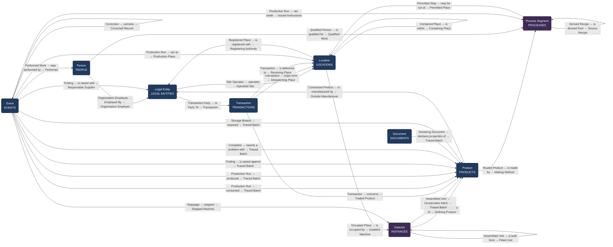

#### 5.1.2 Roles Data Model

One diagram of every role. Each box is an area of the business, and holds the roles that area plays. An arrow joins the two roles of a relationship, labelled with its verb, and runs between boxes wherever the two roles belong to different areas.

```mermaid
flowchart LR
  subgraph SGDOM001["People"]
    ROL037("Organization Employee")
    ROL039("Qualified Person")
    ROL050("Performer")
  end
  subgraph SGDOM002["Legal Entities"]
    ROL011("Outside Manufacturer")
    ROL033("Site Operator")
    ROL036("Registering Authority")
    ROL038("Organization Employer")
    ROL042("Transaction Party")
    ROL066("Responsible Supplier")
  end
  subgraph SGDOM003["Documents"]
    ROL067("Declaring Document")
  end
  subgraph SGDOM004["Events"]
    ROL046("Production Run")
    ROL049("Performed Work")
    ROL055("Stoppage")
    ROL057("Finding")
    ROL059("Complaint")
    ROL061("Response")
    ROL062("Trigger")
    ROL063("Correction")
    ROL064("Corrected Record")
    ROL069("Storage Breach")
  end
  subgraph SGDOM005["Transactions"]
    ROL041("Transaction")
  end
  subgraph SGDOM006["Products"]
    ROL010("Contracted Product")
    ROL012("Routed Product")
    ROL027("Defining Product")
    ROL043("Traded Product")
    ROL071("Traced Batch")
  end
  subgraph SGDOM007["Instances"]
    ROL023("Installed Machine")
    ROL026("Individual Unit")
    ROL028("Assembled Unit")
    ROL029("Fitted Unit")
    ROL056("Stopped Machine")
  end
  subgraph SGDOM009["Processes"]
    ROL013("Making Method")
    ROL014("Later Step")
    ROL015("Earlier Step")
    ROL016("Permitted Step")
    ROL018("Derived Recipe")
    ROL019("Source Recipe")
    ROL040("Qualified Work")
    ROL048("Issued Instructions")
  end
  subgraph SGDOM010["Locations"]
    ROL017("Permitted Place")
    ROL022("Occupied Place")
    ROL031("Contained Place")
    ROL032("Containing Place")
    ROL034("Operated Site")
    ROL035("Registered Place")
    ROL044("Despatching Place")
    ROL045("Receiving Place")
    ROL047("Production Place")
  end
  ROL010 -->|is manufactured by| ROL011
  ROL012 -->|is made by| ROL013
  ROL014 -->|follows| ROL015
  ROL016 -->|may be run at| ROL017
  ROL018 -->|is derived from| ROL019
  ROL022 -->|is occupied by| ROL023
  ROL026 -->|is a unit of| ROL027
  ROL028 -->|is built from| ROL029
  ROL028 -->|incorporates batch| ROL071
  ROL031 -->|is within| ROL032
  ROL035 -->|is registered with| ROL036
  ROL033 -->|operates| ROL034
  ROL037 -->|Employed By| ROL038
  ROL039 -->|is qualified for| ROL040
  ROL042 -->|Is Party To| ROL041
  ROL041 -->|concerns| ROL043
  ROL041 -->|ships from| ROL044
  ROL041 -->|is delivered to| ROL045
  ROL046 -->|ran at| ROL047
  ROL046 -->|ran under| ROL048
  ROL049 -->|was performed by| ROL050
  ROL046 -->|consumed| ROL071
  ROL046 -->|produced| ROL071
  ROL055 -->|stopped| ROL056
  ROL057 -->|is raised against| ROL071
  ROL059 -->|reports a problem with| ROL071
  ROL061 -->|responds to| ROL062
  ROL063 -->|corrects| ROL064
  ROL057 -->|is raised with| ROL066
  ROL067 -->|declares properties of| ROL071
  ROL069 -->|exposed| ROL071
```

#### 5.1.3 Concept Models by Domain

One diagram per area: its main concept and the concepts beneath it, each arrow saying how many of the lower concept the upper one may have.

**People**

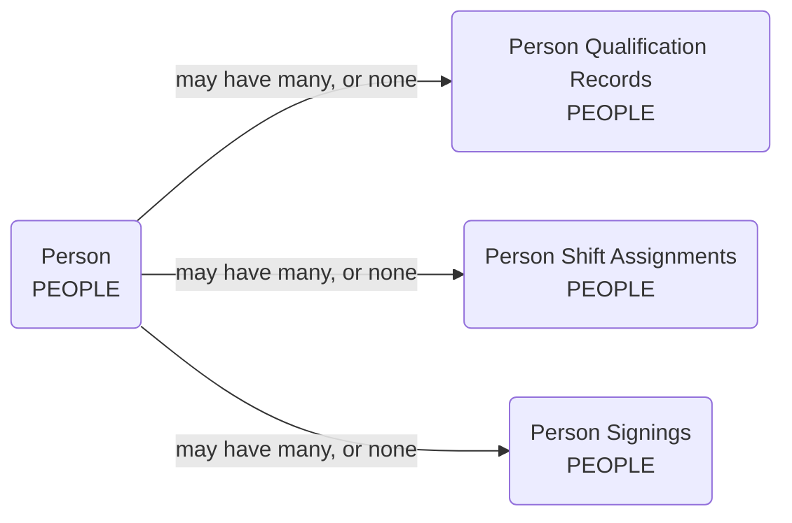

**Legal Entities**

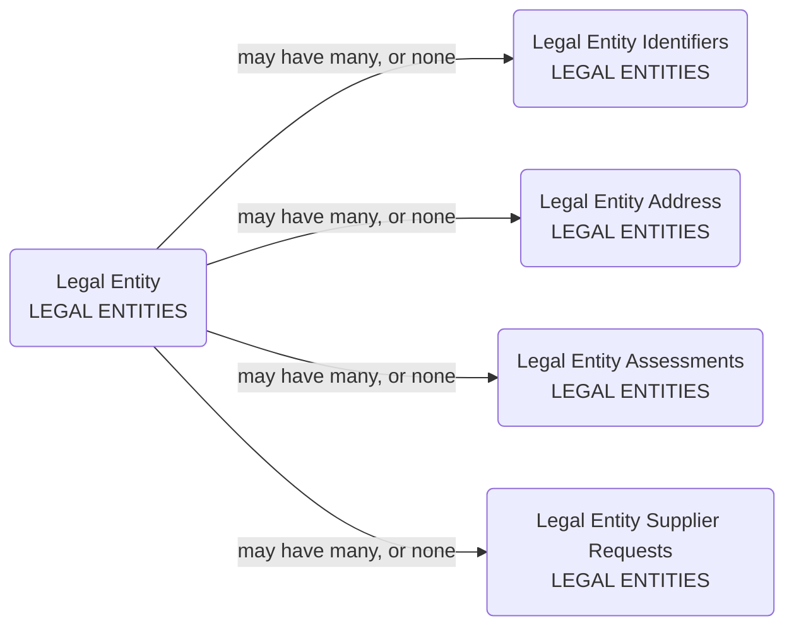

**Documents**

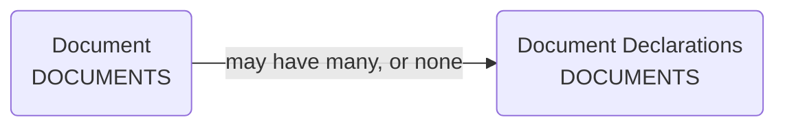

**Events**

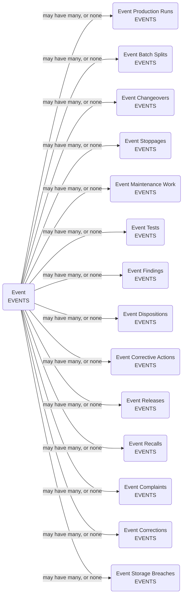

**Transactions**

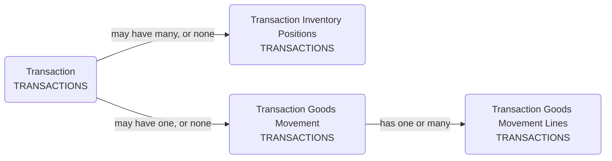

**Products**

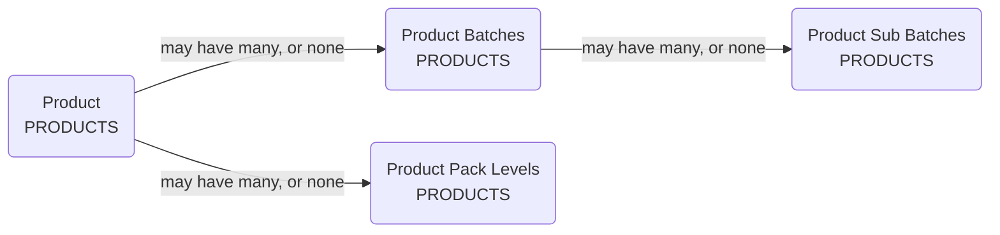

**Instances**

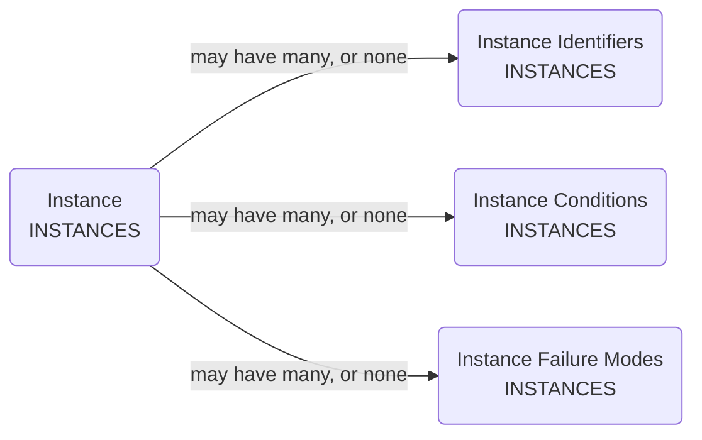

**Processes**

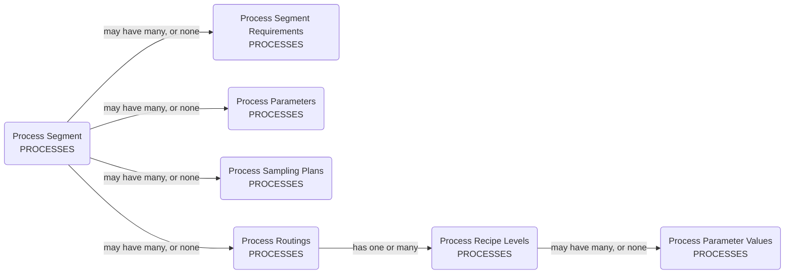

**Locations**

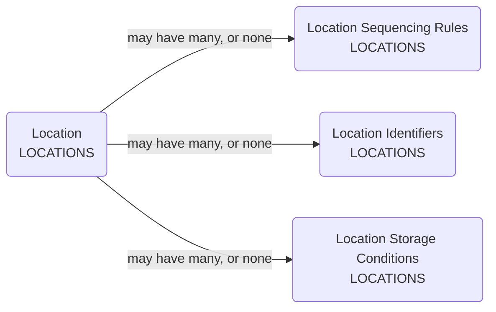

### 5.2 Subject Domains

| Domain | In DDA | Main concept | What it covers | Roles | Concepts |
|---|---|---|---|---|---|
| DOM001 **People** | [DMD000000001](https://datadesign.maoperatingsystem.com/models/domains/DMD000000001) | Person | Holds each person the factory deals with, such as an operator, a technician or a supplier's contact, with their qualifications, the shifts they work and what they have signed. | [3](#53-canonical-roles) | [4](#55-concepts) |
| DOM002 **Legal Entities** | [DMD000000012](https://datadesign.maoperatingsystem.com/models/domains/DMD000000012) | Legal Entity | Holds the companies the organisation deals with, such as suppliers, outside manufacturers, operators of sites and regulators, with their identifiers and addresses, the assessments made of suppliers and outside manufacturers, and the requests made of suppliers. | [6](#53-canonical-roles) | [5](#55-concepts) |
| DOM003 **Documents** | [DMD000000016](https://datadesign.maoperatingsystem.com/models/domains/DMD000000016) | Document | Holds the documents that state facts about a batch, such as a supplier's certificate of analysis, with what each one declares and whether the organisation checked it. | [1](#53-canonical-roles) | [2](#55-concepts) |
| DOM004 **Events** | [DMD000000020](https://datadesign.maoperatingsystem.com/models/domains/DMD000000020) | Event | Holds what happens in making and moving product: production runs, splits of batches, changeovers, stoppages, maintenance, tests, findings, decisions, corrective actions, releases, recalls, complaints, corrections and storage breaches. | [10](#53-canonical-roles) | [15](#55-concepts) |
| DOM005 **Transactions** | [DMD000000022](https://datadesign.maoperatingsystem.com/models/domains/DMD000000022) | Transaction | Holds the exchanges of goods the organisation records, with their lines and the stock position each one leaves. | [1](#53-canonical-roles) | [4](#55-concepts) |
| DOM006 **Products** | [DMD000000032](https://datadesign.maoperatingsystem.com/models/domains/DMD000000032) | Product | Holds each batch of a product, the batches split from or combined into it, and the levels a product is packed in: unit, case and pallet. What a product is made from and what it must be are held by CPG - Product Definition. | [5](#53-canonical-roles) | [4](#55-concepts) |
| DOM007 **Instances** | New | Instance | Instances are individually identified physical things — a serial-numbered pack, a machine, a vessel, a tool — each made to a product definition and traceable as itself for its whole life. Includes what is fitted into each and what condition it is in. Excludes the product definition it is made to, which is a Product, and the batch it belongs to where it is not individually identified, which is a concept of Products. | [5](#53-canonical-roles) | [4](#55-concepts) |
| DOM009 **Processes** | New | Process Segment | Processes are the defined steps of work by which products are made — mixing, pasteurising, filling, labelling — the order they run in, the settings they run at, and the recipes that state them at each level of specificity from formulation to the instructions issued for one batch. Includes what each step requires of machines, people and materials. Excludes what a product is made from, which is Products, and the record of a step actually being performed, which is an Event. | [8](#53-canonical-roles) | [7](#55-concepts) |
| DOM010 **Locations** | [DMD000000034](https://datadesign.maoperatingsystem.com/models/domains/DMD000000034) | Location | The Locations domain holds all physical points on earth that an organisation needs to identify, as DDA defines it. For this model it also holds the structure of each factory down to the shop floor: the site, its areas, production lines, rooms and storage positions, each place inside the one above it, with the conditions each place must keep and the identifiers each is known by. Machines standing in these places are held with Instances. | [9](#53-canonical-roles) | [4](#55-concepts) |

### 5.3 Canonical Roles

A role describes what something is while it is in a relationship. The same thing can play several roles at once.

| Area | Role | What it means | Requirements |
|---|---|---|---|
| People | ROL037 **Organization Employee** | A person is an Organization Employee while they work for an organization under a contract of employment. It says the person is on the organization's payroll and is paid to do a job for it. It is not the same as an Organization Board or Advisory Member, who holds an oversight or advisory seat without being employed; one person may be both, and one person may work for several organizations. A person who leaves the job stops being an employee, and the employment stays on record with its dates. | [REQ041](#req041) |
| People | ROL050 **Performer** | A person is a Performer while it carries out recorded work. It says that the person did a piece of work, in a stated capacity. That is not the same as being a Qualified Person, which says a person entitled to do the work, whether or not they did it. | [REQ041](#req041) · [REQ047](#req047) · [REQ050](#req050) |
| People | ROL039 **Qualified Person** | A person is a Qualified Person while it holds a qualification for a kind of work. It says that the person may carry out that work. That is not the same as being a Performer, which says a person who actually did a piece of work. | [REQ064](#req064) · [REQ041](#req041) |
| Legal Entities | ROL038 **Organization Employer** | A legal entity is an Organization Employer while people work for it under contracts of employment. It says the organization has staff on its payroll. It is not the same as an Organization With A Board or Advisory Body, which has people who oversee or advise it without being employed; one body may be both. A body that employs no one stops being an employer, and its earlier employment stays on record. | [REQ041](#req041) |
| Legal Entities | ROL011 **Outside Manufacturer** | A company is an Outside Manufacturer while it makes or packs a product for the organisation. It says that the company holds a contract to make or pack goods for the organisation. That is not the same as being a Site Operator, which says that the company runs a place, whatever it makes there. | [REQ060](#req060) · [REQ062](#req062) |
| Legal Entities | ROL036 **Registering Authority** | A company is a Registering Authority while it keeps a register of places. It says that the body holds the register a place appears on. That is not the same as being a Site Operator, which says a company that runs a place. | [REQ067](#req067) |
| Legal Entities | ROL066 **Responsible Supplier** | A company is a Responsible Supplier while it is the supplier a problem is raised with. It says that the supplier is answerable for a problem. That is not the same as being a Trading Party, which says a company goods were bought from or sold to. | [REQ059](#req059) |
| Legal Entities | ROL033 **Site Operator** | A company is a Site Operator while it runs a place. It says that the company is responsible for running a place. That is not the same as being a Registering Authority, which says an authority that records a place without running it. | [REQ060](#req060) · [REQ062](#req062) |
| Legal Entities | ROL042 **Transaction Party** | A legal entity is a Transaction Party while it takes part in a transaction as a payer, a payee, a buyer, a seller or an issuer. It says who the money or holdings moved from or to. It is not the same as an Account Beneficial Owner, who owns an account, because a party to a transaction may use an account it does not own. One legal entity may be a party to many transactions. | [REQ061](#req061) |
| Documents | ROL067 **Declaring Document** | A document is a Declaring Document while it states properties of a batch. It says that the document makes a claim about a batch. That is not the same as being a Traced Batch, which says the batch the claim is about. | [REQ009](#req009) · [REQ010](#req010) |
| Events | ROL059 **Complaint** | A recorded event is a Complaint while it reports a problem raised by a customer. It says that a customer raised a problem with goods. That is not the same as being a Finding, which says a problem found by the organisation itself. | [REQ054](#req054) |
| Events | ROL064 **Corrected Record** | A recorded event is a Corrected Record while it has been corrected by a later entry. It says that the record stands corrected and is kept as it was. That is not the same as being a Correction, which says the entry that corrects it. | [REQ056](#req056) |
| Events | ROL063 **Correction** | A recorded event is a Correction while it corrects an earlier record. It says that an earlier record was altered, and why. That is not the same as being a Corrected Record, which says the record that was corrected. | [REQ056](#req056) |
| Events | ROL057 **Finding** | A recorded event is a Finding while it reports a departure from procedure, a failure against specification or a problem with a supplier. It says that something went wrong and needs a response. That is not the same as being a Complaint, which says a problem reported by a customer. | [REQ046](#req046) · [REQ047](#req047) |
| Events | ROL049 **Performed Work** | A recorded event is a Performed Work while it was carried out by a person. It says that a named person did the work. That is not the same as being a Production Run, which says the making of a batch, whoever did it. | [REQ041](#req041) · [REQ047](#req047) · [REQ050](#req050) · [REQ057](#req057) |
| Events | ROL046 **Production Run** | A recorded event is a Production Run while it is the making of a batch on a line. It says that a batch was made, using some batches and producing others. That is not the same as being a Stoppage, which says an interruption within or between runs. | [REQ040](#req040) |
| Events | ROL061 **Response** | A recorded event is a Response while it is an action taken in answer to another event. It says that it was prompted by something else, such as a corrective action following a finding. That is not the same as being a Trigger, which says the event that prompted it. | [REQ049](#req049) |
| Events | ROL055 **Stoppage** | A recorded event is a Stoppage while it halts a machine. It says that production stopped, for a reason. That is not the same as being a Production Run, which says the making of a batch. | [REQ037](#req037) · [REQ038](#req038) |
| Events | ROL069 **Storage Breach** | A recorded event is a Storage Breach while it records stock held outside its conditions. It says that stock was exposed to conditions it should not have been. That is not the same as being a Finding, which says a problem found by checking, not by exposure. | [REQ066](#req066) |
| Events | ROL062 **Trigger** | A recorded event is a Trigger while it prompts another event. It says that something else was done because of it. That is not the same as being a Response, which says the event that answered it. | [REQ049](#req049) |
| Transactions | ROL041 **Transaction** | A transaction is a Transaction in a relationship while it is the movement of money, holdings or ownership that the other subject took part in, was booked to, or was recorded against. It is the same role wherever a transaction meets another subject, which is how those subjects join up around it. It is the movement itself, not the parties to it or the accounts it touches. | [REQ042](#req042) · [REQ061](#req061) |
| Products | ROL010 **Contracted Product** | A product is a Contracted Product while it is made for the organisation by another company. It says that the organisation relies on an outside company to make or pack it. That is not the same as being a Routed Product, which says that the organisation has a method of its own for making it. | [REQ060](#req060) |
| Products | ROL027 **Defining Product** | A product is a Defining Product while it is the product that individually identified units are made to. It says that units are made to it. That is not the same as being a Traded Product, which says goods bought or sold, not the units made to it. | [REQ023](#req023) |
| Products | ROL012 **Routed Product** | A product is a Routed Product while it is made by a method the organisation has defined. It says that the organisation has a defined way of making it. That is not the same as being a Contracted Product, which says that an outside company makes it. | [REQ025](#req025) |
| Products | ROL071 **Traced Batch** | A product is a Traced Batch while it is a batch that can be followed back to its inputs and forward to where it went. It says that the batch is the thing traceability follows, in either direction. That is not the same as being a Traded Product, which says the product named on a movement, not one batch of it. | [REQ016](#req016) · [REQ027](#req027) · [REQ051](#req051) |
| Products | ROL043 **Traded Product** | A product is a Traded Product while it is the product named on a movement of goods. It says that the product moved. That is not the same as being a Traced Batch, which says the particular batch, rather than the product. | [REQ042](#req042) |
| Instances | ROL028 **Assembled Unit** | An unit is an Assembled Unit while it is built from other units or from batches. It says that the unit is put together from parts. That is not the same as being an Individual Unit, which says a unit identified on its own, whether or not it is assembled. | [REQ023](#req023) |
| Instances | ROL029 **Fitted Unit** | An unit is a Fitted Unit while it is built into another unit. It says that the unit is a part of a larger one. That is not the same as being an Assembled Unit, which says the larger unit it is built into. | [REQ023](#req023) |
| Instances | ROL026 **Individual Unit** | An unit is an Individual Unit while it is a single item made to a product. It says that the item is identified on its own and made to a product. That is not the same as being a Fitted Unit, which says an item built into another item. | [REQ023](#req023) · [REQ024](#req024) |
| Instances | ROL023 **Installed Machine** | A machine is an Installed Machine while it stands in a place in the plant. It says that the machine occupies a place for a stated period. That is not the same as being a Stopped Machine, which says a machine a stoppage halted, wherever it stands. | [REQ034](#req034) · [REQ035](#req035) |
| Instances | ROL056 **Stopped Machine** | A machine is a Stopped Machine while it is halted by a stoppage. It says that this is the machine that stopped. That is not the same as being an Installed Machine, which says a machine standing in a place, whether or not it stopped. | [REQ035](#req035) · [REQ037](#req037) |
| Processes | ROL018 **Derived Recipe** | A recipe is a Derived Recipe while it is written from a more general recipe. It says that its instructions come from a more general level. That is not the same as being a Source Recipe, which says the recipe that others are written from. | [REQ029](#req029) · [REQ030](#req030) |
| Processes | ROL015 **Earlier Step** | A step is an Earlier Step while it comes before another step in a method. It says that another step depends on this one being done first. That is not the same as being a Later Step, which says the step that follows. | [REQ025](#req025) |
| Processes | ROL048 **Issued Instructions** | A recipe is an Issued Instructions while it is the set of instructions a production run was issued. It says that a run was made to these instructions. That is not the same as being a Source Recipe, which says a more general recipe that others are written from. | [REQ030](#req030) |
| Processes | ROL014 **Later Step** | A step is a Later Step while it follows another step in a method. It says that the step comes after another and starts only once that one is done. That is not the same as being an Earlier Step, which says the step that must come first. | [REQ025](#req025) |
| Processes | ROL013 **Making Method** | A method is a Making Method while it describes how a product is made. It says that this is the way the organisation makes the product. That is not the same as being a Permitted Step, which says one step within a method, not the whole method. | [REQ025](#req025) · [REQ027](#req027) |
| Processes | ROL016 **Permitted Step** | A step is a Permitted Step while it may be run at a particular place. It says that the step may be carried out in that place. That is not the same as being a Qualified Work, which says that the step needs a qualified person, whatever the place. | [REQ026](#req026) · [REQ029](#req029) |
| Processes | ROL040 **Qualified Work** | A step is a Qualified Work while it may be carried out by people holding the right qualification. It says that the step needs a qualified person. That is not the same as being a Permitted Step, which says a step that may be run at a place. | [REQ064](#req064) |
| Processes | ROL019 **Source Recipe** | A recipe is a Source Recipe while it is the starting point for a more specific recipe. It says that other recipes are written from it. That is not the same as being a Derived Recipe, which says the recipe written from another. | [REQ029](#req029) |
| Locations | ROL031 **Contained Place** | A place is a Contained Place while it sits within a larger place. It says that the place is inside another, such as a line within an area. That is not the same as being a Containing Place, which says the larger place that holds it. | [REQ065](#req065) |
| Locations | ROL032 **Containing Place** | A place is a Containing Place while it holds smaller places within it. It says that other places sit inside it. That is not the same as being a Contained Place, which says the place that sits inside another. | [REQ065](#req065) |
| Locations | ROL044 **Despatching Place** | A place is a Despatching Place while it is where a movement of goods starts. It says that goods left from the place. That is not the same as being a Receiving Place, which says where goods arrive. | [REQ042](#req042) |
| Locations | ROL022 **Occupied Place** | A place is an Occupied Place while it has a machine standing in it. It says that a machine is fitted in the place for a stated period. That is not the same as being a Production Place, which says that a run took place there, whether or not a machine is fitted. | [REQ034](#req034) |
| Locations | ROL034 **Operated Site** | A place is an Operated Site while it is run by a company. It says that a company is responsible for running it. That is not the same as being a Registered Place, which says a place recorded by an authority, whoever runs it. | [REQ062](#req062) |
| Locations | ROL017 **Permitted Place** | A place is a Permitted Place while it is allowed to run a particular step. It says that the place is fit to host that step. That is not the same as being a Production Place, which says the place where a run actually took place. | [REQ026](#req026) · [REQ029](#req029) |
| Locations | ROL047 **Production Place** | A place is a Production Place while it is where a production run took place. It says that the run happened there. That is not the same as being a Permitted Place, which says a place allowed to run a step, whether or not a run happened there. | [REQ040](#req040) · [REQ034](#req034) |
| Locations | ROL045 **Receiving Place** | A place is a Receiving Place while it is where a movement of goods ends. It says that goods arrived at the place. That is not the same as being a Despatching Place, which says where goods left from. | [REQ042](#req042) |
| Locations | ROL035 **Registered Place** | A place is a Registered Place while it is recorded on a register kept by an authority. It says that an authority knows the place under its own number. That is not the same as being an Operated Site, which says a place a company runs, whether or not it is registered. | [REQ067](#req067) |

### 5.4 Role–Verb–Role Relationships

Each relationship reads as two sentences, one in each direction. *How many* says how many on one side can link to the other. *Dates kept* says whether each link records when it starts and stops.

| ID | How it reads | How many | Dates kept | Why it is needed | In DDA |
|---|---|---|---|---|---|
| REL020 Legal Entity Employment | An [organization employee](#rol037) Employed By [organization employers](#rol038). An [organization employer](#rol038) Employs [organization employees](#rol037). | Many to many | Yes | [DRQ023](#drq023) | [DMR000000005](https://datadesign.maoperatingsystem.com/models/relationships/DMR000000005) |
| REL021 Person Work Qualifications | A [qualified person](#rol039) is qualified for [qualified works](#rol040). A [qualified work](#rol040) may be performed by [qualified people](#rol039). | Many to many | Yes | [DRQ023](#drq023) | New |
| REL019 Legal Entity Site Operations | A [site operator](#rol033) operates [operated sites](#rol034). An [operated site](#rol034) is operated by [site operators](#rol033). | Many to many | Yes | [DRQ033](#drq033) | New |
| REL022 Legal Entity Transaction Party | A [transaction party](#rol042) Is Party To [transactions](#rol041). A [transaction](#rol041) Has Party [transaction parties](#rol042). | Many to many | No | [DRQ033](#drq033) | [DMR000000037](https://datadesign.maoperatingsystem.com/models/relationships/DMR000000037) |
| REL037 Document Batch Declarations | A [declaring document](#rol067) declares properties of [traced batches](#rol071). A [traced batch](#rol071) is declared by [declaring documents](#rol067). | Many to many | No | [DRQ007](#drq007) | New |
| REL026 Event Run Places | A [production run](#rol046) ran at a [production place](#rol047). A [production place](#rol047) ran [production runs](#rol046). | Many to one | No | [DRQ020](#drq020) · [DRQ023](#drq023) | New |
| REL027 Event Run Recipes | A [production run](#rol046) ran under an [issued instructions](#rol048). An [issued instructions](#rol048) governed [production runs](#rol046). | Many to one | No | [DRQ018](#drq018) | New |
| REL029 Event Batch Inputs | A [production run](#rol046) consumed [traced batches](#rol071). A [traced batch](#rol071) was consumed by [production runs](#rol046). | Many to many | No | [DRQ004](#drq004) · [DRQ030](#drq030) | New |
| REL030 Event Batch Outputs | A [production run](#rol046) produced [traced batches](#rol071). A [traced batch](#rol071) was produced by [production runs](#rol046). | Many to many | No | [DRQ030](#drq030) | New |
| REL028 Event Performers | A [performed work](#rol049) was performed by [performers](#rol050). A [performer](#rol050) performed [performed works](#rol049). | Many to many | Yes | [DRQ023](#drq023) · [DRQ027](#drq027) · [DRQ029](#drq029) | New |
| REL031 Event Stoppage Machines | A [stoppage](#rol055) stopped a [stopped machine](#rol056). A [stopped machine](#rol056) was stopped in [stoppages](#rol055). | Many to one | No | [DRQ021](#drq021) · [DRQ022](#drq022) | New |
| REL032 Event Finding Batches | A [finding](#rol057) is raised against [traced batches](#rol071). A [traced batch](#rol071) is subject of [findings](#rol057). | Many to many | No | [DRQ026](#drq026) · [DRQ027](#drq027) | New |
| REL036 Event Supplier Findings | A [finding](#rol057) is raised with a [responsible supplier](#rol066). A [responsible supplier](#rol066) received [findings](#rol057). | Many to one | Yes | [DRQ028](#drq028) | New |
| REL033 Event Complaint Batches | A [complaint](#rol059) reports a problem with a [traced batch](#rol071). A [traced batch](#rol071) is complained about in [complaints](#rol059). | Many to one | No | [DRQ031](#drq031) | New |
| REL034 Event Action Triggers | A [response](#rol061) responds to [triggers](#rol062). A [trigger](#rol062) prompted [responses](#rol061). | Many to many | No | [DRQ028](#drq028) | New |
| REL035 Event Correction Targets | A [correction](#rol063) corrects a [corrected record](#rol064). A [corrected record](#rol064) is corrected by [corrections](#rol063). | Many to one | No | [DRQ032](#drq032) | New |
| REL038 Event Storage Exposures | A [storage breach](#rol069) exposed [traced batches](#rol071). A [traced batch](#rol071) was exposed in [storage breaches](#rol069). | Many to many | No | [DRQ034](#drq034) | New |
| REL023 Transaction Subjects | A [transaction](#rol041) concerns [traded products](#rol043). A [traded product](#rol043) is traded in [transactions](#rol041). | Many to many | No | [DRQ024](#drq024) | New |
| REL024 Transaction Origins | A [transaction](#rol041) ships from a [despatching place](#rol044). A [despatching place](#rol044) despatches [transactions](#rol041). | Many to one | No | [DRQ024](#drq024) | New |
| REL025 Transaction Destinations | A [transaction](#rol041) is delivered to a [receiving place](#rol045). A [receiving place](#rol045) receives [transactions](#rol041). | Many to one | No | [DRQ024](#drq024) | New |
| REL005 Product Contract Manufacture | A [contracted product](#rol010) is manufactured by [outside manufacturers](#rol011). An [outside manufacturer](#rol011) manufactures [contracted products](#rol010). | Many to many | Yes | [DRQ033](#drq033) | New |
| REL006 Product Routings | A [routed product](#rol012) is made by a [making method](#rol013). A [making method](#rol013) makes [routed products](#rol012). | Many to one | Yes | [DRQ017](#drq017) | New |
| REL013 Instance Definitions | An [individual unit](#rol026) is a unit of a [defining product](#rol027). A [defining product](#rol027) is made as [individual units](#rol026). | Many to one | No | [DRQ016](#drq016) | New |
| REL014 Instance Composition | An [assembled unit](#rol028) is built from [fitted units](#rol029). A [fitted unit](#rol029) is built into [assembled units](#rol028). | Many to many | Yes | [DRQ016](#drq016) | New |
| REL015 Instance Batch Composition | An [assembled unit](#rol028) incorporates batch [traced batches](#rol071). A [traced batch](#rol071) is incorporated into [assembled units](#rol028). | Many to many | No | [DRQ016](#drq016) | New |
| REL007 Process Segment Sequences | A [later step](#rol014) follows [earlier steps](#rol015). An [earlier step](#rol015) precedes [later steps](#rol014). | Many to many | No | [DRQ017](#drq017) | New |
| REL008 Process Segment Places | A [permitted step](#rol016) may be run at [permitted places](#rol017). A [permitted place](#rol017) may run [permitted steps](#rol016). | Many to many | Yes | [DRQ017](#drq017) | New |
| REL009 Process Recipe Derivations | A [derived recipe](#rol018) is derived from a [source recipe](#rol019). A [source recipe](#rol019) is the source of [derived recipes](#rol018). | Many to one | Yes | [DRQ018](#drq018) | New |
| REL011 Location Installations | An [occupied place](#rol022) is occupied by [installed machines](#rol023). An [installed machine](#rol023) occupies [occupied places](#rol022). | Many to many | Yes | [DRQ020](#drq020) | New |
| REL016 Location Hierarchies | A [contained place](#rol031) is within a [containing place](#rol032). A [containing place](#rol032) contains [contained places](#rol031). | Many to one | No | [DRQ024](#drq024) | New |
| REL018 Location Registrations | A [registered place](#rol035) is registered with [registering authorities](#rol036). A [registering authority](#rol036) registers [registered places](#rol035). | Many to many | Yes | [DRQ035](#drq035) | New |

### 5.5 Concepts

Every concept the design uses, whether DDA already has it or the design adds it. The code beneath each name is its DDA name.

| Area | Concept | In DDA | What it is | Sits under | How many | Why it is needed |
|---|---|---|---|---|---|---|
| People | SBJ001 **Person** Person | [DMC000000143](https://datadesign.maoperatingsystem.com/models/concepts/DMC000000143) | There is one of these for each person the business deals with, such as an operator, a technician or a supplier's contact. If you need to know who someone is, this is what you go by. What they do for the business is held beside it, and who employs them comes from the relationship with their employer. | — | — | [DRQ023](#drq023) |
| People | SBJ002 **Person Qualification Records** PersonQualificationRecords | New | There is one of these for each qualification a person holds to carry out particular work, such as running a filling line or taking a sample. If you need to know whether someone was qualified to do a job on a given day, this is what you go by. It does not record the work they actually did, which is recorded against the batch. | Person | For each person: many, or none | [DRQ023](#drq023) |
| People | SBJ003 **Person Shift Assignments** PersonShiftAssignments | New | There is one of these for each shift a person is rostered to work. If you need to know who was on duty at a given time, this is what you go by. It does not say what they worked on, which is recorded against each production run, and it does not say whether they were qualified for it. | Person | For each person: many, or none | [DRQ023](#drq023) |
| People | SBJ004 **Person Signings** PersonSignings | New | There is one of these for each time a person puts their name to a record, whether to say they did the work or to confirm another person's work as a second check. If you need to know who signed a record, when, and what the signing meant, this is what you go by. A correction to a record is a record of its own and is not a signing. | Person | For each person: many, or none | [DRQ032](#drq032) |
| Legal Entities | SBJ005 **Legal Entity** LegalEntity | [DMC000000106](https://datadesign.maoperatingsystem.com/models/concepts/DMC000000106) | There is one of these for each company, partnership or other body that can hold rights and owe duties in its own name, such as a supplier, an outside manufacturer, a customer or a regulator. If you need to know who a body is, this is what you go by. What it is to the business comes from its relationships and is not stored here. | — | — | [DRQ006](#drq006) · [DRQ033](#drq033) |
| Legal Entities | SBJ006 **Legal Entity Identifiers** LegalEntityIdentifiers | [DMC000000023](https://datadesign.maoperatingsystem.com/models/concepts/DMC000000023) | There is one of these for each identifier a legal entity is known by, such as a registration number, a tax number or a number a regulator issued. If you need to match a supplier or an outside manufacturer to a register, this is what you go by. It does not say which identifier is preferred. | Legal Entity | For each legal entity: many, or none | [DRQ035](#drq035) |
| Legal Entities | SBJ007 **Legal Entity Address** LegalEntityAddress | [DMC000000108](https://datadesign.maoperatingsystem.com/models/concepts/DMC000000108) | There is one of these for each address a legal entity is known by, such as its registered office or the address it writes from. If you need to know where to write to a body, this is what you go by. It is not the place where the body makes or stores goods, which is a place held with Locations. | Legal Entity | For each legal entity: many, or none | [DRQ006](#drq006) |
| Legal Entities | SBJ008 **Legal Entity Assessments** LegalEntityAssessments | New | There is one of these for each time a supplier or an outside manufacturer is assessed, saying what the assessment covered and how long it is valid. If you need to know whether a supplier held a valid assessment on the day a delivery arrived, this is what you go by. The problems raised against the supplier are not held here; each is recorded as a finding. | Legal Entity | For each legal entity: many, or none | [DRQ006](#drq006) |
| Legal Entities | SBJ009 **Legal Entity Supplier Requests** LegalEntitySupplierRequests | New | There is one of these for each request the business makes to a supplier to put a problem right, with the supplier's answer. If you need to know what a supplier was asked to do and how they replied, this is what you go by. The action the business takes itself is not held here; it is recorded as a corrective action. | Legal Entity | For each legal entity: many, or none | [DRQ028](#drq028) |
| Documents | SBJ010 **Document** Document | [DMC000000142](https://datadesign.maoperatingsystem.com/models/concepts/DMC000000142) | There is one of these for each document the business keeps, such as a supplier's certificate, a test report or a method statement. If you need to find a document and know what kind it is, this is what you go by. What the document says about a batch is held as its declarations. | — | — | [DRQ007](#drq007) |
| Documents | SBJ011 **Document Declarations** DocumentDeclarations | New | There is one of these for each property a supplier's document states about a batch, such as a moisture level or the absence of an allergen. If you need to know what a supplier claims about a batch, and so what the business relies on without having tested it, this is what you go by. A test the business carried out itself is a test result and is not held here. | Document | For each document: many, or none | [DRQ007](#drq007) · [DRQ008](#drq008) |
| Events | SBJ049 **Event** Event | New | There is one of these for each thing that happens in making or handling goods that the business needs to record, with the time it happened. If you need to know that something happened and when, this is what you go by. What kind of thing it was, and its details, are held by the concept for that kind. | — | — | [DRQ023](#drq023) |
| Events | SBJ051 **Event Production Runs** EventProductionRuns | New | There is one of these for each time a batch is made on a line, from its start to its end. If you need to know what was made, where, when and how much of each input was used, this is what you go by. The instructions it was made to are held as recipe levels, and the batch itself is held with the product. | Event | For each event: many, or none | [DRQ004](#drq004) · [DRQ023](#drq023) |
| Events | SBJ053 **Event Batch Splits** EventBatchSplits | New | There is one of these for each time a batch is divided into parts, with the reason. If you need to know why a batch was divided, this is what you go by. The parts and their quantities are held as sub-batches. | Event | For each event: many, or none | [DRQ012](#drq012) |
| Events | SBJ054 **Event Changeovers** EventChangeovers | New | There is one of these for each time a line is switched from one product to another, with how long it took and whether it included a clean. If you need to know whether a line was cleaned between two products, this is what you go by. The rule about what may follow what is held as a sequencing rule. | Event | For each event: many, or none | [DRQ019](#drq019) |
| Events | SBJ055 **Event Stoppages** EventStoppages | New | There is one of these for each time production stops, with when it started, when it ended and why. If you need to know how long a line stopped and for what reason, this is what you go by. The repair that followed is recorded as maintenance work. | Event | For each event: many, or none | [DRQ022](#drq022) |
| Events | SBJ056 **Event Maintenance Work** EventMaintenanceWork | New | There is one of these for each piece of maintenance or repair work done on a machine, saying what was done. If you need to know what was done about a stoppage, this is what you go by. The stoppage itself is held as a stoppage, and the machine's wider history is held on the machine. | Event | For each event: many, or none | [DRQ021](#drq021) · [DRQ022](#drq022) |
| Events | SBJ057 **Event Tests** EventTests | New | There is one of these for each test of a sample, with the method, the result, whether it met the specification and which version of the specification it was judged against. If you need to know whether a batch met its specification and by what test, this is what you go by. The specification itself is held by CPG - Product Definition. | Event | For each event: many, or none | [DRQ025](#drq025) |
| Events | SBJ058 **Event Findings** EventFindings | New | There is one of these for each departure from procedure or failure against specification that is found, saying which it is, how serious it is and how it was contained. If you need to know what went wrong on a batch, this is what you go by. What was decided about the affected material is recorded as a disposition. | Event | For each event: many, or none | [DRQ026](#drq026) |
| Events | SBJ060 **Event Dispositions** EventDispositions | New | There is one of these for each decision about what is done with material that failed, such as rework or scrap, with the reason. If you need to know what was decided about failed material and why, this is what you go by. The failure itself is recorded as a finding. | Event | For each event: many, or none | [DRQ027](#drq027) |
| Events | SBJ061 **Event Corrective Actions** EventCorrectiveActions | New | There is one of these for each action taken to put right the cause of a problem, with the cause found, the check that the fix worked and when it was closed. If you need to know whether an action was closed before anyone checked it worked, this is what you go by. The problem itself is recorded as a finding. | Event | For each event: many, or none | [DRQ028](#drq028) |
| Events | SBJ062 **Event Releases** EventReleases | New | There is one of these for each time a batch is released for use or sale, with who released it, when and on what basis. If you need to know whether and why a batch was released, this is what you go by. A batch that has finished being made is not available until this exists. | Event | For each event: many, or none | [DRQ029](#drq029) |
| Events | SBJ063 **Event Recalls** EventRecalls | New | There is one of these for each recall of product already sent out, with what it covered. If you need to know what was recalled and why, this is what you go by. The batches a recall reached are found through the links between batches, not here. | Event | For each event: many, or none | [DRQ030](#drq030) |
| Events | SBJ064 **Event Complaints** EventComplaints | New | There is one of these for each complaint received about a product, with the report as it was given. If you need to know what a customer reported and which batch it was about, this is what you go by. The investigation that follows is recorded as findings and corrective actions. | Event | For each event: many, or none | [DRQ031](#drq031) |
| Events | SBJ065 **Event Corrections** EventCorrections | New | There is one of these for each correction made to an earlier record, saying why. If you need to know that a record was altered and why, this is what you go by. The earlier record is kept as it was and is never overwritten. | Event | For each event: many, or none | [DRQ032](#drq032) |
| Events | SBJ066 **Event Storage Breaches** EventStorageBreaches | New | There is one of these for each time stock was held outside the conditions its place must keep, with when it began. If you need to know whether a batch was ever stored out of condition, this is what you go by. The conditions themselves are held with the place. | Event | For each event: many, or none | [DRQ034](#drq034) |
| Transactions | SBJ046 **Transaction** Transaction | [DMC000000031](https://datadesign.maoperatingsystem.com/models/concepts/DMC000000031) | There is one of these for each movement of money or of a holding between two parties on a date. If you need to know what moved, between whom and when, this is what you go by. A holding's balance is worked out from these and is not kept here; the more specific kinds, such as movements of goods, are held beneath it. | — | — | [DRQ024](#drq024) |
| Transactions | SBJ047 **Transaction Goods Movement Lines** TransactionGoodsMovementLines | New | There is one of these for each item and quantity on a movement of goods. If you need to know how much of what moved, this is what you go by. The parties and places of the movement are held on the movement itself. | Transaction Goods Movement | For each transaction goods movement: one or many | [DRQ024](#drq024) |
| Transactions | SBJ048 **Transaction Inventory Positions** TransactionInventoryPositions | New | There is one of these for each count of an item held at a place, in a stated condition, at a time. If you need to know how much is available, on hold or rejected right now, this is what you go by. A decision to hold material is recorded as a disposition. | Transaction | For each transaction: many, or none | [DRQ013](#drq013) |
| Transactions | SBJ068 **Transaction Goods Movement** TransactionGoodsMovement | New | There is one of these for each time goods are received, issued, moved, bought or despatched, with the time it happened. If you need to know where goods went and when, this is what you go by. How much of an item is held at a point in time is held as stock positions. It is a movement of goods; a movement of money or of a holding is the transaction it sits beneath. | Transaction | For each transaction: one, or none | [DRQ024](#drq024) · [DRQ033](#drq033) |
| Products | SBJ012 **Product** Product | Created by CPG - Product Definition | One product, whether it is bought in, made or sold, as CPG - Product Definition defines it. This design uses it for the product a batch is of, the product a pack level is for and the product a production run makes. | — | — | [DRQ008](#drq008) · [DRQ013](#drq013) |
| Products | SBJ016 **Product Batches** ProductBatches | New | There is one of these for each batch of a product that was made, packed or received, known by the lot code given when it was first packed or transformed. If you need to know when it was made, how much there was and what to call it at every later movement, this is what you go by. What went into it and where it went are held on the links between production runs and batches. | Product | For each product: many, or none | [DRQ012](#drq012) · [DRQ030](#drq030) |
| Products | SBJ017 **Product Sub Batches** ProductSubBatches | New | There is one of these for each part a batch is divided into, with the quantity of that part. If you need to know which batch a quantity came from, this is what you go by. A batch combined from others is shown by the links between production runs and batches, not here. | Product Batches | For each product batches: many, or none | [DRQ012](#drq012) |
| Products | SBJ067 **Product Pack Levels** ProductPackLevels | New | There is one of these for each level a product is packed in, such as a single unit, a case or a pallet, with how many of the level below it holds. If you need to know how many units are in a case and how many cases are on a pallet, this is what you go by. What is in the pack and the wording on it are held by CPG - Product Definition. | Product | For each product: many, or none | [DRQ037](#drq037) |
| Instances | SBJ026 **Instance** Instance | New | There is one of these for each machine, vessel or tool, and for each individually identified unit of product, that is tracked on its own. If you need to know which machine stood in a place or what is inside a unit, this is what you go by. A kind of machine, or a product, which many of them share, is not held here. | — | — | [DRQ016](#drq016) · [DRQ020](#drq020) · [DRQ021](#drq021) |
| Instances | SBJ027 **Instance Identifiers** InstanceIdentifiers | New | There is one of these for each identifier a machine or unit is known by, such as a serial number or an asset number, with the dates it applied. If you need to match a machine to its maker's records, this is what you go by. It does not say which identifier is preferred. | Instance | For each instance: many, or none | [DRQ016](#drq016) |
| Instances | SBJ028 **Instance Conditions** InstanceConditions | New | There is one of these for each reading taken of a machine's condition, such as a temperature or the hours it has run, with the time it was taken. If you need to know how a machine was running before it failed, this is what you go by. A failure itself is recorded as a stoppage. | Instance | For each instance: many, or none | [DRQ021](#drq021) |
| Instances | SBJ029 **Instance Failure Modes** InstanceFailureModes | New | There is one of these for each way a machine is known to fail, with what the failure does. If you need to know how a machine fails and what follows when it does, this is what you go by. A particular breakdown is recorded as a stoppage, not here. | Instance | For each instance: many, or none | [DRQ021](#drq021) |
| Processes | SBJ036 **Process Segment** ProcessSegment | New | There is one of these for each defined step of work in making a product, such as mixing, pasteurising or filling. If you need to know what a step is called and what it does, this is what you go by. The order steps run in belongs to the method, and the performing of a step is recorded against the batch. | — | — | [DRQ017](#drq017) |
| Processes | SBJ037 **Process Segment Requirements** ProcessSegmentRequirements | New | There is one of these for each thing a step needs, whether a kind of machine, a qualified person or a material. If you need to know what must be in place before a step can run, this is what you go by. It does not say which machine or person was used on a given day, which is recorded against the production run. | Process Segment | For each process segment: many, or none | [DRQ017](#drq017) |
| Processes | SBJ038 **Process Parameters** ProcessParameters | New | There is one of these for each setting a step is run at, such as a temperature or a speed, with the lowest and highest value allowed. If you need to know the limits a step must stay within, this is what you go by. The value used for a given batch is held with the recipe instructions. | Process Segment | For each process segment: many, or none | [DRQ017](#drq017) |
| Processes | SBJ039 **Process Sampling Plans** ProcessSamplingPlans | New | There is one of these for each plan for taking samples at a step, saying how often. If you need to know how often a step is sampled, this is what you go by. The sample actually taken and its result are recorded as a test. | Process Segment | For each process segment: many, or none | [DRQ025](#drq025) |
| Processes | SBJ040 **Process Routings** ProcessRoutings | New | There is one of these for each method by which a product is made, as an ordered set of steps. If you need to know how a product is made and in what order, this is what you go by. The steps themselves are held separately, and the making of a batch is recorded as a production run. | Process Segment | For each process segment: many, or none | [DRQ017](#drq017) |
| Processes | SBJ041 **Process Recipe Levels** ProcessRecipeLevels | New | There is one of these for each level a recipe is written at, from the general recipe the company holds, through the site recipe and the master recipe, to the instructions issued for one batch. If you need to know which instructions a batch was made to and where they came from, this is what you go by. What the product is made from is held by CPG - Product Definition. | Process Routings | For each process routings: one or many | [DRQ018](#drq018) |
| Processes | SBJ042 **Process Parameter Values** ProcessParameterValues | New | There is one of these for each value a setting is given at a particular level of a recipe. If you need to know what a setting was set to for a batch, this is what you go by. The limits the setting must stay within are held with the setting itself. | Process Recipe Levels | For each process recipe levels: many, or none | [DRQ017](#drq017) · [DRQ018](#drq018) |
| Locations | SBJ034 **Location Sequencing Rules** LocationSequencingRules | New | There is one of these for each rule about what may run on a line straight after what, with the reason and whether a clean is needed between. If you need to know whether one product may follow another on a line, this is what you go by. What actually ran, and whether the clean was done, is recorded as changeovers. | Location | For each location: many, or none | [DRQ019](#drq019) |
| Locations | SBJ043 **Location** Location | New | There is one of these for each place the organisation needs to identify, from a site down through its areas, lines, rooms and storage positions to the shop floor, and each site a supplier, an outside manufacturer or a customer works from. If you need to know where something was made, held or sent, this is what you go by. Who owns or runs the place comes from its relationship with a legal entity, and the machines standing in it are held with Instances. | — | — | [DRQ020](#drq020) · [DRQ024](#drq024) |
| Locations | SBJ044 **Location Identifiers** LocationIdentifiers | New | There is one of these for each identifier a place is known by, such as a site number or a registration number a regulator issued, with who issued it. If you need to match a place to a supplier's or a regulator's record, this is what you go by. It does not say which identifier is preferred. | Location | For each location: many, or none | [DRQ035](#drq035) |
| Locations | SBJ045 **Location Storage Conditions** LocationStorageConditions | New | There is one of these for each condition a place must keep stock in, such as a temperature range. If you need to know what a storage place must hold to, this is what you go by. A time the condition was broken is recorded as a storage breach. | Location | For each location: many, or none | [DRQ034](#drq034) |

### 5.6 Lookups and Values

Each list is a fixed set of allowed answers, so the same thing is always described the same way. Where a list is used by a relationship rather than a concept, the name beside it is that relationship's own group of facts.

#### Universal Unit Of Measure Codes

The unit a quantity is stated in, used wherever a quantity of food, an ingredient, packaging or product is recorded, so that kilograms are never mixed up with litres.

DDA already holds this list, created without values. The values below are what this design contributes to it. CPG - Product Definition contributes the same values.

| List | In DDA | Used for |
|---|---|---|
| LKP009 UniversalUnitOfMeasureCodes | [DLT000000156](https://datadesign.maoperatingsystem.com/models/lookup-types/DLT000000156) | Event Batch Inputs |

| Value | Meaning |
|---|---|
| **Kilogram** KG | Mass in kilograms. |
| **Gram** G | Mass in grams. |
| **Litre** L | Volume in litres. |
| **Millilitre** ML | Volume in millilitres. |
| **Each** EA | A count of items. |
| **Per cent** PCT | A share of the whole, in per cent. |
| **Case** CASE | A count of cases. |

#### Event Dispositions Decision Type

What is done with material that failed its specification. Each decision has a different consequence for whether the material may still be sold.

| List | In DDA | Used for |
|---|---|---|
| LKP007 EventDispositionsDecisionType | New | Event Dispositions |

| Value | Meaning |
|---|---|
| **Use as is** USEASIS | Accepted despite the failure, on a stated justification. |
| **Rework** REWORK | Returned to production to be brought into specification. |
| **Regrade** REGRADE | Accepted against a different specification. |
| **Scrap** SCRAP | Destroyed or disposed of. |
| **Return to supplier** RETURN | Sent back to the party that supplied it. |

#### Event Findings Kind Type

Whether a finding is a departure from procedure or a failure against specification. The two are kept apart because they are acted on differently and against different things.

| List | In DDA | Used for |
|---|---|---|
| LKP010 EventFindingsKindType | New | Event Findings |

| Value | Meaning |
|---|---|
| **Deviation** DEVIATION | A departure from the written procedure while a batch was being made. |
| **Non-conformance** NONCONFORMANCE | A batch, material or result that fails its specification. |

#### Event Stoppages Reason Type

Why production stopped, chosen from a governed list so that stoppages can be counted and compared by reason. It does not say how long the stoppage lasted.

| List | In DDA | Used for |
|---|---|---|
| LKP006 EventStoppagesReasonType | New | Event Stoppages |

| Value | Meaning |
|---|---|
| **Changeover** CHANGEOVER | Moving the line between products. |
| **Cleaning** CLEANING | Scheduled cleaning or sanitation. |
| **Planned maintenance** PLANNEDMAINT | Work scheduled against a plan. |
| **Breakdown** BREAKDOWN | A machine ceased to perform its function. |
| **Material shortage** MATERIALSHORT | An input was unavailable. |
| **Quality hold** QUALITYHOLD | Stopped pending a quality decision. |
| **Upstream blockage** UPSTREAM | Starved by a preceding place. |
| **Downstream blockage** DOWNSTREAM | Blocked by a following place. |
| **Labour unavailable** LABOUR | No qualified operator available. |
| **Utility failure** UTILITY | Power, water, steam or air unavailable. |

#### Instance Kind Type

Whether something tracked on its own is a machine standing in a place or an individual unit of product.

| List | In DDA | Used for |
|---|---|---|
| LKP012 InstanceKindType | New | Instance |

| Value | Meaning |
|---|---|
| **Machine** MACHINE | A machine, vessel or tool that stands in a place in the plant. |
| **Individual unit** UNIT | A single item of product that is identified on its own, such as by a serial number. |

#### Location Level Type

The level a place holds in the structure of a factory, from the site down to the equipment module, following the ISA-95 standard. It lets a reader tell a line from the room it stands in.

| List | In DDA | Used for |
|---|---|---|
| LKP005 LocationLevelType | New | Location |

| Value | Meaning |
|---|---|
| **Site** SITE | One manufacturing location. |
| **Area** AREA | A part of a site — processing, packing, storage. |
| **Process cell** PROCESSCELL | A work centre for batch production. |
| **Production line** PRODUCTIONLINE | A work centre for repetitive production. |
| **Storage zone** STORAGEZONE | A work centre for holding material. |
| **Work unit** WORKUNIT | One part of a work centre performing one function. |
| **Equipment module** EQUIPMENTMODULE | One part of a unit performing one task. |

#### Process Recipe Levels Type

How specific a recipe is, from the general recipe the company holds to the instructions issued for one batch, following the ISA-88 standard. Each level is written from the one above it.

| List | In DDA | Used for |
|---|---|---|
| LKP004 ProcessRecipeLevelsType | New | Process Recipe Levels |

| Value | Meaning |
|---|---|
| **General recipe** GENERAL | The formulation and method, naming no factory. |
| **Site recipe** SITE | Adapted to the materials and constraints of one site. |
| **Master recipe** MASTER | Bound to one work centre, with its settings. |
| **Control recipe** CONTROL | The instructions issued for one batch. This is what runs. |

#### Product Pack Levels Level Type

The levels a product is packed in, from the single unit up to the pallet. It names the level and does not say how many the level holds.

| List | In DDA | Used for |
|---|---|---|
| LKP011 ProductPackLevelsLevelType | New | Product Pack Levels |

| Value | Meaning |
|---|---|
| **Unit** UNIT | The single pack a shopper buys. |
| **Inner pack** INNER | A group of units packed together inside a case, such as a multipack. |
| **Case** CASE | The outer carton units are shipped in. |
| **Layer** LAYER | One layer of cases on a pallet. |
| **Pallet** PALLET | The pallet cases are moved and stored on. |

#### Transaction Kind Type

What kind of movement of goods a transaction records. It lets a reader tell goods coming in from goods going out.

| List | In DDA | Used for |
|---|---|---|
| LKP008 TransactionKindType | New | Transaction Goods Movement |

| Value | Meaning |
|---|---|
| **Purchase** PURCHASE | An order placed with a supplier. |
| **Receipt** RECEIPT | Goods arriving and becoming the organisation's. |
| **Issue to production** ISSUE | Material released to a run. |
| **Transfer** TRANSFER | A move between the organisation's own places. |
| **Despatch** DESPATCH | Goods leaving for a customer. |

## 6 Outstanding Decisions

### 6.1 Decisions still open

Design choices that remain open.

| ID | Decision | Options |
|---|---|---|
| DEC001 | Hold a batch beneath Product, with traced links pointing at it (EXC002), or give batches a domain of their own. | beneath Product · own domain |
| DEC004 | Instances takes the prefix UNT because INS is held by Instruments. DDA as read on 16 November 2026 holds no domain with UNT, and none with PRC, the prefix proposed for Processes. | confirm UNT · reassign |
| DEC005 | Is finished output identified individually, or only by batch? (SCQ001) | individually · batch only · both |
| DEC007 | State transitions could not be read from DDA, so the change package carries no preconditions. | retry before applying · apply without preconditions |
| DEC008 | The Events and Transactions domain definitions in DDA are written for financial services. Broaden them to cover making and moving goods. | broaden · leave as is |
| DEC011 | Two years is the retention period given for traceability records. The rule's own text could not be read, so the period is unconfirmed. | keep two years · use the period in the rule |
| DEC013 | DDA's Transaction is a movement of money or of a holding between two parties, with legs that balance, and says balances are never stored on it. Goods movements sit beneath it as the more specific kind it anticipates, and stock positions sit beneath it as counts. Keep both beneath Transaction, or propose a separate home for goods. | keep beneath Transaction · separate home for goods |

### 6.2 Where the design departs from DDA's principles

DDA sets its design principles in its standard [DMS000000169](https://datadesign.maoperatingsystem.com/models/standards/DMS000000169). Every principle is met or does not apply, except the following, each stated with its consequence, its owner and the route back.

| ID | Principle | What is not met | Consequence | Owner and route back |
|---|---|---|---|---|
| EXC002 | 1 | **Conflict with a requirement.** Tracing food forward and back is between batches, and a batch is a thing in its own right with its own life. DDA's Products domain has no place for it other than beneath the Product anchor, so every traced link points at a concept inside the domain and not at the anchor itself. | A reader following a traced link must read its destination as the batch within Products, not as a product. A batch cannot be shared with another domain without going through Product. | **Owner:** Data Design Authority owner A domain of its own for batches, if batches acquire identity and obligations that products do not share. It fails the domain tests today because a batch has no existence apart from the product it is a batch of. |
| EXC003 | 13 | **Not met.** Principle 13 asks for stewardship, retention and provenance to be set as part of the design. This design names no steward for any concept and sets a retention period only for the lot-code records the United States food traceability rule covers. | Nobody is named as accountable for a definition, and nothing says how long the other dated records are kept. | **Owner:** Data Design Authority owner Naming a steward for each domain and setting a retention period for each kind of dated record. |

## Appendix A — Sources

Every statement in this design rests on at least one of these. Each title links to the source.

| ID | Source | Organisation | Type | Why it is included | Supports |
|---|---|---|---|---|---|
| SRC001 | [OPC 10030 ISA-95 Common Object Model — ISA-95 Base Information Model](https://reference.opcfoundation.org/specs/OPC-10030/7) | OPC Foundation | Industry standard | The formal standard for how a factory is structured. The only source defining the levels of the plant, and the basis for keeping a place on a line separate from the machine in it. | [REQ026](#req026) · [REQ033](#req033) · [REQ034](#req034) · [REQ041](#req041) · [REQ064](#req064) · [REQ065](#req065) |
| SRC003 | [ISA-88 (S88) Batch Control Standard](https://sgsystemsglobal.com/?p=16813) | SG Systems Global | Industry practice | A practitioner reading of ISA-88. It confirms that recipes and equipment are held apart in practice and that parameters carry limits. | [REQ025](#req025) · [REQ027](#req027) · [REQ028](#req028) · [REQ029](#req029) · [REQ030](#req030) · [REQ050](#req050) |
| SRC004 | [ISA-88](https://www.fabrico.io/blog/isa-88/) | Fabrico | Industry practice | Shows the recipe and the method used across several products on one tank, and that the plant structure maps onto how maintenance records machines. | [REQ027](#req027) · [REQ028](#req028) · [REQ033](#req033) · [REQ034](#req034) |
| SRC005 | [Batch Genealogy](https://sgsystemsglobal.com/?p=15659) | SG Systems Global | Industry practice | The clearest source separating what a batch should have used from what it did use. Also the main source on splitting and merging lots. | [REQ001](#req001) · [REQ006](#req006) · [REQ007](#req007) · [REQ016](#req016) · [REQ017](#req017) · [REQ022](#req022) · [REQ040](#req040) · [REQ050](#req050) · [REQ054](#req054) · [REQ068](#req068) |
| SRC006 | [MES Traceability and Genealogy](https://gevernova.com/software/blog/mes-traceability-genealogy) | GE Vernova | Industry practice | States the questions a plant is asked in plain terms. Several data requirements are those questions. | [REQ041](#req041) |
| SRC007 | [How to do batch tracking for manufacturing](https://www.cleverence.com/amp/articles/business-blogs/how-to-batch-tracking-for-manufacturing-7284/) | Cleverence | Industry practice | The only source stating that serial and batch tracking are mixed within one operation. | [REQ016](#req016) · [REQ023](#req023) |
| SRC009 | [FSMA Final Rule on Requirements for Additional Traceability Records for Certain Foods](https://www.fda.gov/food/food-safety-modernization-act-fsma/fsma-proposed-rule-food-traceability) | US Food and Drug Administration | Regulator or law | The regulation setting the twenty-four-hour limit on traceability records. The primary legal source for recall. | [REQ042](#req042) · [REQ051](#req051) · [REQ052](#req052) · [REQ053](#req053) · [REQ063](#req063) |
| SRC010 | [FDA FSMA 204 Food Traceability Rule](https://foodbusiness.ces.ncsu.edu/news/fda-fsma-204-food-traceability-rule/) | NC State Extension | Industry practice | Gives the current compliance date, which the model must be ready for. | [REQ051](#req051) |
| SRC011 | [FSMA 204 General Summary](https://support.famoussoftware.com/article/fsma-204-general-summary) | Famous Software | Industry practice | States when lot codes are assigned, how long they are kept, and that places are identified by several authorities. | [REQ052](#req052) · [REQ053](#req053) · [REQ063](#req063) · [REQ067](#req067) · [REQ069](#req069) |
| SRC012 | [Nonconformance: Definition, Types, Causes, and Process](https://simplerqms.com/non-conformance/) | SimplerQMS | Industry practice | Draws the line between a departure from procedure and a failure against specification. | [REQ044](#req044) · [REQ046](#req046) |
| SRC013 | [Deviation Management Process in GMP](https://gmpinsiders.com/deviation-management-process/) | GMP Insiders | Industry practice | Connects a departure from procedure to investigation, corrective action and the decision on the batch. | [REQ046](#req046) · [REQ047](#req047) · [REQ048](#req048) · [REQ049](#req049) |
| SRC014 | [Non-conformance report](https://www.fabrico.io/de/blog/non-conformance-report/) | Fabrico | Industry practice | Sets out the disposition choices and that each needs a recorded decision. | [REQ018](#req018) · [REQ047](#req047) · [REQ049](#req049) · [REQ059](#req059) |
| SRC015 | [Deviation management](https://www.pharmaceutical-technology.com/?p=1983) | Pharmaceutical Technology | Industry practice | The regulatory basis for investigating every departure from procedure. | [REQ048](#req048) |
| SRC016 | [MES and CMMS integration](https://oxmaint.com/industries/manufacturing-plant/manufacturing-execution-system-maintenance-integration-mes) | OxMaint | Industry practice | The source for recording a stoppage once, seen by production and maintenance alike. | [REQ035](#req035) · [REQ037](#req037) · [REQ039](#req039) |
| SRC017 | [OEE data accuracy best practices](https://oxmaint.com/industries/steel-plant/oee-data-accuracy-best-practices) | OxMaint | Industry practice | Establishes that stoppage reasons must come from a governed list. | [REQ032](#req032) · [REQ038](#req038) |
| SRC018 | [Food plant production uptime](https://oxmaint.com/industries/food-manufacturing/food-plant-production-uptime-cmms-guide-2026) | OxMaint | Industry practice | Food-specific evidence on critical machines and failure recording. | [REQ035](#req035) · [REQ036](#req036) · [REQ038](#req038) · [REQ039](#req039) |
| SRC020 | [ISO 22716 and raw material management](https://www.registrarcorp.com/iso-22716-raw-materials/) | Registrar Corp | Industry practice | The main source on qualifying suppliers and checking what arrives. | [REQ009](#req009) · [REQ044](#req044) · [REQ045](#req045) · [REQ058](#req058) · [REQ059](#req059) · [REQ066](#req066) |
| SRC021 | [Guidance for Industry: Cosmetic Good Manufacturing Practices](https://fda.gov/media/86366/download) | US Food and Drug Administration | Regulator or law | The US regulator's position on cosmetics records. | [REQ040](#req040) |
| SRC022 | [ISO 22716 — Cosmetics GMP](https://sgsystemsglobal.com/?p=16831) | SG Systems Global | Industry practice | The only source putting outside manufacturers under the same good-practice rules as own plants. | [REQ045](#req045) · [REQ054](#req054) · [REQ062](#req062) · [REQ064](#req064) |
| SRC023 | [Turnkey vs. Tolling — Which Makes Sense for Me?](https://prod.ryder.com/en-us/insights/blogs/logistics/turnkey-vs-tolling) | Ryder | Industry practice | Defines the two arrangements. The scope settles on turnkey. | [REQ010](#req010) · [REQ060](#req060) · [REQ061](#req061) |
| SRC024 | [Contract Manufacturing Solutions](https://prod.ryder.com/en-us/logistics/co-packaging/contract-manufacturing) | Ryder | Industry practice | States who does what in turnkey manufacturing. | [REQ010](#req010) · [REQ060](#req060) · [REQ061](#req061) |
| SRC027 | [FSMA: legal ramifications of cGMPs are important to pet food safety](https://www.canr.msu.edu/news/fsma-legal-ramifications-of-cgmps-are-important-to-pet-food-safety) | Michigan State University Extension | Industry practice | The regulatory basis for pet food manufacturing — a subgroup otherwise unsourced. | [REQ040](#req040) |
| SRC029 | [Good pet food manufacturing practice](https://ukpetfood.org/asset/14810E67%2DFA8C%2D48E8%2D924792E5213FFF43) | UK Pet Food | Industry practice | Industry-body evidence for the checking of suppliers and for batch records in pet food. | [REQ058](#req058) |
| SRC030 | [The GTIN management handbook](https://www.gs1uk.org/sites/default/files/The_GTIN_management_handbook.pdf) | GS1 UK | Industry standard | The external rule for when a change makes a new product rather than a new version. | [REQ069](#req069) · [REQ072](#req072) |
| SRC031 | [GTIN allocation rules](https://www.gs1nz.org/assets/Resources/Services/GS1NZ_Fact-sheet-gtin-allocation-rules.-V2.pdf) | GS1 New Zealand | Industry standard | Confirms the same rule and defines formulation. | [REQ072](#req072) |
| SRC032 | [21 CFR Part 11](https://sgsystemsglobal.com/glossary/21-cfr-part-11-electronic-records-signatures/) | SG Systems Global | Industry practice | The regulatory basis for signatures and for never altering a recorded entry. | [REQ055](#req055) · [REQ056](#req056) |
| SRC033 | [Electronic Batch Record](https://casrai.org/dictionary/term/electronic-batch-record-ebr) | CASRAI | Reference model | Defines what a batch record must hold. | [REQ006](#req006) · [REQ007](#req007) · [REQ022](#req022) · [REQ030](#req030) · [REQ040](#req040) · [REQ041](#req041) · [REQ055](#req055) · [REQ057](#req057) |
| SRC034 | [CPG Sec. 555.250 Statement of Policy for Labeling and Preventing Cross-contact of Common Food Allergens](https://www.fda.gov/regulatory-information/search-fda-guidance-documents/cpg-sec-555250-statement-policy-labeling-and-preventing-cross-contact-common-food-allergens) | US Food and Drug Administration | Regulator or law | The regulator's statement that the order products run in is a safety matter. | [REQ031](#req031) · [REQ032](#req032) |
| SRC037 | [GS1 2D code printing](https://www.linxglobal.com/en/solutions/coding-types/gs1/) | Linx | Industry practice | Evidence that individual serial numbers are becoming readable on consumer packs. | [REQ023](#req023) · [REQ024](#req024) |
| SRC038 | [GS1 Sunrise 2027](https://www.qrstuff.com/feeds/blog/gs1-sunrise-2027) | QRStuff | Industry practice | Establishes that individual identification is expected commercially rather than required by law. | [REQ024](#req024) |
| SRC039 | [Guide to batch tracking](https://www.cleverence.com/amp/articles/business-blogs/guide-batch-tracking-5829/) | Cleverence | Industry practice | The source for what is captured when material arrives and where it is kept. | [REQ001](#req001) · [REQ009](#req009) · [REQ017](#req017) · [REQ065](#req065) |
| SRC040 | [Traceability — End-to-End Lot Genealogy](https://sgsystemsglobal.com/traceability/) | SG Systems Global | Industry practice | Establishes that stock carries a status such as quarantined or released, separate from its identity. | [REQ018](#req018) · [REQ042](#req042) |
| SRC041 | [Regulation (EC) No 178/2002, Article 18 — Traceability (Great Britain text)](https://www.legislation.gov.uk/eur/2002/178/article/18) | UK Government (legislation.gov.uk, The National Archives) | Regulator or law | The legal basis for one step back, one step forward traceability in Great Britain and, in the same words, the European Union. The package had no source outside the United States for traceability. | [REQ073](#req073) |
| SRC042 | [Food traceability for businesses](https://www.gov.uk/government/publications/food-traceability-for-businesses/food-traceability-for-businesses) | UK Food Standards Agency (GOV.UK) | Regulator or law | The United Kingdom regulator's statement of what a traceability record holds. It sets no retention period, so the design does not state one for the United Kingdom. | [REQ073](#req073) |
| SRC043 | [FDA FSMA 204 Food Traceability Rule — compliance date of 20 July 2028](https://foodbusiness.ces.ncsu.edu/news/fda-fsma-204-food-traceability-rule-july-20-2028/) | NC State Extension | Industry practice | States which foods the rule covers and the date from which it applies. The date is a proposal in this source, so it is stated here as proposed. | [REQ051](#req051) |
| SRC044 | [FDA document 183514 on the food traceability rule (electronic sortable spreadsheet within 24 hours)](https://fda.gov/media/183514/download) | US Food and Drug Administration | Regulator or law | The regulator's own statement of the 24-hour requirement, replacing reliance on trade summaries for that point. | [REQ051](#req051) |
| SRC045 | [List of all ISA standards (ISA-88 batch control; ISA-95 enterprise-control system integration)](https://isa.org/standards-and-publications/isa-standards/list-of-all-isa-standards) | International Society of Automation (ISA) | Industry standard | The publisher's own catalogue for the standards behind the recipe levels and the plant structure. It replaces a Wikipedia article as the source for ISA-88. | [REQ025](#req025) · [REQ026](#req026) · [REQ029](#req029) |
| SRC046 | [FSMA Final Rule for Preventive Controls for Human Food](https://www.fda.gov/food/food-safety-modernization-act-fsma/fsma-final-rule-preventive-controls-human-food) | US Food and Drug Administration | Regulator or law | The primary United States regulator source for good manufacturing practice, corrective action and supplier control in food. Most of the quality requirements rested on vendor and cosmetics-industry pages. | [REQ046](#req046) · [REQ047](#req047) · [REQ048](#req048) · [REQ049](#req049) · [REQ058](#req058) · [REQ059](#req059) · [REQ064](#req064) |

## Appendix E — Business Test Cases

Each case is a question the business must be able to ask, with the path through the design that answers it. A case marked *Limit accepted* shows where the design stops by intention.

| Case | Question | Kind | As at | Requirements | Walked through | Result | Note |
|---|---|---|---|---|---|---|---|
| SCN004 | How much more or less of each input did this batch use than the recipe specified? | Designed | as-at | [REQ006](#req006) · [REQ022](#req022) | Event Batch Inputs Quantity Specified → Event Production Runs → Event Batch Inputs → Event Batch Inputs Quantity Used → Event Batch Outputs Quantity Produced → Event Production Runs Yield Variance | Pass | — |
| SCN005 | Which batches used an alternative input, and for which ingredient? | Designed | as-at | [REQ007](#req007) | Event Production Runs → Event Batch Inputs → Event Batch Inputs Is Alternative → Event Batch Inputs Quantity Used | Pass | — |
| SCN006 | Did this supplier hold a valid assessment on the day a delivery was received? | Designed | as-at | [REQ058](#req058) | Legal Entity → Legal Entity Assessments → Legal Entity Assessments Scope → Legal Entity Assessments Valid Until | Pass | — |
| SCN007 | Which of this batch's stated properties were tested here, and which were taken on the supplier's word? | Designed | current | [REQ009](#req009) | Document → Document Declarations → Document Batch Declarations → Document Batch Declarations Verified → Document Declarations Property | Pass | — |
| SCN008 | Which products depend on a bought-in ingredient whose contents we rely on the supplier to declare? | Designed | current | [REQ010](#req010) · [REQ063](#req063) | Product → Document Declarations → Document Declarations Property | Pass | — |
| SCN012 | Which batches came from this one, and which batches made up this combined one? | Designed | current | [REQ016](#req016) | Product Batches → Product Sub Batches → Product Batches Made On → Product Batches Quantity Made | Pass | — |
| SCN013 | How much of this material is available, on hold, or rejected at each site right now? | Designed | as-at | [REQ001](#req001) · [REQ017](#req017) · [REQ018](#req018) | Transaction Inventory Positions Condition → Product → Transaction Inventory Positions → Transaction Inventory Positions Quantity | Pass | — |
| SCN016 | What exactly is inside this individual unit, and which batch did each part come from? | Designed | as-at | [REQ023](#req023) · [REQ024](#req024) | Instance Composition → Instance → Instance Identifiers → Instance Definitions → Instance Batch Composition → Instance Batch Composition Quantity | Pass | — |
| SCN017 | What steps, equipment, qualifications and settings does making this product need on this line? | Designed | current | [REQ025](#req025) · [REQ026](#req026) · [REQ027](#req027) · [REQ028](#req028) | Process Segment → Process Segment Requirements → Product Routings → Process Segment Sequences → Process Segment Name → Process Segment Requirements Kind → Process Parameters Lower Limit | Pass | — |
| SCN018 | Which instructions were issued for this batch, and which formulation did they come from? | Designed | as-at | [REQ029](#req029) · [REQ030](#req030) | Process Recipe Derivations → Process Recipe Levels → Process Parameter Values → Event Run Recipes → Process Parameter Values Value → Process Recipe Levels Level | Pass | — |
| SCN019 | What ran on this line just before this batch, and was the line cleaned in between? | Designed | as-at | [REQ031](#req031) · [REQ032](#req032) | Location Sequencing Rules Reason → Location Sequencing Rules → Event Changeovers → Location Sequencing Rules Requires Clean → Event Changeovers Duration | Pass | — |
| SCN020 | Which machine was in this place on the day this batch was made? | Designed | as-at | [REQ033](#req033) · [REQ034](#req034) | Location Installations → Instance → Location → Location Hierarchies → Location Installations Installed By | Pass | — |
| SCN021 | Which machines cause the most unplanned stoppage, and how do they fail? | Designed | as-at | [REQ035](#req035) · [REQ036](#req036) · [REQ039](#req039) | Event Stoppage Machines Failure Mode → Instance Conditions → Instance Failure Modes → Event Stoppage Machines → Instance Conditions Measure → Instance Conditions Value → Instance Criticality Score | Pass | — |
| SCN022 | How long did this line stop, why, and what did maintenance do about it? | Designed | as-at | [REQ037](#req037) · [REQ038](#req038) | Event Stoppage Machines Failure Mode → Event Stoppages → Event Maintenance Work → Event Stoppage Machines → Event Action Triggers → Event Stoppages Reason → Event Stoppages Started At | Pass | — |
| SCN023 | Who carried out each step of this batch, and were they qualified on that day? | Designed | as-at | [REQ040](#req040) · [REQ041](#req041) · [REQ064](#req064) | Legal Entity Employment → Person → Person Qualification Records → Person Work Qualifications → Event Run Places → Event Performers Capacity | Pass | — |
| SCN024 | Where has this batch been, and where is it now? | Designed | as-at | [REQ042](#req042) · [REQ065](#req065) | Transaction Goods Movement Kind → Location → Transaction → Location Hierarchies → Transaction Subjects → Location Name | Pass | — |
| SCN025 | Did this batch meet the specification in force when it was made, and by what test? | Designed | as-at | [REQ044](#req044) · [REQ045](#req045) | Process Sampling Plans → Event Tests → Event Tests Method → Event Tests Result → Event Tests Specification Version → Event Tests Conformed | Pass | — |
| SCN026 | What went wrong on this batch — a procedure not followed, the product out of specification, or both? | Designed | current | [REQ046](#req046) · [REQ048](#req048) | Event Findings → Event Finding Batches → Event Findings Kind → Event Findings Classification → Event Findings Contained At | Pass | — |
| SCN027 | What was decided about this failed material, why, and by whom? | Designed | current | [REQ047](#req047) | Event Dispositions → Event Performers → Event Finding Batches → Event Performers Capacity → Event Dispositions Decision | Pass | — |
| SCN028 | Which corrective actions are open, and were any closed without checking they worked? | Designed | current | [REQ049](#req049) · [REQ059](#req059) | Legal Entity Supplier Requests → Event Corrective Actions → Event Action Triggers → Event Supplier Findings → Legal Entity Supplier Requests Response → Event Corrective Actions Root Cause | Pass | — |
| SCN029 | Who released this batch, when, and on what basis? | Designed | current | [REQ050](#req050) | Event Releases → Event Performers → Event Performers Capacity → Event Releases Basis | Pass | — |
| SCN030 | Every batch this ingredient batch went into, and everywhere those went — within twenty-four hours | Designed | current | [REQ051](#req051) · [REQ052](#req052) · [REQ053](#req053) · [REQ073](#req073) | Product Batches → Event Recalls → Event Batch Inputs → Event Batch Outputs → Event Batch Outputs Quantity Produced → Product Batches Lot Code | Pass | — |
| SCN031 | Which complaints concern this batch, and what else was made from the same inputs? | Designed | current | [REQ054](#req054) | Event Complaints → Event Complaint Batches → Event Complaints Report | Pass | — |
| SCN032 | Who signed this record, what did it mean, and has anything been corrected since? | Designed | as-at | [REQ055](#req055) · [REQ056](#req056) · [REQ057](#req057) | Person Signings Meaning → Person Signings → Event Corrections → Event Correction Targets → Person Signings Signed At → Person Signings Is Second Check | Pass | — |
| SCN033 | Which of our finished batches were made by an outside manufacturer, to which specification, and when did they become ours? | Designed | as-at | [REQ060](#req060) · [REQ061](#req061) · [REQ062](#req062) | Product Contract Manufacture → Legal Entity → Transaction → Legal Entity Site Operations → Legal Entity Transaction Party → Product Contract Manufacture Scope | Pass | — |
| SCN034 | Was this batch ever stored outside its permitted conditions? | Designed | as-at | [REQ066](#req066) | Event Storage Exposures Duration → Location Storage Conditions → Event Storage Breaches → Event Storage Exposures → Location Storage Conditions Lower Limit → Location Storage Conditions Upper Limit | Pass | — |
| SCN035 | Which place or machine is this, whatever identifier the supplier or regulator used? | Designed | current | [REQ067](#req067) · [REQ069](#req069) | Location Identifiers → Location Identifiers Value → Location Identifiers Issuer → Location Registrations → Instance Identifiers → Instance Identifiers Value | Pass | — |
| SCN037 | What is inside the chocolate coating we buy in finished? | Awkward | as-at | [REQ010](#req010) · [REQ063](#req063) | Document Declarations → Document Declarations Property → Document Declarations Value | Limit accepted | The chain of what goes into what stops at anything bought in. Only what the supplier has declared is known here, and that is recorded with who declared it and whether it was checked. |
| SCN038 | A supplier recalls a sugar batch used inside a coating they sold us. Which of our batches are affected? | Awkward | as-at | [REQ010](#req010) · [REQ051](#req051) · [REQ052](#req052) · [REQ053](#req053) · [REQ063](#req063) · [REQ073](#req073) | Event Batch Outputs Quantity Produced → Product Batches → Event Recalls → Event Batch Inputs → Event Batch Outputs → Product Batches Lot Code | Limit accepted | Our record reaches the coating batch we received. Whether that batch contains the recalled sugar is in the supplier's records, so the twenty-four-hour answer depends on them. |
| SCN040 | Two products are recorded as running at the same moment on a line and on a unit inside it. Which was it? | Awkward | as-at | [REQ040](#req040) · [REQ041](#req041) · [REQ064](#req064) | Legal Entity Employment → Person → Person Qualification Records → Person Work Qualifications → Event Run Places → Event Performers Capacity | Pass | Both runs are held with their places and times, and the place hierarchy says one is inside the other. Whether they may overlap is a value-level rule, authored against the model in DDA. |
| SCN041 | An operator ran a step the day after their qualification expired. | Awkward | as-at | [REQ040](#req040) · [REQ041](#req041) · [REQ064](#req064) | Legal Entity Employment → Person → Person Qualification Records → Person Work Qualifications → Event Run Places → Event Performers Capacity | Pass | Recorded as it happened. The qualification's dates show it had expired, so the run is answerable rather than blocked after the event. |
| SCN042 | How many units are in a case of this product, and how many cases on a pallet? | Designed | current | [REQ072](#req072) | Product → Product Pack Levels → Product Pack Levels Level → Product Pack Levels Identifier → Product Pack Levels Units Per Level | Pass | — |
