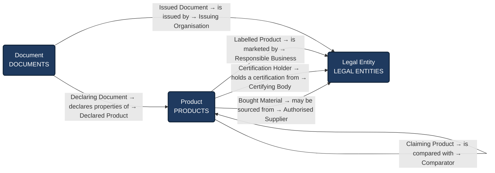
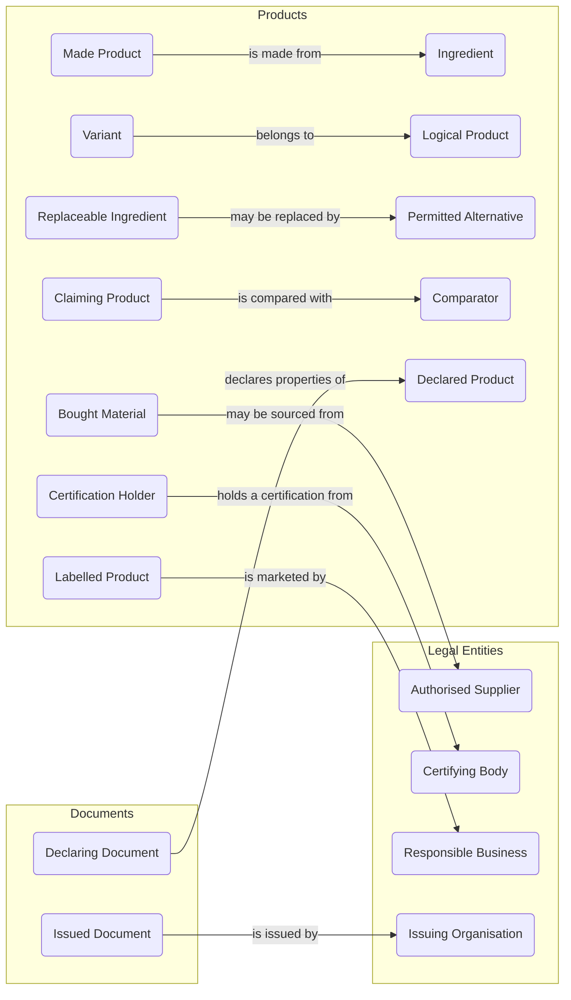
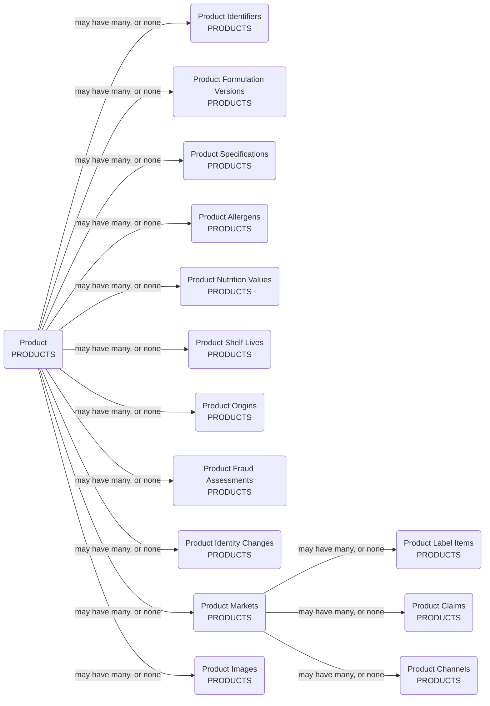
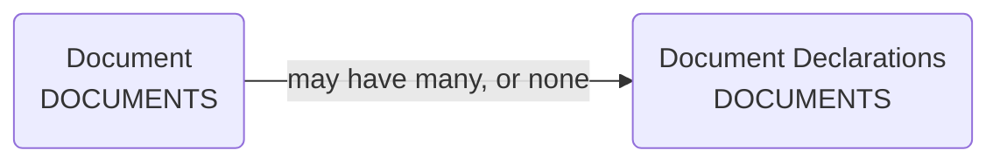
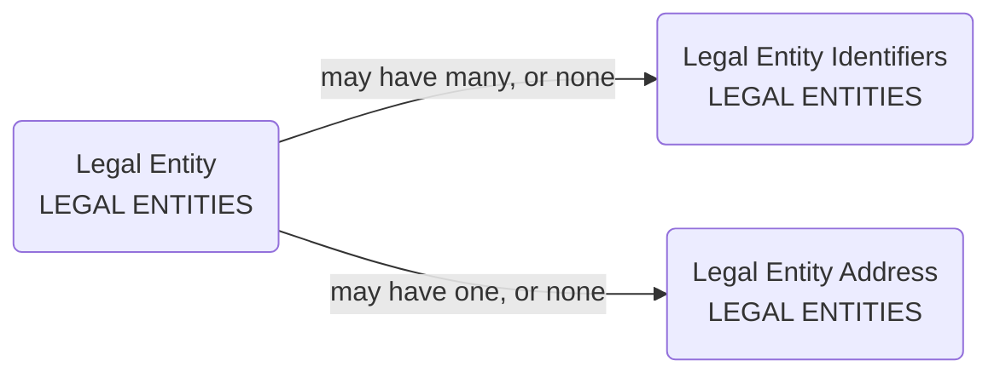

# CPG - Product Definition Data Model Design Document

This **Data Model Design Document** by **M&A Operating System** provides a single traceable review of one scoped area of a business: the business requirements that area works to, how those requirements translate into data requirements, and how those data requirements translate into a data model design. Every part of the design traces back to the requirement that made it necessary and to the source that evidences it, so that each statement can be followed in either direction. It is written in plain English for the business audience accountable for the area — the people best placed to say whether what it describes is true of their business, and who decide whether this design is recorded in a centralised Data Design Authority as the governed definition the organisation builds and reports on.

## Version

|  |  |
|---|---|
| Domain | CPG - Product Definition |
| Document date | 17 November 2026 |
| Package reference (the working files this document is produced from) | fnb-bdd |
| Method version | 31.5 |

**In brief.** This design covers what a food or beverage product is, what goes into it, where it is sold, what it must be, how long it lasts, who may supply its ingredients and what may be said about it on pack. The full summary, the questions it answers and the counts are in section 1.3. In this document, DDA means the Data Design Authority, the central register where the company's data model is kept.

## Table of Contents

- [1 Introduction](#1-introduction)
  - [1.1 About M&A Operating System](#11-about-ma-operating-system)
  - [1.2 About the MAOS Practical Data Modelling Approach](#12-about-the-maos-practical-data-modelling-approach)
  - [1.3 Summary of Findings](#13-summary-of-findings)
- [2 Scope](#2-scope)
  - [2.1 The business](#21-the-business)
  - [2.2 In scope](#22-in-scope)
  - [2.3 Out of scope](#23-out-of-scope)
  - [2.4 Shared with other models](#24-shared-with-other-models)
  - [2.5 Assumptions](#25-assumptions)
  - [2.6 Open questions](#26-open-questions)
- [3 Business Requirements](#3-business-requirements)
- [4 Data Requirements](#4-data-requirements)
- [5 Data Model](#5-data-model)
  - [5.1 Diagrams](#51-diagrams)
    - [5.1.1 Domains Data Model](#511-domains-data-model)
    - [5.1.2 Roles Data Model](#512-roles-data-model)
    - [5.1.3 Concept Models by Domain](#513-concept-models-by-domain)
  - [5.2 Subject Domains](#52-subject-domains)
  - [5.3 Canonical Roles](#53-canonical-roles)
  - [5.4 Role–Verb–Role Relationships](#54-roleverbrole-relationships)
  - [5.5 Concepts](#55-concepts)
  - [5.6 Lookups and Values](#56-lookups-and-values)
- [6 Outstanding Decisions](#6-outstanding-decisions)
- [Appendix A — Sources](#appendix-a--sources)
- [Appendix B — Data Modelling Principles](#appendix-b--data-modelling-principles)
  - [Where the principles and the requirements could not be reconciled](#where-the-principles-and-the-requirements-could-not-be-reconciled)

## 1 Introduction

### 1.1 About M&A Operating System

#### M&A Operating System — AI & Data Advisory Practice

**M&A Operating System (MAOS) helps organizations turn data into measurable business outcomes.**

Our **AI & Data Advisory Practice** works with senior business, data, analytics, and technology leaders to improve how their organizations use information to grow revenue, understand customers, make better decisions, reduce operating cost, manage risk, and enable analytics and AI.

Most organizations do not lack data. They struggle to turn the data they already have into information the business can consistently trust and use. Customer information is fragmented, reports disagree, data is repeatedly copied and transformed, and business definitions vary across teams. Analytics and AI initiatives then inherit the same problems.

We start with the business outcome and work backwards to the information, architecture, governance, operating model, and technology changes required to achieve it. That may mean improving customer identity to support segmentation and personalization, creating more reliable management information, simplifying complex data flows, or establishing the trusted business context required for AI.

Our work typically includes:

- Improving customer identity, segmentation, personalization, and revenue-growth capabilities
- Solving complex data management and data content design issues for Legal Entity, Beneficial Owner, People, Securities, Product Definition and transactional data
- Creating more consistent, timely, and trusted information for reporting, analytics, forecasting, and decision-making
- Designing and maintaining business-aligned data models for operational, analytical, and AI needs
- Resolving data quality, reliability, and performance issues caused by complex data flows, fragmented connectivity, duplication, and uncontrolled data propagation
- Establishing trusted views of customers, legal entities, products, accounts, agreements, and other critical business subjects
- Simplifying data architectures and reducing unnecessary movement, duplication, and technology complexity
- Establishing practical data governance, ownership, and AI readiness aligned to business priorities

Our goal is not simply to modernize data technology. It is to make information work better for the business.

**The value of a data program should ultimately be measured by what the business can do better because of it.**

#### Find Out More

To learn more about how M&A Operating System can help your organization turn data into measurable business outcomes, visit [maoperatingsystem.com](https://www.maoperatingsystem.com).

For a direct conversation about your data, analytics, or AI priorities, contact [cdao-advisory@maoperatingsystem.com](mailto:cdao-advisory@maoperatingsystem.com).

### 1.2 About the MAOS Practical Data Modelling Approach

#### About the M&A Operating System Practical Data Modelling Approach

The **M&A Operating System Practical Data Modelling Approach** is our proprietary, business-led methodology for translating business outcomes and challenges into data requirements and approved logical data models.

We engage business stakeholders and data-consuming groups to understand what they expect data services to make possible. Their needs are captured as plain-English business requirements, then translated through a controlled, traceable sequence of analysis and design activities. The methodology deliberately avoids overly technical terminology and modelling techniques, presenting the information in a business-readable, plain-English form. The resulting data modelling document follows the same sequence, allowing business stakeholders and data practitioners to understand, challenge, and approve the design.

#### The Five-Step Process

##### Step 1 — Gather and Approve Business Requirements

We identify the outcomes stakeholders expect, the challenges they need to solve, and the business activities that data services must support. These are documented as plain-English requirements and approved as the scope and source of knowledge for the design.

##### Step 2 — Identify Actors, Objects, and Roles

Using **Subject-Based Data Modelling**, we identify the actors, roles, and objects in the business lifecycle and map them to domains representing the immutable subjects of the data. Domains describe the enduring people, organizations, things, places, and other subjects the business needs to understand—not the specific reason they appear in a single process.

Actors and objects are aligned to their underlying mastered subjects. Roles describe the capacity in which a subject participates in a relationship, process, or context. The same subject can perform several roles without being modelled repeatedly.

##### Step 3 — Identify Relationships

We identify the relationships between actors and objects and express them as clear business verbs—such as owns, manages, supplies, purchases, or is party to. This makes their meaning understandable and reviewable by business and data stakeholders.

##### Step 4 — Identify Lifecycle Events

We identify the events that actors, roles, and objects pass through as they live their natural lives and interact within business processes. These events include when an object is created, changed, activated, transferred, or retired; a subject assumes or ceases a role; or a relationship is established, modified, or ended. This determines what data must be captured at each stage.

##### Step 5 — Design Logical Data Models

The approved requirements, subjects, roles, relationships, and lifecycle events form the logical data model, documented through four connected components:

- **Data Domains** — governed groupings representing the immutable subjects of the data
- **Data Concepts** — the unique logical elements that make up the data known and recorded about each subject
- **Data Relationships** — the business connections between concepts, including the roles they perform
- **Data Attributes** — the individual data elements that describe each concept or relationship

Each component remains traceable to the requirement that established its need. The completed document provides the shared record business stakeholders and data practitioners use to review and approve the data requirements and model design.

### 1.3 Summary of Findings

This design covers what a food or beverage product is, what goes into it, where it is sold, what it must be, how long it lasts, who may supply its ingredients and what may be said about it on pack. The formulation, meaning the list of what goes into a product and how much, is at its heart. The order ingredients are listed in, the allergens, the nutrition values and the claims on a pack all follow from the formulation, so a change to it shows which labels and claims it reaches. Where an ingredient is bought in already made, the design relies on what the supplier declares is inside it, and records who declared it and whether it was checked.

Products are held in two layers. Each size, pack and recipe is a product in its own right, with its own identifiers, formulation, allergens and label. A product definition above them groups the versions that belong together and is never made, bought or sold itself. A product is listed in markets, each named by a country or by a wider region, and the items on its pack, the claims it makes and the sales channels it uses hang from that listing. The design covers three markets, the United States, the European Union and the United Kingdom, and no others. It holds a market as a value in its lists, so it extends to any other country or wider region without a change of structure, but none is included here by choice.

The design has three stated limits. It cannot say what is inside a bought-in ingredient beyond what the supplier declares. It finds every product that uses a recalled ingredient but not which batches. Batches, factories and the places inside them down to the shop floor, supplier sites and supply chain detail belong to the proposed CPG Manufacturing and Supply Chain model. It keeps a shelf life for each product and does not work one out from the shelf lives of its ingredients, because none of the sources describe a rule for doing so.

**What the business can answer with this design**

- We reformulate to cut sugar by 30%. Which claims and labels does that reach?
- A supplier changes what is inside an ingredient. Which of our labels does that reach?
- Which allergens must this product declare, and which ingredient brings each one?
- Which suppliers may supply this ingredient today, and which could on a past date?
- Which of this ingredient's stated properties did we check, and which did we take on the supplier's word?
- Where and through which channels is this product sold, and what must its pack say there?

This design creates sixteen concepts, eighteen roles, nine relationships and fourteen lists of values in DDA, gathers the relationships into the existing CPG - Product Definition model, adds ten values to two existing lists, and reuses three existing domains, four existing concepts and two existing lists of values.

|  | Count |
|---|---|
| Business requirements | 42 |
| Data requirements | 27 |
| Areas of the business covered (domains) | 3 (3 already in DDA) |
| Roles, meaning the part something plays in a relationship | 18 |
| Relationships between roles | 9 |
| Concepts, meaning groups of related facts | 20 |
| Lists of allowed values | 18 |
| Sources | 43 |

## 2 Scope

### 2.1 The business

Consumer packaged goods are products that a company makes and sells in packs to consumers through shops and online, and this design is shown with food and beverage products. The design records what each product is: the product definition, its variants (the sizes, packs and recipes that are sold) and the ingredients that go into it. Around that it records what a product must be, who may supply its ingredients, what may be said about it on pack, and where it is sold and how it is pictured. It does not cover how a product is made: factories, production lines, machines, batches and the steps of manufacture belong to the proposed CPG Manufacturing and Supply Chain model.

### 2.2 In scope

| ID | In scope |
|---|---|
| SCI001 | What a product is — how it is identified, how its variants (sizes, packs and recipes) relate to each other, and how they are grouped under one product definition that is not itself sold |
| SCI002 | What a product is made from — its ingredients and packaging, and how much of each. This is the formulation, not the steps of making the product |
| SCI003 | What a product and its ingredients must be — specifications and their limits |
| SCI004 | What must be declared on pack — ingredients, allergens, nutrition, origin, date marks and claims |
| SCI005 | Which suppliers may supply each ingredient, and on what evidence |
| SCI006 | What a supplier states about what it supplies, and whether it was checked |
| SCI007 | How long a product lasts, and under what storage conditions |
| SCI009 | Where each product is sold — the markets, the sales channels and the dates |
| SCI010 | The pictures that show each product |
| SCI011 | The markets covered: the United States, the European Union and the United Kingdom. For each, what a product must declare on pack, which allergens it must name, the language of the pack and who is named on it as responsible, and the dates and channels it is sold through there |
| SCI012 | The core product, and the hierarchy of what goes into what: which products and ingredients make up each product, to any depth. This design holds both, and other models, including CPG Manufacturing and Supply Chain, refer to them and do not hold their own |

### 2.3 Out of scope

What this design leaves out, and the model that is intended to own it. The CPG Manufacturing and Supply Chain model is proposed and is not yet in DDA.

| ID | Out of scope | Owned by another model |
|---|---|---|
| SCO001 | How a product is made — steps, settings and the instructions issued for a batch | CPG Manufacturing and Supply Chain model |
| SCO002 | Factories, the places inside them down to the shop floor, production lines and the machines in them, and which factory makes a product and which recipe version it uses there. | CPG Manufacturing and Supply Chain model |
| SCO003 | Batches made, what they used, yields and stoppages | CPG Manufacturing and Supply Chain model |
| SCO004 | Supply chain detail: the sites suppliers make and ship from, movements, storage, stock and despatch. A supplier is held here as a company only. | CPG Manufacturing and Supply Chain model |
| SCO005 | Batch-level traceability and recall scoping | CPG Manufacturing and Supply Chain model |
| SCO006 | Testing each delivery of an ingredient. Whether the organisation checked a supplier's document is in scope; testing each delivery is not. | CPG Manufacturing and Supply Chain model |
| SCO007 | Trade spending, pricing and retail execution. Where and through which channel a product is sold is in scope; what it sells for is not. | Commercial model |
| SCO008 | Marketing and campaigns. The pictures that show a product are in scope; how a campaign uses them is not. | Digital marketing model |
| SCO010 | Packing, and the levels a product is packed in for handling, such as case and pallet. | CPG Manufacturing and Supply Chain model |
| SCO011 | A named successor: which product takes over from another when it is discontinued. This is a general capability for any record and not product information. It is held on the general Master record as a Successor field (DMA000000910), which must be given when a record has been merged into another or replaced by one. | Master data (general) |
| SCO012 | Placing each country in a region of the world, and each region on a continent. | Universal core data model |
| SCO013 | Every market other than the United States, the European Union and the United Kingdom, and the labelling rules of those markets. The design holds a country or a wider region as a value in its lists, so it extends to another market without a change of structure, but none is included here by choice. | Not owned by another model. Left for a later extension |

### 2.4 Shared with other models

These are used as DDA already holds them.

| ID | Shared area | In DDA |
|---|---|---|
| SCS001 | Legal Entities | [DMD000000012](https://datadesign.maoperatingsystem.com/models/domains/DMD000000012) |
| SCS002 | Documents | [DMD000000016](https://datadesign.maoperatingsystem.com/models/domains/DMD000000016) |
| SCS003 | Products | [DMD000000032](https://datadesign.maoperatingsystem.com/models/domains/DMD000000032) |

### 2.5 Assumptions

| ID | Assumption |
|---|---|
| SCA001 | Material held by a supplier is the supplier's. This design is about definitions and declarations, not stock. |
| SCA002 | Something bought as an ingredient may be another company's finished product, and what is inside it may not be known here. |
| SCA003 | Where a declaration is worked out from what goes in, the design keeps the inputs and the declared value. It does not keep the calculation. |
| SCA004 | This design is built from published sources alone. The owner named for each requirement is proposed from those sources. |
| SCA005 | What changes over time is kept with dates: formulations, specifications, supplier authorisations, certifications and shelf lives. The design does not follow a product from launch to discontinuation as a single lifecycle. |
| SCA006 | The CPG Manufacturing and Supply Chain, commercial and digital marketing models named in section 2.3 are the intended owners of what this design leaves out. The first is proposed and is not yet in DDA. Whether the others exist is not known. |
| SCA007 | A manufacturing bill of materials is read as the formulation held here: what goes into a product, including packaging, and how much. How, where and in what order the product is made is not held. |
| SCA008 | The markets covered are the United States, the European Union and the United Kingdom, and no others. A market is a country, or a wider region of the world, in which a product is intended to be sold. Requirements, allergen lists and label rules are provided for these three markets only. The design holds a market as a value in its lists, so it extends to any other country or wider region without a change of structure. No other market is included here by choice. |
| SCA009 | A sales channel is the kind of trade a product is sold through in a market, such as grocery, food service or online. It is not a named customer. |
| SCA010 | Each version of a product is a product in its own right. The product definition above them only groups them and is never made, bought or sold. |
| SCA012 | The European Union is treated as one market. A product sold in the Union is listed once for the Union and not once for each member country, and the member countries are not mapped to it. |
| SCA013 | A supplier is held as a company, a Legal Entity playing a role. The places a supplier works from, the places inside a factory down to the shop floor and batches are held in the CPG Manufacturing and Supply Chain model. |
| SCA014 | The United Kingdom keeps one allergen list, the list for Great Britain. Northern Ireland has no list of its own. |
| SCA015 | Nutrition values belong to the product itself, whether it is playing the part of an ingredient, a variant or a finished product. Each value names how it was arrived at from a governed list, so any number of ways can be supported by adding values to the list. |
| SCA016 | All allergen information about a product is held in one concept. A universal list holds each food once, and each market's list names the food each of its allergens is. A market allergen has one food, or one group of foods, above it. How an allergen came to be associated with a product is held as plain text. |

### 2.6 Open questions

| ID | Question |
|---|---|
| SCQ005 | Is a single Successor field on the general Master record enough, or should a record be able to name several successors, for example when one product is split into two? The field holds one successor, and a general link between records would be needed for more. |

## 3 Business Requirements

Each requirement can be checked against the source beside it. Which rules apply to a product depends on the market it is sold in (assumption SCA008).

| ID | Category | Business requirement | Proposed owner | Sources |
|---|---|---|---|---|
| REQ001 | Product | A product is either something the organisation sells, or an ingredient or packaging item it buys in order to make one. | Technical lead | [SRC002](https://www.gs1nz.org/assets/Resources/Services/GS1NZ_Fact-sheet-gtin-allocation-rules.-V2.pdf), [SRC015](https://www.bsigroup.com/globalassets/localfiles/vi-vn/news/CE%20Marking/bsi_supplier_management_food_assessment_a4_brochure_en_in_092019_web.pdf) |
| REQ002 | Product | A product is made from a defined set of ingredients and packaging items in defined quantities, and that definition changes over time. | Technical lead | [SRC002](https://www.gs1nz.org/assets/Resources/Services/GS1NZ_Fact-sheet-gtin-allocation-rules.-V2.pdf), [SRC004](https://library.regask.com/docs/4-labeling-requirements-78) |
| REQ003 | Product | An ingredient may itself be made from other ingredients. The parts of such an ingredient must still be declared on the pack of the product that uses it. | Regulatory lead | [SRC003](https://www.bromley.gov.uk/leaflet/323910/3/733/d) |
| REQ004 | Product | Ingredients are declared heaviest first, by the weight used. Ingredients under 2%, and spice mixes where no single spice stands out, may go last. | Regulatory lead | [SRC003](https://www.bromley.gov.uk/leaflet/323910/3/733/d), [SRC004](https://library.regask.com/docs/4-labeling-requirements-78), [SRC010](https://foodlabelmaker.com/gb/regulatory-hub/fda/food-labeling-packaging/) |
| REQ005 | Product | The same ingredient goes into many products, and a product may be sold as it is and also used inside another. | Technical lead | [SRC002](https://www.gs1nz.org/assets/Resources/Services/GS1NZ_Fact-sheet-gtin-allocation-rules.-V2.pdf), [SRC003](https://www.bromley.gov.uk/leaflet/323910/3/733/d) |
| REQ006 | Product | When an alternative ingredient is used in place of a specified one, the change must carry through the specification, the recipe, the product information and the label. | Technical lead | [SRC020](https://humanfocus.co.uk/blog/supplier-change-control-failures-during-food-substitutions/) |
| REQ007 | Product | Where an ingredient is itself a made product, what is inside it must still be known well enough to declare it, and where the organisation did not make it, that knowledge comes from the supplier. | Technical lead | [SRC003](https://www.bromley.gov.uk/leaflet/323910/3/733/d), [SRC019](https://www.cleverence.com/amp/articles/business-blogs/guide-batch-tracking-5829/) |
| REQ008 | Identity | The same product is sold in several sizes and pack formats, related to each other but identified and counted separately. | Commercial lead | [SRC001](https://www.gs1uk.org/sites/default/files/The_GTIN_management_handbook.pdf), [SRC002](https://www.gs1nz.org/assets/Resources/Services/GS1NZ_Fact-sheet-gtin-allocation-rules.-V2.pdf), [SRC030](https://schema.org/ProductGroup) |
| REQ009 | Identity | A change to the declared ingredients, the net quantity, a certification mark or the pack count makes a different product. Other changes do not. | Regulatory lead | [SRC001](https://www.gs1uk.org/sites/default/files/The_GTIN_management_handbook.pdf), [SRC002](https://www.gs1nz.org/assets/Resources/Services/GS1NZ_Fact-sheet-gtin-allocation-rules.-V2.pdf) |
| REQ010 | Identity | What goes into a product changes over time while it remains the same product. | Technical lead | [SRC001](https://www.gs1uk.org/sites/default/files/The_GTIN_management_handbook.pdf) |
| REQ011 | Identity | An identifier issued by an outside authority, such as a trade item number, is the strongest evidence of which product something is. | Data steward | [SRC001](https://www.gs1uk.org/sites/default/files/The_GTIN_management_handbook.pdf), [SRC002](https://www.gs1nz.org/assets/Resources/Services/GS1NZ_Fact-sheet-gtin-allocation-rules.-V2.pdf) |
| REQ035 | Identity | Versions of one product that differ only in size, format or pack count are grouped under a single product definition that is never sold itself. Each version is identified, formulated and labelled in its own right. | Commercial lead | [SRC030](https://schema.org/ProductGroup), [SRC001](https://www.gs1uk.org/sites/default/files/The_GTIN_management_handbook.pdf), [SRC002](https://www.gs1nz.org/assets/Resources/Services/GS1NZ_Fact-sheet-gtin-allocation-rules.-V2.pdf) |
| REQ039 | Identity | A product is intended for sale in stated markets, each a country or a wider region, from and until stated dates, and through stated trade channels such as grocery, food service or online. | Commercial lead | [SRC035](https://gs1.eu/wp-content/uploads/2024/11/GS1inEU_Trade_Item_Implementation_Guideline_v1.5.pdf), [SRC036](https://gs1.se/en/guides/documentation/code-lists/t4452-trade-item-trade-channel-code/), [SRC037](https://gdsn.gs1-germany.de/BMSattribute?id=65) |
| REQ043 | Identity | A product is shown by pictures that are tied to it by its trade item number, each taken from one stated side. | Commercial lead | [SRC038](https://ref.gs1.org/standards/product-image-specification/), [SRC001](https://www.gs1uk.org/sites/default/files/The_GTIN_management_handbook.pdf) |
| REQ022 | Specification | An ingredient or product must meet a stated specification, and what it must be changes over time. | Quality manager | [SRC026](https://ascfoodsafety.com/?p=39508), [SRC015](https://www.bsigroup.com/globalassets/localfiles/vi-vn/news/CE%20Marking/bsi_supplier_management_food_assessment_a4_brochure_en_in_092019_web.pdf) |
| REQ023 | Specification | What a supplier says an ingredient is must be comparable with what the organisation specified, including whether it is what it claims to be. | Quality manager | [SRC026](https://ascfoodsafety.com/?p=39508), [SRC016](https://www.nsf.org/za/en/training/series/brcgs-vulnerability-assessment-for-food-fraud) |
| REQ012 | Declaration | Every pre-packed product must carry a defined set of information: its name, its ingredients, the allergens among them, the quantity of certain ingredients, the net quantity, a date mark, storage and use conditions, the responsible business and its address, and the country of origin. | Regulatory lead | [SRC006](https://teagasc.ie/wp-content/uploads/media/website/rural-economy/rural-development/diversification/5-Pre-Packaged-Food-Labels.pdf), [SRC007](https://gimb.public.lu/en/gesond-iessen/bien-manger/etiquettage-nutritionnel.html) |
| REQ013 | Declaration | An allergen is declared by the food it comes from, including when it arrives inside another ingredient. | Quality manager | [SRC008](https://www.hoganlovells.com/en/publications/fda-releases-draft-compliance-policy-guide-for-major-food-allergen-labeling-and-cross-contact), [SRC009](https://www.fda.gov/regulatory-information/search-fda-guidance-documents/cpg-sec-555250-statement-policy-labeling-and-preventing-cross-contact-common-food-allergens), [SRC027](https://www.legislation.gov.uk/eur/2011/1169/annex/II), [SRC028](https://www.fda.gov/food/food-allergensgluten-free-guidance-documents-regulatory-information/frequently-asked-questions-food-allergen-labeling-guidance-industry), [SRC029](https://www.canr.msu.edu/news/the-faster-act-sesame-as-major-food-allergen) |
| REQ014 | Declaration | Nutrition must be declared, and the values may come from analysis of the product, from calculation from the ingredients used, or from accepted published data. | Regulatory lead | [SRC005](https://library.regask.com/docs/4-labeling-requirements-49), [SRC011](https://www.eurofir.org/wp-admin/wp-content/uploads/2015/12/EUROFIR-RECIPE-GUIDELINE_FINAL.pdf) |
| REQ015 | Declaration | Working nutrition out from the ingredients has to allow for the edible part of each, for weight change in preparation and for nutrients lost or gained. | Technical lead | [SRC012](https://www.cfs.gov.hk/english/food_leg/files/wsm4_indirect_nutrient_analysis_e.pdf), [SRC011](https://www.eurofir.org/wp-admin/wp-content/uploads/2015/12/EUROFIR-RECIPE-GUIDELINE_FINAL.pdf) |
| REQ016 | Declaration | Declared values are averages and are allowed to vary within stated tolerances. | Regulatory lead | [SRC011](https://www.eurofir.org/wp-admin/wp-content/uploads/2015/12/EUROFIR-RECIPE-GUIDELINE_FINAL.pdf) |
| REQ017 | Declaration | A claim about a product may only be made where stated conditions are met, and making it obliges the label to carry the figure behind it. | Regulatory lead | [SRC013](https://afgc.org.au/wp-content/uploads/2025/08/2025-Webinar-3-Food-Standards-Code-AFGC.pdf) |
| REQ018 | Declaration | A claim that compares a product with others requires a named comparator and a defined difference. | Regulatory lead | [SRC014](https://www.eeb.gov.hk/food/download/press_and_publications/otherinfo/050826_labelling/tech_meeting4_comparative.pdf) |
| REQ019 | Declaration | A product must not carry information that misleads the buyer or suggests it has medicinal properties. | Regulatory lead | [SRC007](https://gimb.public.lu/en/gesond-iessen/bien-manger/etiquettage-nutritionnel.html) |
| REQ020 | Declaration | Which rules a product must follow depends on the market it is sold in. | Regulatory lead | [SRC007](https://gimb.public.lu/en/gesond-iessen/bien-manger/etiquettage-nutritionnel.html), [SRC010](https://foodlabelmaker.com/gb/regulatory-hub/fda/food-labeling-packaging/), [SRC027](https://www.legislation.gov.uk/eur/2011/1169/annex/II), [SRC028](https://www.fda.gov/food/food-allergensgluten-free-guidance-documents-regulatory-information/frequently-asked-questions-food-allergen-labeling-guidance-industry), [SRC039](https://www.gov.uk/government/publications/allergen-labelling-for-food-manufacturers/allergen-labelling-for-food-manufacturers) |
| REQ021 | Declaration | Where a country of origin is declared on pack, the organisation must be able to show where the ingredient or product comes from. | Regulatory lead | [SRC006](https://teagasc.ie/wp-content/uploads/media/website/rural-economy/rural-development/diversification/5-Pre-Packaged-Food-Labels.pdf) |
| REQ040 | Declaration | In Great Britain pre-packed food must declare the same fourteen allergens as the European Union, under rules of its own. A product sold in several markets declares the allergens of each. | Regulatory lead | [SRC039](https://www.gov.uk/government/publications/allergen-labelling-for-food-manufacturers/allergen-labelling-for-food-manufacturers), [SRC027](https://www.legislation.gov.uk/eur/2011/1169/annex/II), [SRC028](https://www.fda.gov/food/food-allergensgluten-free-guidance-documents-regulatory-information/frequently-asked-questions-food-allergen-labeling-guidance-industry) |
| REQ041 | Declaration | The language of the mandatory label information is decided by the country in which the food is sold. | Regulatory lead | [SRC041](https://food.ec.europa.eu/food-safety/labelling-and-nutrition/food-information-consumers-legislation/language-and-presentation-food-information_en) |
| REQ042 | Declaration | The business named on a pack as responsible is the one the food is marketed under or, where that business is not established in the market, the importer, so it can differ from one market to another. | Regulatory lead | [SRC042](https://www.legislation.gov.uk/eur/2011/1169/article/8/data.htm) |
| REQ045 | Declaration | An allergen may be declared in two ways: as an allergen the food contains, or as an allergen that may be present through cross-contact that cannot be avoided. A statement that an allergen may be present is voluntary, is used only where the risk cannot be controlled, and is not used for an allergen that is also declared as contained or claimed as absent. | Regulatory lead | [SRC028](https://www.fda.gov/food/food-allergensgluten-free-guidance-documents-regulatory-information/frequently-asked-questions-food-allergen-labeling-guidance-industry), [SRC043](https://www.fda.gov/food/food-labeling-nutrition/food-allergies), [SRC044](https://www.gov.uk/government/publications/precautionary-allergen-labelling/precautionary-allergen-labelling), [SRC045](https://www.fao.org/newsroom/story/no-more-going-nuts-on-food-allergen-labelling/en) |
| REQ047 | Declaration | The lists of allergens differ from market to market and group foods differently: the European Union names cereals containing gluten where the United States names wheat, and names celery, mustard, lupin, molluscs and sulphites that the United States list does not. A food named in two markets must still be recognisable as the same food. | Regulatory lead | [SRC027](https://www.legislation.gov.uk/eur/2011/1169/annex/II), [SRC028](https://www.fda.gov/food/food-allergensgluten-free-guidance-documents-regulatory-information/frequently-asked-questions-food-allergen-labeling-guidance-industry), [SRC039](https://www.gov.uk/government/publications/allergen-labelling-for-food-manufacturers/allergen-labelling-for-food-manufacturers) |
| REQ024 | Shelf life | How long a product lasts depends on how it is stored, and is limited by whichever is shorter of its safe life and its quality life. | Quality manager | [SRC023](https://efsa.europa.eu/en/efsajournal/pub/6306), [SRC025](https://cdnmedia.eurofins.com/european-west/media/jtgbfkxv/eurofins-determining-shelf-life-ftuki102.pdf) |
| REQ025 | Shelf life | A shelf life is set for ingredients and part-made goods as well as for finished products. | Quality manager | [SRC024](https://www.fdfscotland.org.uk/globalassets/resources/publications/guidance/shelf-life-guidance.pdf) |
| REQ026 | Shelf life | A product carries a date mark — use-by where the food could soon become unsafe, best-before where it only loses quality — and the business labelling it decides which. | Regulatory lead | [SRC022](https://www.fsai.ie/Business-Advice/Running-a-Food-Business/Food-Safety-and-Hygiene/Shelf-life/Shelf-life-Best-before-and-Use-by-Dates), [SRC006](https://teagasc.ie/wp-content/uploads/media/website/rural-economy/rural-development/diversification/5-Pre-Packaged-Food-Labels.pdf) |
| REQ046 | Shelf life | Where a food needs special storage conditions, such as being kept refrigerated or within a stated range of temperature, the pack states them. | Regulatory lead | [SRC046](https://www.legislation.gov.uk/eur/2011/1169/chapter/IV/adopted), [SRC047](https://www.fsai.ie/getmedia/21d61e0e-f402-4ce5-a683-0d42b8044529/Information-regulation-Commission-qanda.pdf), [SRC048](https://www.fda.gov/regulatory-information/search-fda-guidance-documents/guidance-labeling-foods-need-refrigeration-consumers) |
| REQ027 | Sourcing | An ingredient may be bought from several authorised suppliers, and an authorisation may lapse or be suspended. | Procurement lead | [SRC015](https://www.bsigroup.com/globalassets/localfiles/vi-vn/news/CE%20Marking/bsi_supplier_management_food_assessment_a4_brochure_en_in_092019_web.pdf), [SRC018](https://www.salsafood.co.uk/news/add0d885-6016-4280-9ce9-820cc152bc39-354) |
| REQ028 | Sourcing | A documented programme of authorising suppliers must cover every ingredient and every packaging item that goes into a finished product. | Procurement lead | [SRC015](https://www.bsigroup.com/globalassets/localfiles/vi-vn/news/CE%20Marking/bsi_supplier_management_food_assessment_a4_brochure_en_in_092019_web.pdf) |
| REQ029 | Sourcing | Every ingredient must be assessed for how likely it is to be tampered with or swapped for something cheaper. | Quality manager | [SRC016](https://www.nsf.org/za/en/training/series/brcgs-vulnerability-assessment-for-food-fraud), [SRC017](https://www.highspeedtraining.co.uk/hub/food-vulnerability-assessment-checklist/) |
| REQ030 | Sourcing | Where an ingredient is found to be at particular risk, extra checks must be put in place for it. | Quality manager | [SRC017](https://www.highspeedtraining.co.uk/hub/food-vulnerability-assessment-checklist/), [SRC016](https://www.nsf.org/za/en/training/series/brcgs-vulnerability-assessment-for-food-fraud) |
| REQ031 | Sourcing | A supplier states what it has supplied, and the organisation may or may not check that statement. | Quality manager | [SRC019](https://www.cleverence.com/amp/articles/business-blogs/guide-batch-tracking-5829/), [SRC026](https://ascfoodsafety.com/?p=39508) |
| REQ032 | Sourcing | A supplier must tell the organisation of changes that could affect an ingredient's safety, quality, shelf life, declared contents, allergens or nutrition, and of any loss of a site's certification. | Procurement lead | [SRC021](https://www.ifsqn.com/forum/index.php/topic/50089-sqf-2324-supplier-notification-of-product-composition-changes/), [SRC020](https://humanfocus.co.uk/blog/supplier-change-control-failures-during-food-substitutions/) |
| REQ033 | Sourcing | A product's certification comes from a named body, is valid for a set period, and can be revoked. | Quality manager | [SRC001](https://www.gs1uk.org/sites/default/files/The_GTIN_management_handbook.pdf), [SRC015](https://www.bsigroup.com/globalassets/localfiles/vi-vn/news/CE%20Marking/bsi_supplier_management_food_assessment_a4_brochure_en_in_092019_web.pdf) |

## 4 Data Requirements

What the business must keep, the questions it must be able to answer, and the mistakes the design prevents. Each links back to the requirements it serves.

| ID | The business must keep | It must be able to answer | When | Mistakes it must prevent | How the design prevents them | Requirements |
|---|---|---|---|---|---|---|
| DRQ001 | Every line of a product's formulation: the product, the ingredient or packaging item, and how much of it is used Which version of the formulation each line belongs to | What goes into this product, and what is inside each of those ingredients? | Today and on any past date | A product that ends up containing itself, however many steps away A formulation put together from lines that belong to two different versions | A product cannot be listed as an ingredient of itself, directly or through other products. Every line of a formulation must say which version it belongs to. | [REQ001](#req001) · [REQ002](#req002) · [REQ003](#req003) · [REQ005](#req005) |
| DRQ002 | The same information, read starting from an ingredient | Which products contain this ingredient, by any route? | Today | — | — | [REQ005](#req005) |
| DRQ003 | How much of each ingredient is used, and whether it may go at the end of the list | In what order must this product's ingredients be declared, and which may go at the end? | On any past date | — | — | [REQ004](#req004) |
| DRQ004 | Which alternatives may stand in for an ingredient, the conditions for using each, and what using it changes on the label | Which alternatives are permitted for this ingredient, and what does using one change on the label? | On any past date | An alternative recorded without saying what it changes on the label | Every permitted alternative must state what using it changes on the label. | [REQ006](#req006) |
| DRQ005 | Where an ingredient is bought in already made, who supplies it and what the supplier says is inside it | Which of our products rest on an ingredient whose contents only the supplier can declare? | Today | — | — | [REQ007](#req007) |
| DRQ006 | Each size and pack as its own product, linked to its family, with what makes it differ Each change to a product, whether it made a different product or a new version, and why | Which packs of this product exist, and did this change make a different product? | On any past date | — | — | [REQ008](#req008) · [REQ009](#req009) · [REQ010](#req010) · [REQ035](#req035) |
| DRQ007 | Every item that must appear on pack for a product in a market, and what it says The business named on the pack as answerable for the product | Is everything this market requires on this pack present, and what does each item say? | On any past date | A pack item recorded for a market the product is not sold in | Every pack item belongs to a market the product is sold in. | [REQ012](#req012) · [REQ020](#req020) · [REQ041](#req041) · [REQ042](#req042) |
| DRQ008 | Each allergen an ingredient carries, named by the food it comes from and by the market whose list it belongs to | Which allergens must this product declare, and which ingredient brings each one? | Today and on any past date | A product declared free of an allergen one of its ingredients carries | A product's allergens are worked out from everything in its formulation, so an allergen that an ingredient carries cannot be left off. | [REQ013](#req013) |
| DRQ009 | Each nutrition value shown on pack, how it was arrived at, and how far it may vary For a calculated value, the allowance made for the edible part, for weight change in preparation and for nutrient loss | What are this product's nutrition values, how was each arrived at, and how far may each vary? | On any past date | A nutrition value shown without saying how it was arrived at | Every nutrition value must say how it was arrived at. | [REQ014](#req014) · [REQ015](#req015) · [REQ016](#req016) |
| DRQ010 | Each claim made, the market it is made in, the condition it rests on, and the product it is compared with where it compares | Which claims does this pack make, and does each still meet its condition? | On any past date | A claim kept after its condition stops being met | Whether a claim's condition is still met is worked out from the current values, so a claim cannot outlive its condition unnoticed. | [REQ017](#req017) · [REQ018](#req018) · [REQ019](#req019) |
| DRQ011 | Each version of what a product or ingredient must be, with its limits | What must this ingredient be, and what did it have to be on a past date? | On any past date | — | — | [REQ022](#req022) |
| DRQ012 | What a supplier's document says about what it supplied, who issued it and when, and whether the organisation checked it | Which of this ingredient's stated properties did we check, and which did we take on the supplier's word? Which supplier documents about an ingredient are newer than the formulation of a product that uses it? | On any past date | A supplier's statement shown as though the organisation had checked it | Every supplier statement must say whether the organisation checked it. | [REQ023](#req023) · [REQ031](#req031) · [REQ032](#req032) |
| DRQ013 | How long a product, ingredient or part-made good lasts under each storage condition, and which date mark it carries | How long does this last under each storage condition, and which date mark does it carry? | On any past date | — | — | [REQ024](#req024) · [REQ025](#req025) · [REQ026](#req026) |
| DRQ014 | Each supplier authorised for each ingredient or packaging item, under which programme, and for what period | Which suppliers may supply this ingredient today, and which could on a past date? Which ingredients and packaging items have no authorised supplier? | On any past date | An authorisation treated as current after it has lapsed | Every supplier authorisation has a start and an end date, so a lapsed authorisation is never treated as current. | [REQ027](#req027) · [REQ028](#req028) |
| DRQ015 | Each ingredient's fraud-risk assessment, what it found, and the extra checks it calls for | Which ingredients are most at risk of fraud, and what is in place for them? | On any past date | — | — | [REQ029](#req029) · [REQ030](#req030) |
| DRQ016 | Each certification a product holds, who granted it, and the period it is valid for | Which certifications does this product hold, from whom, and are they still valid? | Today and on any past date | A certification shown as current after it has lapsed | Every certification has a start and an end date, so a lapsed certification is never shown as current. | [REQ033](#req033) |
| DRQ017 | The identifiers a product carries, who issued each, and the period each was in use | Which product is this, whatever identifier the retailer or supplier used? | Today | — | — | [REQ011](#req011) |
| DRQ018 | Where a country of origin is declared, which country and what it rests on | Where does this ingredient or product come from, as declared? | On any past date | — | — | [REQ021](#req021) |
| DRQ019 | Which products are the sizes, formats and pack counts of one product definition Whether a product is only a grouping and is never made, bought or sold | Which products are sold as versions of this product definition, and how does each differ? | Today | A product that belongs to two product definitions | A product belongs to at most one product definition. | [REQ035](#req035) · [REQ008](#req008) |
| DRQ023 | Each market a product is intended for, named by country or by a wider region, and the dates it is sold there The sales channels a product is sold through in each market, and the dates | Where, and through which channels, is this product sold today? | On any past date | A market named by neither a country nor a region, or by both The same product listed twice in the same market for overlapping dates | Every market names a country or a region, and not both. A product has one listing for each market and period. | [REQ039](#req039) |
| DRQ024 | Which of the fourteen allergens listed for Great Britain a product declares | Which allergens must this pack declare in Great Britain? | Today | — | — | [REQ040](#req040) |
| DRQ025 | The language each label item is printed in | In which language is each mandatory item printed for each market? | On any past date | A label item with no language stated | Every label item states its language. | [REQ041](#req041) |
| DRQ026 | Which business a pack names as responsible in each market, and from when | Which business does this pack name as responsible in this market? | On any past date | Two businesses named as responsible for the same product in the same market at the same time | A product names one responsible business for each market and period. | [REQ042](#req042) |
| DRQ027 | Each picture of a product: which side it shows, where the file is held, its file type and the date from which it is current | Which pictures show this product, and which is the current front view? | On any past date | Two current pictures of the same side of one product | A product has one picture of each side for each period. | [REQ043](#req043) |
| DRQ029 | For each allergen a product declares in a market, whether the product contains it or it may be present How the allergen came to be associated with the product, in plain words | Which allergens does this product contain, and which may it contain, in this market? Why does this product carry this allergen? | Today | The same allergen shown as both contained and possibly present for one product in one market | A product has one entry for each allergen in a market, and each entry has one status. | [REQ045](#req045) |
| DRQ030 | The lowest and highest temperature a product may be kept at under each storage condition | At what temperature must this product be kept? | Today | — | — | [REQ046](#req046) |
| DRQ031 | Each food that causes allergies, held once for all markets For each allergen in a market's list, the food it is, or the group of foods it names | Is the celery declared in one market the same food as the celery declared in another? Which allergens in the markets' lists are this food? | Today | A market allergen that is two foods at once | Each market allergen names one food, and where a market groups several foods it names the group. | [REQ047](#req047) |

## 5 Data Model

**How to read this section.** A *domain* is an area of the business the design keeps information about. A *concept* is a group of related facts kept about something in a domain. A *role* is the part something plays, such as an organisation while it supplies goods. A *relationship* links two roles with a verb that reads naturally in both directions. A *list of values* is a fixed set of allowed answers. Names follow DDA's naming rules, so a concept called ProductAllergens is the group of facts about a product's allergens.

**The model.** DDA already holds a model for this field, **CPG - Product Definition** (DMM000000005), with nothing yet in it. The design gathers the nine relationships in 5.4 into it, and the eighteen roles in 5.3 are reached through them. Its description reads:

> The CPG - Product Definition model holds what a food and beverage manufacturer needs to define a product, what goes into it, who may supply it and who stands behind it. A Made Product is made from Ingredients, and each Ingredient is itself a product. A Logical Product groups the Variants that are its sizes and packs, and is never made, bought or sold itself. A Replaceable Ingredient may be replaced by a Permitted Alternative, and a Claiming Product is compared with a Comparator when its pack makes a claim against another product. A Bought Material may be sourced from an Authorised Supplier, which is held only as a company. A Certification Holder holds its certification from a Certifying Body. A Labelled Product names a Responsible Business on its pack. A Declaring Document states properties of a Declared Product, and an Issuing Organisation issues the Issued Document. Which labels and claims a change to a recipe reaches, which allergens a product must declare and which suppliers may supply an ingredient on a given date are worked out from these arrangements and never stored. Factories and the places inside them down to the shop floor, supplier sites, batches and supply chain detail belong to a separate, proposed CPG Manufacturing and Supply Chain model.

### 5.1 Diagrams

The diagrams come first, as a map of the model. The tables that follow give every area, role, relationship and concept in full: areas in 5.2, roles in 5.3, relationships in 5.4, concepts in 5.5 and lists of values in 5.6.

#### 5.1.1 Domains Data Model

One box for each area of the business. Each arrow is one relationship, labelled with the role at each end and the verb between them. An arrow that returns to its own box is a relationship between two things of the same kind. Areas DDA already holds are solid.

#### 5.1.2 Roles Data Model

One diagram of every role. Each box is an area of the business, and holds the roles that area plays. An arrow joins the two roles of a relationship, labelled with its verb, and runs between boxes wherever the two roles belong to different areas. The same product can play several roles at once, which is why its roles share a box.

#### 5.1.3 Concept Models by Domain

One diagram per area: its main concept and the concepts beneath it, each arrow saying how many of the lower concept the upper one may have. Only the concepts this design uses are shown.

**Products**

**Documents**

**Legal Entities**

### 5.2 Subject Domains

| Domain | In DDA | Main concept | What it covers | Roles | Concepts |
|---|---|---|---|---|---|
| DOM001 **Products** | [DMD000000032](https://datadesign.maoperatingsystem.com/models/domains/DMD000000032) | Product | Everything an organisation makes, buys or sells, including ingredients, packaging, sizes and packs. This design uses it for what each product is, what it is made from, what it must be, how long it lasts and what its pack says. The domain has no concepts in DDA yet, so this design adds them. | [12](#53-canonical-roles) | [15](#55-concepts) |
| DOM003 **Documents** | [DMD000000016](https://datadesign.maoperatingsystem.com/models/domains/DMD000000016) | Document | Documents that give evidence for business processes. This design uses it for supplier certificates of analysis, change notices, certification documents and specification sheets. | [2](#53-canonical-roles) | [2](#55-concepts) |
| DOM002 **Legal Entities** | [DMD000000012](https://datadesign.maoperatingsystem.com/models/domains/DMD000000012) | Legal Entity | Organisations of every kind. This design uses it for suppliers, certifying bodies, the business named on a pack and the organisations that issue supplier documents. | [4](#53-canonical-roles) | [3](#55-concepts) |

### 5.3 Canonical Roles

A role describes what something is while it is in a relationship. The same product can play several roles at once.

| Area | Role | What it means | Requirements |
|---|---|---|---|
| Products | ROL001 **Made Product** | A product is a Made Product while the organisation makes it. This is how the parts of a finished product are found,. It is not a Variant, which is only another size or pack of the same product. A product the organisation stops making stops being a Made Product, and its earlier formulation remains on record. | [REQ002](#req002) · [REQ003](#req003) |
| Products | ROL002 **Ingredient** | A product is an Ingredient while it goes into another product. This is how every product an ingredient ends up in is found. It is not a Bought Material, which says an item is bought in and nothing about where it goes. A product that goes into no other product stops being an Ingredient, and its earlier uses remain on record. | [REQ002](#req002) · [REQ005](#req005) |
| Products | ROL003 **Variant** | A product is a Variant while it belongs to a Logical Product that groups related sizes and packs, such as the 200g pack of a biscuit. It is sold and counted on its own. It is not a Made Product, which is defined by what goes into it and not by the group it belongs to. A product that leaves its group stops being a Variant, and its earlier membership remains on record. | [REQ008](#req008) |
| Products | ROL004 **Logical Product** | A product is a Logical Product while it stands for a group of related sizes, formats and pack counts, each of which is a product in its own right. It holds what the versions share and is never itself made, bought or sold. It is not an Ingredient, which is defined by where a product goes and not by what it groups. A product definition with no sizes or packs left stops being a Logical Product, and its history remains on record. | [REQ008](#req008) · [REQ035](#req035) |
| Products | ROL005 **Replaceable Ingredient** | A product is a Replaceable Ingredient while it may be replaced by another product. It shows which ingredients have a cleared substitute, so the effect of a swap on the label can be looked up. It is not an Ingredient, which says only that an item goes into something. An ingredient whose cleared replacements have all ended stops being a Replaceable Ingredient, and the earlier replacements remain on record. | [REQ006](#req006) |
| Products | ROL006 **Permitted Alternative** | A product is a Permitted Alternative while it may stand in for another product, under stated conditions. It is not a Bought Material, which is about who supplies an item and not about whether it may replace another. A product whose clearance ends stops being a Permitted Alternative, and the earlier clearance remains on record. | [REQ006](#req006) |
| Products | ROL007 **Claiming Product** | A product is a Claiming Product while it is compared with another product in a claim on its pack, such as lower in sugar than another. It is not a Labelled Product, which is defined by naming a responsible business and not by making a comparison. A product that stops making the claim stops being a Claiming Product, and the earlier comparison remains on record. | [REQ018](#req018) |
| Products | ROL008 **Comparator** | A product is a Comparator while it is used to compare another product in a claim on that product's pack. It is the reference the claim is measured against, whether a named product or an average of leading brands. It is not a Permitted Alternative, which stands in for an ingredient and is not measured against. A product that ceases to be used as a reference stops being a Comparator, and the earlier comparison remains on record. | [REQ018](#req018) |
| Products | ROL009 **Bought Material** | A product is a Bought Material while it may be sourced from an outside organisation. It shows which ingredients rely on an outside organisation. It is not an Ingredient, which is about where an item goes and not where it comes from. An ingredient the organisation stops buying in stops being a Bought Material, and its earlier sources remain on record. | [REQ007](#req007) · [REQ027](#req027) · [REQ028](#req028) |
| Legal Entities | ROL010 **Authorised Supplier** | An organisation is an Authorised Supplier while it may supply a product, for a stated period. It is cleared to supply a particular ingredient or packaging item. It is not a Certifying Body, which grants certifications and does not supply anything. An organisation whose clearance ends stops being an Authorised Supplier, and its earlier clearance remains on record. | [REQ027](#req027) · [REQ028](#req028) |
| Products | ROL011 **Certification Holder** | A product is a Certification Holder while it holds a certification from another party. The certification can be revoked. It is not a Labelled Product, which is about who is named as answerable on the pack and not about a certification held. A product whose certification is revoked or lapses stops being a Certification Holder for it, and the earlier certification remains on record. | [REQ033](#req033) |
| Legal Entities | ROL012 **Certifying Body** | An organisation is a Certifying Body while it grants a certification to another party, for a stated period. It stands behind that certification. It is not an Authorised Supplier, which supplies goods and does not grant anything. A body whose certification ends stops being a Certifying Body for it, and the earlier certification remains on record. | [REQ033](#req033) |
| Products | ROL013 **Labelled Product** | A product is a Labelled Product while it is marketed by another party named on its pack. The pack names who is answerable for it. It is not a Certification Holder, which holds a certification and does not name a party. A product that stops carrying another party's name on its pack stops being a Labelled Product for that party, and the earlier naming remains on record. | [REQ012](#req012) |
| Legal Entities | ROL014 **Responsible Business** | An organisation is a Responsible Business while it markets a product under its own name and address. It is the business the pack names as answerable. It is not an Authorised Supplier, which supplies an ingredient to a manufacturer and does not answer for a finished pack. A business that the pack stops naming stops being its Responsible Business, and its earlier responsibility remains on record. | [REQ012](#req012) |
| Products | ROL015 **Declared Product** | A product is a Declared Product while another party declares properties of it, for example in a supplier's certificate of analysis. It shows which facts about a product come from outside. It is not a Bought Material, which is about where an item is sourced and not about what is said of it. A product with no document declaring its properties stops being a Declared Product, and the earlier declarations remain on record. | [REQ031](#req031) · [REQ023](#req023) |
| Documents | ROL016 **Declaring Document** | A document is a Declaring Document while it declares properties of something else. It is the evidence for what a supplier says it supplied. It is not an Issued Document, which is about who produced a document and not about what it states. A document that is replaced stops being relied on as a Declaring Document, and it remains on record. | [REQ031](#req031) · [REQ023](#req023) |
| Documents | ROL017 **Issued Document** | A document is an Issued Document while it is issued by another party. It lets a statement be traced to whoever made it. It is not a Declaring Document, which is about what a document states about a product. A document stays an Issued Document for good, because who issued it does not change. | [REQ031](#req031) |
| Legal Entities | ROL018 **Issuing Organisation** | An organisation is an Issuing Organisation while it issues something to another party. It stands behind the statements in what it issues. It is not a Responsible Business, which answers for a finished pack and not for a document. An organisation that issues nothing further stops being an Issuing Organisation, and what it issued remains on record. | [REQ031](#req031) |

### 5.4 Role–Verb–Role Relationships

Each relationship reads as two sentences, one in each direction. *How many* says how many on one side can link to the other. *Dates kept* says whether each link records when it starts and stops.

| ID | How it reads | How many | Dates kept | Why it is needed | In DDA |
|---|---|---|---|---|---|
| REL001 | A [made product](#rol001) is made from [ingredients](#rol002). An [ingredient](#rol002) is used in [made products](#rol001). | Many to many | Yes | [DRQ001](#drq001) · [DRQ002](#drq002) · [DRQ003](#drq003) · [DRQ008](#drq008) · [DRQ009](#drq009) · [DRQ005](#drq005) | New |
| REL002 | A [variant](#rol003) belongs to a [logical product](#rol004). A [logical product](#rol004) groups [variants](#rol003). | Many to one | Yes | [DRQ006](#drq006) · [DRQ019](#drq019) | New |
| REL003 | A [replaceable ingredient](#rol005) may be replaced by [permitted alternatives](#rol006). A [permitted alternative](#rol006) may stand in for [replaceable ingredients](#rol005). | Many to many | Yes | [DRQ004](#drq004) | New |
| REL004 | A [claiming product](#rol007) is compared with [comparators](#rol008). A [comparator](#rol008) is used to compare [claiming products](#rol007). | Many to many | Yes | [DRQ010](#drq010) | New |
| REL005 | A [bought material](#rol009) may be sourced from [authorised suppliers](#rol010). An [authorised supplier](#rol010) may supply [bought materials](#rol009). | Many to many | Yes | [DRQ014](#drq014) · [DRQ005](#drq005) | New |
| REL006 | A [certification holder](#rol011) holds a certification from [certifying bodies](#rol012). A [certifying body](#rol012) grants a certification to [certification holders](#rol011). | Many to many | Yes | [DRQ016](#drq016) | New |
| REL007 | A [labelled product](#rol013) is marketed by [responsible businesses](#rol014). A [responsible business](#rol014) markets [labelled products](#rol013). | Many to many | Yes | [DRQ007](#drq007) · [DRQ026](#drq026) | New |
| REL008 | A [declaring document](#rol016) declares properties of [declared products](#rol015). A [declared product](#rol015) is declared by [declaring documents](#rol016). | Many to many | No | [DRQ012](#drq012) | New |
| REL009 | An [issued document](#rol017) is issued by an [issuing organisation](#rol018). An [issuing organisation](#rol018) issues [issued documents](#rol017). | Many to one | No | [DRQ012](#drq012) | New |

### 5.5 Concepts

Every concept the design uses, whether DDA already has it or the design adds it. The code beneath each name is its DDA name.

| Area | Concept | In DDA | What it is | Sits under | How many | Why it is needed |
|---|---|---|---|---|---|---|
| Products | SBJ001 **Product** Product | New | There is one of these for each product the business sells, for each ingredient or packaging item it buys to make one, and for each product definition that only groups related sizes and packs. Everything else about a product refers back to it: what it is made from, what it must be, how long it lasts and what its pack says are each kept in their own concept. It is not a batch, which is one production run of a product. | — | — | [DRQ001](#drq001) · [DRQ002](#drq002) · [DRQ005](#drq005) · [DRQ019](#drq019) |
| Products | SBJ002 **Product Identifiers** ProductIdentifiers | New | There is one of these for each identifier a product is known by, in each scheme, such as a trade item number or the organisation's own material number. You can rely on it to say which identifiers belong to which product and who issued each. It is not the name of the product, which belongs to the product itself, and it is not an identifier of an organisation, which belongs to the legal entity identifiers. | Product | Each product may have many, or none | [DRQ017](#drq017) |
| Products | SBJ003 **Product Formulation Versions** ProductFormulationVersions | New | There is one of these for each version of a product's formulation, with the date it applies from and the market it applies in. You can rely on it to say which version of what goes into a product is in force, so that every ingredient line belongs to exactly one version. It is not the ingredient lines themselves, which are the relationship between a product and what it is made from. | Product | Each product may have many, or none | [DRQ001](#drq001) · [DRQ006](#drq006) |
| Products | SBJ004 **Product Specifications** ProductSpecifications | New | There is one of these for each limit on one characteristic of a product or ingredient, in each version of its specification. You can rely on it for what a product or ingredient must be on any past date. It is not what a supplier says it delivered, which comes from the supplier's documents, and it is not the testing of a delivery, which belongs to the manufacturing model. | Product | Each product may have many, or none | [DRQ011](#drq011) · [DRQ012](#drq012) |
| Products | SBJ005 **Product Allergens** ProductAllergens | New | There is one of these for each allergen a product declares in a market, either because it contains the allergen or because the allergen may be present. The allergen is a value from the list for that market, so a product sold in two markets has an entry for each. You can rely on it to say which allergens are declared, whether each is contained or only may be present, how each came to be associated with the product, and whether it is known only because a supplier said so; for a product made from other products, the contained allergens come from its formulation. It is not the production line or the factory that cross-contact arises in, which belong to the manufacturing model. | Product | Each product may have many, or none | [DRQ008](#drq008) · [DRQ029](#drq029) |
| Products | SBJ006 **Product Nutrition Values** ProductNutritionValues | New | There is one of these for each nutrient value shown on a pack, for each way it was arrived at. It belongs to the product itself, whether the product is playing the part of an ingredient, a variant or a finished product. You can rely on it for the value, how it was arrived at and how far it may vary. It is not the ingredient lines a calculated value rests on, which are the product's formulation, and it is not the claims made from a value, which are kept as claims. | Product | Each product may have many, or none | [DRQ009](#drq009) |
| Products | SBJ007 **Product Label Items** ProductLabelItems | New | There is one of these for each item a pack must print in a market, such as the name of the food or the storage instructions. You can rely on it for what the pack actually prints and the language it prints it in, which can differ from what the formulation says it should print, so a pack that is out of step can be seen. It is not the allergen or nutrition facts, which are kept in their own concepts. | Product Markets | Each product market may have many, or none | [DRQ007](#drq007) · [DRQ025](#drq025) |
| Products | SBJ008 **Product Claims** ProductClaims | New | There is one of these for each claim a pack makes in a market. You can rely on it for the wording, the condition the claim rests on, and whether the declared values still meet that condition. It is not the nutrition values a condition rests on, which are kept as nutrition values, and the product a claim compares with is named through the comparison relationship. | Product Markets | Each product market may have many, or none | [DRQ010](#drq010) |
| Products | SBJ009 **Product Shelf Lives** ProductShelfLives | New | There is one of these for each storage condition under which a product, ingredient or part-made good has a stated shelf life. You can rely on it for how long the item lasts under that storage, which date mark it carries, and the lowest and highest temperature it may be kept at. It is not the date on a particular batch, which is a manufacturing matter. | Product | Each product may have many, or none | [DRQ013](#drq013) · [DRQ030](#drq030) |
| Products | SBJ010 **Product Origins** ProductOrigins | New | There is one of these for each country of origin declared for a product or ingredient. You can rely on it for which country is declared and what the statement rests on. It is not the wording printed on the pack, which is a label item, and it is not who supplies the ingredient, which comes from its authorised suppliers. | Product | Each product may have many, or none | [DRQ018](#drq018) |
| Products | SBJ011 **Product Fraud Assessments** ProductFraudAssessments | New | There is one of these for each assessment of an ingredient's exposure to tampering or substitution. You can rely on it for how likely the ingredient is judged to be swapped for something cheaper, what that rested on, and what extra checks it calls for. It is not the checks made on a delivery, which are a manufacturing matter. | Product | Each product may have many, or none | [DRQ015](#drq015) |
| Products | SBJ012 **Product Identity Changes** ProductIdentityChanges | New | There is one of these for each change made to a product that affects what it is. You can rely on it to say whether the change made a different product or only a new version of what goes in, and why. It is not the new version itself, which is a formulation version, and a different product is a product of its own. | Product | Each product may have many, or none | [DRQ006](#drq006) |
| Products | SBJ019 **Product Markets** ProductMarkets | New | There is one of these for each market, a country or a wider region, in which a product is intended to be sold during a stated period. You can rely on it for where the product is sold and from when to when, and the pack items and claims it carries in that market hang from it. It is not the way the product is sold there, which is the sales channel, and it is not the rules of the market, which are applied through the label items and claims. | Product | Each product may have many, or none | [DRQ023](#drq023) |
| Products | SBJ020 **Product Channels** ProductChannels | New | There is one of these for each sales channel, such as grocery, food service or online, through which a product is sold in a market during a stated period. You can rely on it for how the product reaches buyers in that market. It is not a named customer, and it is not a price. | Product Markets | Each product market may have many, or none | [DRQ023](#drq023) |
| Products | SBJ021 **Product Images** ProductImages | New | There is one of these for each picture of a product taken from one side, for each period in which it is the current picture. You can rely on it for which side it shows and where the file is held. It is not the artwork printed on the pack, which is kept as label items, and it is not a document that gives evidence, which is a document. | Product | Each product may have many, or none | [DRQ027](#drq027) |
| Documents | SBJ016 **Document** Document | [DMC000000142](https://datadesign.maoperatingsystem.com/models/concepts/DMC000000142) | One document. This design uses it for supplier certificates of analysis, change notices, certification documents and specification sheets. | — | — | [DRQ012](#drq012) |
| Documents | SBJ017 **Document Declarations** DocumentDeclarations | New | There is one of these for each property a document states about a product or ingredient. You can rely on it for what the document says, one property at a time. It is not who issued the document or which product it is about, which come from the document's relationships, and it is not whether the organisation checked the statement, which is kept with the link to the product. | Document | Each document may have many, or none | [DRQ012](#drq012) |
| Legal Entities | SBJ013 **Legal Entity** LegalEntity | [DMC000000106](https://datadesign.maoperatingsystem.com/models/concepts/DMC000000106) | One organisation of any kind. This design uses it for suppliers, certifying bodies, the business named on a pack and the organisations that issue supplier documents. | — | — | [DRQ014](#drq014) · [DRQ017](#drq017) · [DRQ007](#drq007) |
| Legal Entities | SBJ014 **Legal Entity Identifiers** LegalEntityIdentifiers | [DMC000000023](https://datadesign.maoperatingsystem.com/models/concepts/DMC000000023) | The identifiers an organisation is known by. This design uses it to identify suppliers and other organisations. | Legal Entity | Each legal entity may have many, or none | [DRQ017](#drq017) |
| Legal Entities | SBJ015 **Legal Entity Address** LegalEntityAddress | [DMC000000108](https://datadesign.maoperatingsystem.com/models/concepts/DMC000000108) | An organisation's address. This design uses it for the address of the responsible business, which the pack must show. | Legal Entity | Each legal entity may have one, or none | [DRQ007](#drq007) |

### 5.6 Lookups and Values

Each list is a fixed set of allowed answers, so the same thing is always described the same way. Where a list is used by a relationship rather than a concept, the name beside it is that relationship's own group of facts, such as Product Composition for the lines of a formulation.

#### Kinds of document

The kinds of document that state facts about a product or an ingredient: a certificate of analysis, a change notice, a certification document or a specification sheet.

| List | In DDA | Used for |
|---|---|---|
| LKP008 DocumentTypes | New | Document |

| Value | Meaning |
|---|---|
| **Certificate of analysis** COA | A supplier's statement of what a delivery contains and how it was tested. |
| **Change notice** CHANGENOTICE | A supplier's notice of a change that could affect an ingredient. |
| **Certification document** CERTIFICATION | A certificate showing that a body has granted a certification. |
| **Specification sheet** SPECSHEET | A statement of what an ingredient or product must be. |

#### Kinds of claim

The two kinds of claim a pack can make, which decide the conditions it must meet: a claim about what the food contains, and a claim that compares it with another product.

| List | In DDA | Used for |
|---|---|---|
| LKP006 ProductClaimsTypes | New | Product Claims |

| Value | Meaning |
|---|---|
| **Nutrition content claim** CONTENT | Rests on a declared value meeting a fixed condition, such as a source of a vitamin. |
| **Comparative claim** COMPARATIVE | Rests on a stated difference against a named comparator. |

#### Universal allergens

The foods that cause allergies, held once for all markets, with a group above the foods that some markets name together. You can rely on it to say that the food in one market's allergen list is the same food as in another's. It is not a list of what a market requires to be declared, which is each market's own list.

| List | In DDA | Used for |
|---|---|---|
| LKP017 UniversalAllergens | New | allergens by market (each names one of these) |

| Value | Meaning |
|---|---|
| **Milk** MILK | Milk, and foods made from it such as whey and casein. |
| **Egg** EGG | Egg, and foods made from it. |
| **Fish** FISH | Fish, and foods made from it. |
| **Crustaceans** CRUSTACEAN | Crustaceans such as prawns, crab and lobster, and foods made from them. |
| **Molluscs** MOLLUSC | Molluscs such as mussels, oysters and squid, and foods made from them. |
| **Peanuts** PEANUT | Peanuts, and foods made from them. A peanut is a legume and is not a tree nut. |
| **Soybeans** SOY | Soybeans, and foods made from them. |
| **Sesame** SESAME | Sesame seeds, and foods made from them. |
| **Celery** CELERY | Celery, including celeriac, and foods made from them. |
| **Mustard** MUSTARD | Mustard, and foods made from it. |
| **Lupin** LUPIN | Lupin, and foods made from it. |
| **Sulphur dioxide and sulphites** SULPHITES | Sulphur dioxide and sulphites, used to preserve food. |
| **Tree nuts** TREENUTS | Group. The nuts that grow on trees. Markets differ on which nuts count, so each market's own entry says which. |
| **Cereals containing gluten** GLUTENCEREALS | Group. Wheat, rye, barley and oats, which contain gluten. A market may name the whole group or a single cereal. |
| **Wheat** WHEAT | Wheat, including spelt and khorasan wheat, and foods made from it. *Part of: Cereals containing gluten* |
| **Rye** RYE | Rye, and foods made from it. *Part of: Cereals containing gluten* |
| **Barley** BARLEY | Barley, and foods made from it. *Part of: Cereals containing gluten* |
| **Oats** OATS | Oats, and foods made from them. *Part of: Cereals containing gluten* |

#### Allergens by market

The food allergens a product must declare, listed for each market that requires them. Every value carries its market as a prefix, US for the United States, EU for the European Union and GB for Great Britain, so the same food appears once for each market. Each value is one of the foods in the universal list of allergens, or the group of foods the market names together, so the same food is recognised in every market. The United States list has nine allergens, the European Union list fourteen and the Great Britain list fourteen.

| List | In DDA | Used for |
|---|---|---|
| LKP001 ProductFoodBevAllergens | New | Product Allergens |

| Value | Meaning |
|---|---|
| **Milk (US)** US-MILK | United States. Declared as milk, including where it arrives as whey or casein. *Universal allergen: Milk* |
| **Egg (US)** US-EGG | United States. Declared as egg. *Universal allergen: Egg* |
| **Fish (US)** US-FISH | United States. Declared as fish. *Universal allergen: Fish* |
| **Crustacean shellfish (US)** US-CRUSTACEAN | United States. Declared as crustacean shellfish. *Universal allergen: Crustaceans* |
| **Tree nuts (US)** US-TREENUT | United States. Declared by the nut. FDA's list of tree nuts does not include coconut. *Universal allergen: Tree nuts* |
| **Peanuts (US)** US-PEANUT | United States. Declared as peanuts. *Universal allergen: Peanuts* |
| **Wheat (US)** US-WHEAT | United States. Declared as wheat. *Universal allergen: Wheat* |
| **Soybeans (US)** US-SOY | United States. Declared as soy. *Universal allergen: Soybeans* |
| **Sesame (US)** US-SESAME | United States. Declared as sesame. Required since 1 January 2023. *Universal allergen: Sesame* |
| **Cereals containing gluten (EU)** EU-GLUTEN | European Union. Wheat, including spelt and khorasan, rye, barley and oats, and their hybrids. *Universal allergen: Cereals containing gluten* |
| **Crustaceans (EU)** EU-CRUSTACEAN | European Union. Declared as crustaceans. *Universal allergen: Crustaceans* |
| **Egg (EU)** EU-EGG | European Union. Declared as egg. *Universal allergen: Egg* |
| **Fish (EU)** EU-FISH | European Union. Declared as fish. *Universal allergen: Fish* |
| **Peanuts (EU)** EU-PEANUT | European Union. Declared as peanuts. *Universal allergen: Peanuts* |
| **Soybeans (EU)** EU-SOY | European Union. Declared as soybeans. *Universal allergen: Soybeans* |
| **Milk (EU)** EU-MILK | European Union. Declared as milk, including lactose. *Universal allergen: Milk* |
| **Nuts (EU)** EU-TREENUT | European Union. Almond, hazelnut, walnut, cashew, pecan, Brazil nut, pistachio and macadamia (Queensland nut). *Universal allergen: Tree nuts* |
| **Celery (EU)** EU-CELERY | European Union. Declared as celery. *Universal allergen: Celery* |
| **Mustard (EU)** EU-MUSTARD | European Union. Declared as mustard. *Universal allergen: Mustard* |
| **Sesame seeds (EU)** EU-SESAME | European Union. Declared as sesame seeds. *Universal allergen: Sesame* |
| **Sulphur dioxide and sulphites (EU)** EU-SULPHITES | European Union. Declared when present at more than 10 mg/kg or 10 mg/L. *Universal allergen: Sulphur dioxide and sulphites* |
| **Lupin (EU)** EU-LUPIN | European Union. Declared as lupin. *Universal allergen: Lupin* |
| **Molluscs (EU)** EU-MOLLUSC | European Union. Declared as molluscs. *Universal allergen: Molluscs* |
| **Celery (GB)** GB-CELERY | Great Britain. Declared as celery. *Universal allergen: Celery* |
| **Cereals containing gluten (GB)** GB-GLUTEN | Great Britain. Declared by the cereal: wheat, including spelt and Khorasan, rye, barley and oats. *Universal allergen: Cereals containing gluten* |
| **Crustaceans (GB)** GB-CRUSTACEAN | Great Britain. Declared as crustaceans. *Universal allergen: Crustaceans* |
| **Eggs (GB)** GB-EGG | Great Britain. Declared as egg. *Universal allergen: Egg* |
| **Fish (GB)** GB-FISH | Great Britain. Declared as fish. *Universal allergen: Fish* |
| **Lupin (GB)** GB-LUPIN | Great Britain. Declared as lupin. *Universal allergen: Lupin* |
| **Milk (GB)** GB-MILK | Great Britain. Declared as milk. *Universal allergen: Milk* |
| **Molluscs (GB)** GB-MOLLUSC | Great Britain. Declared as molluscs. *Universal allergen: Molluscs* |
| **Mustard (GB)** GB-MUSTARD | Great Britain. Declared as mustard. *Universal allergen: Mustard* |
| **Tree nuts (GB)** GB-TREENUT | Great Britain. Declared by the nut: almonds, hazelnuts, walnuts, Brazil nuts, cashews, pecans, pistachios and macadamia nuts. *Universal allergen: Tree nuts* |
| **Peanuts (GB)** GB-PEANUT | Great Britain. Declared as peanuts. *Universal allergen: Peanuts* |
| **Sesame seeds (GB)** GB-SESAME | Great Britain. Declared as sesame. *Universal allergen: Sesame* |
| **Soybeans (GB)** GB-SOY | Great Britain. Declared as soybeans. *Universal allergen: Soybeans* |
| **Sulphur dioxide and sulphites (GB)** GB-SULPHITES | Great Britain. Declared where above ten parts per million. *Universal allergen: Sulphur dioxide and sulphites* |

#### Whether an allergen is contained or may be present

Whether a product contains an allergen or only may be present through cross-contact. You can rely on it to separate an allergen the food is made with from an allergen that could be present without being an ingredient. It is not the reason, which is the explanation held with the allergen.

| List | In DDA | Used for |
|---|---|---|
| LKP018 ProductAllergensPresenceTypes | New | Product Allergens |

| Value | Meaning |
|---|---|
| **Contains** CONTAINS | The allergen is in the product by design: it comes from an ingredient, and is declared by the food it comes from. |
| **May contain** MAY-CONTAIN | The allergen is not an ingredient but could be present through cross-contact that cannot be avoided. The explanation held with it says how. |

#### Label items

The items that a pre-packed food label must show, such as the name of the food, its ingredients, allergens, net quantity, date mark and the business responsible for it.

| List | In DDA | Used for |
|---|---|---|
| LKP004 ProductLabelItemsTypes | New | Product Label Items |

| Value | Meaning |
|---|---|
| **Name of the food** NAME | The name the food is sold under. |
| **Ingredient list** INGREDIENTS | Every ingredient, heaviest first. |
| **Allergen information** ALLERGENS | Allergens, named by the food they come from. |
| **Quantity of certain ingredients** QUID | The amount of an ingredient that the name or pack stresses. |
| **Net quantity** NETQUANTITY | How much food is in the pack. |
| **Date mark** DATEMARK | The use-by or best-before date. |
| **Storage and use conditions** STORAGE | How to store and use the food. |
| **Responsible business** OPERATOR | The business answerable for the food, and its address. |
| **Country of origin** ORIGIN | Where the food, or its main ingredient, comes from. |
| **Nutrition declaration** NUTRITION | Energy and the main nutrients. |
| **Batch number** BATCH | Required in some markets only. |

#### How a nutrition value was arrived at

How a declared nutrition value was arrived at: by testing the finished food, by calculating from its ingredients, or from accepted published data. Every value must say which way it used.

| List | In DDA | Used for |
|---|---|---|
| LKP002 ProductNutritionValuesBasisTypes | New | Product Nutrition Values |

| Value | Meaning |
|---|---|
| **Analysis of the food** ANALYSIS | Measured in the finished product. |
| **Calculation from ingredients** CALCULATION | Worked out from the known values of the ingredients used, allowing for edible portion, yield and nutrient loss. |
| **Accepted published data** PUBLISHED | Taken from generally established and accepted data. |

#### Nutrients

The nutrients and energy that a nutrition declaration must show: energy, fat, saturates, carbohydrate, sugars, protein and salt. Others may be shown as well.

| List | In DDA | Used for |
|---|---|---|
| LKP003 ProductNutritionValuesNutrientTypes | New | Product Nutrition Values |

| Value | Meaning |
|---|---|
| **Energy** ENERGY | The energy value of the food. |
| **Fat** FAT | Total fat. |
| **Saturates** SATURATES | Saturated fat. |
| **Carbohydrate** CARBOHYDRATE | Total carbohydrate. |
| **Sugars** SUGARS | Sugars within the carbohydrate. |
| **Protein** PROTEIN | Total protein. |
| **Salt** SALT | Salt, or the sodium it is worked out from. |

#### Date marks

The two kinds of date mark a food can carry: use-by for foods that could soon become unsafe, and best-before for foods that only lose quality.

| List | In DDA | Used for |
|---|---|---|
| LKP005 ProductShelfLivesDateMarkTypes | New | Product Shelf Lives |

| Value | Meaning |
|---|---|
| **Use by** USEBY | For foods that could soon become unsafe. After the date the food cannot be sold. |
| **Best before** BESTBEFORE | For foods that only lose quality. Past the date the food may still be safe. |

#### Ways variants differ

The ways the members of a family of products can differ from one another: in size, in the kind of pack, or in how many units the pack holds.

| List | In DDA | Used for |
|---|---|---|
| LKP007 ProductVariantsAxisTypes | New | Product Variants |

| Value | Meaning |
|---|---|
| **Size** SIZE | Differs in how much food the pack holds. |
| **Format** FORMAT | Differs in the shape or kind of pack. |
| **Pack count** PACKCOUNT | Differs in how many units are in the pack. |

#### Identifier types

Adds three identifier types for products, the trade item number, the organisation's own material number and a supplier's part number, to the existing list of identifier types, which already covers identifiers of legal entities.

| List | In DDA | Used for |
|---|---|---|
| LKP011 MasterCrossRefTypes | [DLT000000064](https://datadesign.maoperatingsystem.com/models/lookup-types/DLT000000064) | Product Identifiers |

Values this design contributes to the existing list:

| Value | Meaning |
|---|---|
| **Trade item number** GTIN | The global trade item number allocated to a product under GS1 rules. |
| **Internal material number** MATERIALNUMBER | The organisation's own number for a product. |
| **Supplier part number** SUPPLIERPART | The supplier's own number for what it sells. |

#### Country codes

The country a market names and the country a business is responsible in, as well as a declared country of origin.

| List | In DDA | Used for |
|---|---|---|
| LKP010 UniversalCountryCodes | [DLT000000071](https://datadesign.maoperatingsystem.com/models/lookup-types/DLT000000071) | Product Origins, Product Markets, Product Responsible Businesses |

The values are kept in DDA and are not repeated here.

#### Wider markets

The wider areas of the world that food rules treat as one market. In this design it holds the European Union. You can rely on it to name a market that is wider than one country. It does not place countries in regions, which the universal core data model does, and it holds no country.

| List | In DDA | Used for |
|---|---|---|
| LKP012 UniversalRegions | New | Product Markets, Product Responsible Businesses |

| Value | Meaning |
|---|---|
| **European Union** EU | A group of countries that sets food rules as one market. Held as one market and not as the list of its member countries. |

#### Languages

The language a label item is printed in.

| List | In DDA | Used for |
|---|---|---|
| LKP016 UniversalLanguageCodes | [DLT000000082](https://datadesign.maoperatingsystem.com/models/lookup-types/DLT000000082) | Product Label Items |

The values are kept in DDA and are not repeated here.

#### Sales channels

The kinds of trade a food product is sold through, taken from the published trade channel list and limited to those a food business sells through. Every sales channel must name one.

| List | In DDA | Used for |
|---|---|---|
| LKP013 ProductChannelsTypes | New | Product Channels |

| Value | Meaning |
|---|---|
| **Grocery** GROCERY | Retailers of a broad range of food products. |
| **Convenience** CONVENIENCE | Small-format stores, often at or next to fuel stations. |
| **Food service** FOODSERVICE | Sales of prepared food to restaurants, hotels and clubs. |
| **Cash and carry** CASHANDCARRY | Self-service wholesale warehouse trade, sometimes called club. |
| **Mass merchandising** MASSMERCHANDISING | Large department-organised stores offering wide product categories under one roof. |
| **Specialty retail** SPECIALTYRETAIL | Retailers focused on one merchandise line with a deep range for a selective customer base. |
| **Online** ONLINE | Items sold online and shipped to consumers or pickup locations. |
| **Vending** VENDING | Sales through vending machines. |
| **Duty free** DUTYFREE | Tax-exempt retail outlets for travellers leaving the country. |
| **Institutional** INSTITUTIONAL | Sales to schools, universities and research centres. |

#### Sides of a product picture

The side of a product that a picture shows, such as the front or the back, taken from the published picture standard. You can rely on it for which side a picture is of. It is not the kind of file the picture is held as. Every product picture must name one.

| List | In DDA | Used for |
|---|---|---|
| LKP014 ProductImagesSides | New | Product Images |

| Value | Meaning |
|---|---|
| **Front** FRONT | The front of the product as set by GS1. |
| **Back** BACK | The back of the product. |
| **Left** LEFT | The left side of the product. |
| **Right** RIGHT | The right side of the product. |
| **Top** TOP | The top of the product. |
| **Bottom** BOTTOM | The bottom of the product. |

#### Picture file types

The kinds of file a product picture is held as. Every product picture must name one.

| List | In DDA | Used for |
|---|---|---|
| LKP015 ProductImagesFileTypes | New | Product Images |

| Value | Meaning |
|---|---|
| **JPEG** JPEG | A compressed picture file used for sharing. |
| **PNG** PNG | A picture file used for sharing. |
| **TIFF** TIFF | A picture file used for keeping the master copy. |

#### Units of measure

The unit a quantity is stated in, used wherever a quantity of food, an ingredient, packaging or product is recorded, so that kilograms are never mixed up with litres. DDA already holds this list, created without values. CPG Manufacturing and Supply Chain contributes the same values.

| List | In DDA | Used for |
|---|---|---|
| LKP009 UniversalUnitOfMeasureCodes | [DLT000000156](https://datadesign.maoperatingsystem.com/models/lookup-types/DLT000000156) | Product, Product Composition |

Values this design contributes to the existing list:

| Value | Meaning |
|---|---|
| **Kilogram** KG | Mass in kilograms. |
| **Gram** G | Mass in grams. |
| **Litre** L | Volume in litres. |
| **Millilitre** ML | Volume in millilitres. |
| **Each** EA | A count of items. |
| **Per cent** PCT | A share of the whole, in per cent. |
| **Case** CASE | A count of cases. |

## 6 Outstanding Decisions

Design choices that remain open.

| ID | Decision | Options |
|---|---|---|
| DEC002 | When a supplier tells the organisation that what is inside its ingredient now differs from what was specified, should acting on that notice be part of this design? The design keeps the notice and what it says, and does not keep the action taken. | Keep the action in this design · Leave the action to supplier management |

## Appendix A — Sources

Every statement in this design rests on at least one of these. Each title links to the source.

| ID | Source | Organisation | Type | Why it is included | Supports |
|---|---|---|---|---|---|
| SRC001 | [The GTIN management handbook](https://www.gs1uk.org/sites/default/files/The_GTIN_management_handbook.pdf) | GS1 UK | Industry standard | The external rule for when a change makes a different product rather than a new version of the same one. | [REQ008](#req008) · [REQ009](#req009) · [REQ010](#req010) · [REQ011](#req011) · [REQ033](#req033) · [REQ035](#req035) · [REQ043](#req043) |
| SRC002 | [GTIN allocation rules](https://www.gs1nz.org/assets/Resources/Services/GS1NZ_Fact-sheet-gtin-allocation-rules.-V2.pdf) | GS1 New Zealand | Industry standard | Defines formulation in the identity rules, tying what a product is made from to what it is. | [REQ001](#req001) · [REQ002](#req002) · [REQ005](#req005) · [REQ008](#req008) · [REQ009](#req009) · [REQ011](#req011) · [REQ035](#req035) |
| SRC003 | [Labelling requirements for packaged food products: the ingredients list](https://www.bromley.gov.uk/leaflet/323910/3/733/d) | London Borough of Bromley Trading Standards | Regulator or law | The clearest statement that an ingredient made of other ingredients must still show what is inside it. It is the labelling rule that makes composition a structural requirement rather than a convenience. | [REQ003](#req003) · [REQ004](#req004) · [REQ005](#req005) · [REQ007](#req007) |
| SRC004 | [Labeling Requirements — ingredients](https://library.regask.com/docs/4-labeling-requirements-78) | Regask | Regulator or law | Fixes the basis of the order — weight at the time of use, not weight in the finished product. | [REQ002](#req002) · [REQ004](#req004) |
| SRC005 | [Labeling Requirements — nutrition declaration](https://library.regask.com/docs/4-labeling-requirements-49) | Regask | Regulator or law | Names exactly which values must be declared, and on what basis. | [REQ014](#req014) |
| SRC006 | [Pre-packaged food labels](https://teagasc.ie/wp-content/uploads/media/website/rural-economy/rural-development/diversification/5-Pre-Packaged-Food-Labels.pdf) | Teagasc | Regulator or law | The full set of what must appear on pack, which is the set the model must be able to produce. | [REQ012](#req012) · [REQ021](#req021) · [REQ026](#req026) |
| SRC007 | [Food labelling](https://gimb.public.lu/en/gesond-iessen/bien-manger/etiquettage-nutritionnel.html) | Luxembourg Ministry of Health (GIMB) | Regulator or law | Establishes that what may not be said is as governed as what must be, and that some requirements vary by market. | [REQ012](#req012) · [REQ019](#req019) · [REQ020](#req020) |
| SRC008 | [FDA Releases Draft Compliance Policy Guide for Major Food Allergen Labeling and Cross-contact](https://www.hoganlovells.com/en/publications/fda-releases-draft-compliance-policy-guide-for-major-food-allergen-labeling-and-cross-contact) | Hogan Lovells | Regulator or law | Establishes that an allergen is declared by its source food, including where it arrives inside another ingredient. | [REQ013](#req013) |
| SRC009 | [CPG Sec. 555.250 Labeling and Preventing Cross-contact of Common Food Allergens](https://www.fda.gov/regulatory-information/search-fda-guidance-documents/cpg-sec-555250-statement-policy-labeling-and-preventing-cross-contact-common-food-allergens) | US Food and Drug Administration | Regulator or law | The US regulator's own statement of the allergen declaration duty. | [REQ013](#req013) |
| SRC010 | [The Fundamentals of Food Product Labeling and Packaging](https://foodlabelmaker.com/gb/regulatory-hub/fda/food-labeling-packaging/) | Food Label Maker | Industry practice | Confirms the same ordering rule applies in the United States, so the model's structure is not tied to one market. | [REQ004](#req004) · [REQ020](#req020) |
| SRC011 | [EuroFIR recipe calculation guideline](https://www.eurofir.org/wp-admin/wp-content/uploads/2015/12/EUROFIR-RECIPE-GUIDELINE_FINAL.pdf) | European Food Information Resource Association | Industry standard | The source for nutrition having three possible bases rather than one, and for declared values being averages within tolerance. | [REQ014](#req014) · [REQ015](#req015) · [REQ016](#req016) |
| SRC012 | [Indirect nutrient analysis](https://www.cfs.gov.hk/english/food_leg/files/wsm4_indirect_nutrient_analysis_e.pdf) | Centre for Food Safety, Hong Kong | Industry standard | Sets out the steps, and therefore what the model must hold for the calculation to be repeatable. | [REQ015](#req015) |
| SRC013 | [Food Standards Code — nutrition content claims](https://afgc.org.au/wp-content/uploads/2025/08/2025-Webinar-3-Food-Standards-Code-AFGC.pdf) | Australian Food and Grocery Council | Regulator or law | Shows a claim is conditional on a declared value, so claims cannot be held apart from the values they rest on. | [REQ017](#req017) |
| SRC014 | [Nutrient comparative claims](https://www.eeb.gov.hk/food/download/press_and_publications/otherinfo/050826_labelling/tech_meeting4_comparative.pdf) | Food and Environmental Hygiene Department, Hong Kong | Regulator or law | The only source establishing that a claim may depend on another product, which the model must be able to name. | [REQ018](#req018) |
| SRC015 | [Supplier management and food safety](https://www.bsigroup.com/globalassets/localfiles/vi-vn/news/CE%20Marking/bsi_supplier_management_food_assessment_a4_brochure_en_in_092019_web.pdf) | BSI | Industry standard | Establishes that supplier authorisation is per material rather than per supplier, and that packaging counts. | [REQ001](#req001) · [REQ022](#req022) · [REQ027](#req027) · [REQ028](#req028) · [REQ033](#req033) |
| SRC016 | [Vulnerability Assessment for Food Fraud](https://www.nsf.org/za/en/training/series/brcgs-vulnerability-assessment-for-food-fraud) | NSF | Industry standard | The obligation to assess each ingredient for fraud, which the model must hold per ingredient rather than per supplier. | [REQ023](#req023) · [REQ029](#req029) · [REQ030](#req030) |
| SRC017 | [Food Fraud: Vulnerability Assessment Checklist](https://www.highspeedtraining.co.uk/hub/food-vulnerability-assessment-checklist/) | High Speed Training | Industry practice | Confirms the assessment is per ingredient and produces controls, not just a score. | [REQ029](#req029) · [REQ030](#req030) |
| SRC018 | [Traceability for BRC and acceptance of SALSA (quoting BRCGS Issue 9, clause 3.5.1.2)](https://www.salsafood.co.uk/news/add0d885-6016-4280-9ce9-820cc152bc39-354) | SALSA (a UK food safety scheme) | Industry standard | The food industry standard's own wording on authorising suppliers. It shows that authorisation covers packaging as well as ingredients and rests on evidence. | [REQ027](#req027) |
| SRC019 | [Guide to batch tracking](https://www.cleverence.com/amp/articles/business-blogs/guide-batch-tracking-5829/) | Cleverence | Industry practice | Establishes that a supplier's statement about what it supplied is a document the organisation holds and can point to. | [REQ007](#req007) · [REQ031](#req031) |
| SRC020 | [Supplier Change Control Failures During Food Substitutions](https://humanfocus.co.uk/blog/supplier-change-control-failures-during-food-substitutions/) | Human Focus | Industry practice | Shows that a substitute ingredient is a change to several linked records at once, which is why the design keeps what an alternative changes on the label. | [REQ006](#req006) · [REQ032](#req032) |
| SRC021 | [SQF 2.3.2.4 supplier notification of product composition changes](https://www.ifsqn.com/forum/index.php/topic/50089-sqf-2324-supplier-notification-of-product-composition-changes/) | IFSQN (Institute of Food Safety and Quality Network) forum | Industry practice | Quotes the supplier-notification clause of an audit standard. It is a forum post, so it carries less weight than the standard itself, which was not read. It is the only source found on what a supplier must tell the buyer. | [REQ032](#req032) |
| SRC022 | [Shelf life: best before and use by dates](https://www.fsai.ie/Business-Advice/Running-a-Food-Business/Food-Safety-and-Hygiene/Shelf-life/Shelf-life-Best-before-and-Use-by-Dates) | Food Safety Authority of Ireland | Regulator or law | The regulator's own account of the two kinds of date mark and who chooses between them. | [REQ026](#req026) |
| SRC023 | [Guidance on date marking and related food information: part 1 (date marking)](https://efsa.europa.eu/en/efsajournal/pub/6306) | European Food Safety Authority | Regulator or law | Establishes that a shelf life depends on storage conditions and is decided for each product. | [REQ024](#req024) |
| SRC024 | [Industry Guidance on Setting Product Shelf-Life](https://www.fdfscotland.org.uk/globalassets/resources/publications/guidance/shelf-life-guidance.pdf) | Food and Drink Federation Scotland | Industry practice | The only source saying a shelf life belongs to ingredients and part-made goods, not only to what is sold. | [REQ025](#req025) |
| SRC025 | [Determining shelf life](https://cdnmedia.eurofins.com/european-west/media/jtgbfkxv/eurofins-determining-shelf-life-ftuki102.pdf) | Eurofins Food Testing UK | Industry practice | States what limits a shelf life. It does not say that an ingredient's own life limits the product's, and the design does not assume it does. | [REQ024](#req024) |
| SRC026 | [BRCGS Issue 9 implementation guide: UK retail](https://ascfoodsafety.com/?p=39508) | ASC Food Safety | Industry practice | The one source read that ties supplier authorisation to specifications, certificates of analysis and authenticity controls together. It is a consultancy's summary of the standard, not the standard itself. | [REQ022](#req022) · [REQ023](#req023) · [REQ031](#req031) |
| SRC027 | [Regulation (EU) No 1169/2011, Annex II: substances or products causing allergies or intolerances](https://www.legislation.gov.uk/eur/2011/1169/annex/II) | legislation.gov.uk (UK-published text of the EU Regulation) | Regulator or law | The European allergen list, which the design carries beside the United States list. | [REQ013](#req013) · [REQ020](#req020) · [REQ040](#req040) · [REQ047](#req047) |
| SRC028 | [Frequently asked questions: food allergen labeling guidance for industry](https://www.fda.gov/food/food-allergensgluten-free-guidance-documents-regulatory-information/frequently-asked-questions-food-allergen-labeling-guidance-industry) | US Food and Drug Administration | Regulator or law | The current United States position on which tree nuts must be declared, which differs from the European list of nuts. | [REQ013](#req013) · [REQ020](#req020) · [REQ040](#req040) · [REQ045](#req045) · [REQ047](#req047) |
| SRC029 | [The FASTER Act: sesame as a major food allergen](https://www.canr.msu.edu/news/the-faster-act-sesame-as-major-food-allergen) | Michigan State University Extension | Industry practice | Fixes the United States list at nine allergens and the date sesame joined it. | [REQ013](#req013) |
| SRC030 | [ProductGroup](https://schema.org/ProductGroup) | Schema.org | Reference model | The published model for a grouping of sizes and formats above the products that are sold. | [REQ008](#req008) · [REQ035](#req035) |
| SRC035 | [EU Trade Item Implementation Guideline, Release 1.5](https://gs1.eu/wp-content/uploads/2024/11/GS1inEU_Trade_Item_Implementation_Guideline_v1.5.pdf) | GS1 in Europe | Industry standard | The external rule for naming a market by country or by a wider area. | [REQ039](#req039) |
| SRC036 | [T4452 Trade item trade channel code](https://gs1.se/en/guides/documentation/code-lists/t4452-trade-item-trade-channel-code/) | GS1 Sweden | Industry standard | The published list of the kinds of trade a product is sold through. | [REQ039](#req039) |
| SRC037 | [tradeItemTradeChannelCode (BMS ID 65)](https://gdsn.gs1-germany.de/BMSattribute?id=65) | GS1 Germany | Industry standard | Shows that one product may be sold through several channels. | [REQ039](#req039) |
| SRC038 | [GS1 Product Image Specification Standard](https://ref.gs1.org/standards/product-image-specification/) | GS1 | Industry standard | The external rule for what identifies a picture of a product. | [REQ043](#req043) |
| SRC039 | [Allergen labelling for food manufacturers](https://www.gov.uk/government/publications/allergen-labelling-for-food-manufacturers/allergen-labelling-for-food-manufacturers) | UK Government, Food Standards Agency | Regulator or law | The United Kingdom's own allergen list, held apart from the European Union's. | [REQ020](#req020) · [REQ040](#req040) · [REQ047](#req047) |
| SRC041 | [Language and presentation of food information](https://food.ec.europa.eu/food-safety/labelling-and-nutrition/food-information-consumers-legislation/language-and-presentation-food-information_en) | European Commission | Regulator or law | Why the language of each label item depends on the country it is sold in. | [REQ041](#req041) |
| SRC042 | [Regulation (EU) No 1169/2011, Article 8](https://www.legislation.gov.uk/eur/2011/1169/article/8/data.htm) | UK Government (legislation.gov.uk) | Regulator or law | Why the business named on a pack depends on the market. | [REQ042](#req042) |
| SRC043 | [Food Allergies](https://www.fda.gov/food/food-labeling-nutrition/food-allergies) | US Food and Drug Administration | Regulator or law | The US rule that an allergen may be declared as possibly present, and that doing so is voluntary. | [REQ045](#req045) |
| SRC044 | [Precautionary allergen labelling](https://www.gov.uk/government/publications/precautionary-allergen-labelling/precautionary-allergen-labelling) | UK Government, Food Standards Agency | Regulator or law | The UK rule for a statement that an allergen may be present. | [REQ045](#req045) |
| SRC045 | [No more going nuts on food allergen labelling](https://www.fao.org/newsroom/story/no-more-going-nuts-on-food-allergen-labelling/en) | Food and Agriculture Organization of the United Nations | Industry standard | The international rule for when an allergen is stated as possibly present. | [REQ045](#req045) |
| SRC046 | [Regulation (EU) No 1169/2011, Article 9: list of mandatory particulars](https://www.legislation.gov.uk/eur/2011/1169/chapter/IV/adopted) | legislation.gov.uk (UK-published text of the EU Regulation) | Regulator or law | The European rule that storage conditions are printed on the pack. | [REQ046](#req046) |
| SRC047 | [Questions and answers on the application of Regulation (EU) No 1169/2011](https://www.fsai.ie/getmedia/21d61e0e-f402-4ce5-a683-0d42b8044529/Information-regulation-Commission-qanda.pdf) | European Commission, Health and Consumer Directorate-General | Regulator or law | How the European storage-condition rule applies to the pack. | [REQ046](#req046) |
| SRC048 | [Guidance for industry: labeling of foods that need refrigeration by consumers](https://www.fda.gov/regulatory-information/search-fda-guidance-documents/guidance-labeling-foods-need-refrigeration-consumers) | US Food and Drug Administration | Regulator or law | The US rule that a food needing refrigeration says so on its pack. | [REQ046](#req046) |

## Appendix B — Data Modelling Principles

These are the design principles set by DDA in its standard [DMS000000169](https://datadesign.maoperatingsystem.com/models/standards/DMS000000169), reproduced as DDA states them. The last column says how this design meets each one, or why it does not apply.

| # | Principle | Outcome and impact | How this design meets it |
|---|---|---|---|
| 1 | Represent the enduring business subject once, and model the roles it performs separately. | Identity survives a change of role, system, or year, and a single view of a traveler stops being a reconciliation exercise. | A product is defined once, as the Product concept. What a product is to another party, such as an ingredient, a variant or a bought-in material, is a role that comes from a relationship, not a field on the product. Suppliers, certifying bodies and the business named on a pack are Legal Entities playing roles in the same way, and a factory or a supplier's site is a Location run by a Legal Entity. One exception applies: some changes make a different product under an external identity rule (see below). |
| 2 | Understand and approve business meaning before selecting physical structures, tools, or pipelines. | Fewer clarification and rework cycles, and definitions that outlive the platform they were first built on. | The requirements in section 3 and the data requirements in section 4 set out the business meaning first, in business words, each with a source. The requirements draw on published sources alone (assumption SCA004). No tool, pipeline or physical structure is chosen. |
| 3 | Understand what source data represents before integrating or distributing it. | Reconciliation is done once rather than by every consumer, and the line from source to business meaning stays visible. | The design starts from 43 published sources, listed in Appendix A with the reason each is included. It brings in no source data. A supplier's statements are kept with who made them and whether the organisation checked them. |
| 4 | Establish enterprise identity for the principal business subjects independently of any analytical product. | Identity survives source replacement, and analytics, operations, and AI all draw on the same answer. | A product is identified by the identifiers it carries, such as a trade item number, an internal material number or a supplier's part number, each with its issuer and dates. Suppliers and documents use the identity DDA already has. Nothing depends on a report or a data product. |
| 5 | Reports should consume governed business information, not become the place where enterprise information is defined. | Dashboards agree with one another, and the same definitions serve APIs, operations, and AI. | Does not apply. This design defines no reports. |
| 6 | Author reusable business information once, and publish it through several purpose-built products. | New products are quicker to build because the core design work has already been completed and can be reused. | Applies in part. The product definition is written once so that other models can refer to it (section 5.2). No data product is designed here. |
| 7 | Model, govern, and preserve relationships with the same care applied to the subjects they connect. | Cross-role questions, operational authorization, and AI context all become answerable rather than reconstructed. | There are nine relationships (section 5.4). Each has a verb that reads naturally in both directions, the role at each end, how many can link, and whether dates are kept. None is reduced to a field on either side. |
| 8 | Approved business metadata should generate or validate the implementation and its documentation. | Less manual schema work, design and implementation that stay in step, and lineage that is produced rather than written. | The list of changes to make in DDA is generated from the model (145 steps in dependency order), and this document is produced from the same working files. One exception applies: DDA's Products definition disagrees with a requirement (see below). |
| 9 | Use the language of the business consistently across definitions, governance, product contracts, and delivery. | Non-technical stakeholders can take part in design decisions, and ownership of a definition is unambiguous. | Definitions are written in the business's own words. Each concept shows a plain name beside its DDA name, and the requirements use the vocabulary of the field. |
| 10 | Business information exists independently of the applications, projects, reports, and AI initiatives that use it. | Institutional knowledge outlives the systems and projects that produced it. | No concept, list of values or relationship refers to an application, a report or a project. |
| 11 | Package governed information into products with defined consumers, ownership, quality, freshness, access, and lifecycle. | Consumers know what they are getting, and it can be changed without breaking them. | Does not apply. This design defines no data products. |
| 12 | Publish trusted information at the frequency the business decision actually requires. | Decisions use information at the frequency required without imposing real-time processing where it is unnecessary. | Does not apply. This design defines no publication of information. |
| 13 | Define privacy, security, quality, retention, provenance, and stewardship as part of information design. | Protection is consistent by construction, and correction, audit, and erasure are possible rather than aspirational. | Sensitivity is set on 52 of the facts the design keeps, where it applies, and 45 are marked critical because they support a legal or safety duty. Retention and provenance are looked after by the platform and are not modelled here. Stewardship and retention are not defined, which is an exception (see below). |
| 14 | The information architecture should describe the same enduring subjects, capabilities, and relationships through which the business operates. | The business recognizes itself in the model, which is what makes ownership real rather than nominal. | The model uses the things the business itself talks about, products, ingredients, suppliers and certificates, and the arrangements between them, as the requirements describe them. |

A proposed design should state how it satisfies each principle that applies to it. Where one is not satisfied, the exception should name the consequence, the owner, and the route back, rather than being left as a gap for someone to find later. Where a principle does not apply, the table says so. Where one is not fully met, the section below names the consequence, who would resolve it, and how.

### Where the principles and the requirements could not be reconciled

Two principles conflicted with a requirement and could not be reconciled; in each, the design follows the requirement. One more is not met. All other principles are met, or do not apply, as the table above says.

| ID | Principle | What could not be reconciled | Consequence | Owner and what would resolve it |
|---|---|---|---|---|
| EXC001 | **1** — Represent the enduring business subject once, and model the roles it performs separately. | **Conflict with a requirement.** An external identity rule makes a change to the declared ingredients, the net quantity, a certification mark or the pack count a different product (requirement REQ009). Principle 1 asks that identity survive changes over time. For these changes it does not. In this conflict the design follows the requirement. ([REQ009](#req009)) | A question about one product over time has to follow a link from the old product to the new one, and cannot rely on a single identity. Anyone counting products before and after such a change will count two. | **Owner:** Regulatory lead Restating REQ009 so that such a change is a new version keeps one identity. The identity-changes concept would then be replaced by formulation versions. |
| EXC002 | **8** — Approved business metadata should generate or validate the implementation and its documentation. | **Conflict with a requirement.** DDA's Products definition says each product points up to one immediate parent product. Requirement REQ005 says the same ingredient goes into many products, so a product can have many parents and the composition relationship is many to many. In this conflict the design follows the requirement. ([REQ005](#req005)) | If the DDA definition is followed as written, an ingredient could be recorded under only one product. The DDA definition and this design disagree, and an implementation generated from the definition would not meet the requirement. | **Owner:** Data Design Authority owner Rewording the Products definition in DDA so that a product may be used in more than one product removes the conflict. Keeping the wording means restating REQ005 and changing the composition relationship. |
| EXC003 | **13** — Define privacy, security, quality, retention, provenance, and stewardship as part of information design. | **Not met.** Principle 13 asks for stewardship, retention and provenance to be defined as part of the design. This design names no steward for any concept, sets no retention period for the dated history it keeps, and leaves provenance to the platform. | Nobody is named as accountable for the definition of a concept, list of values or relationship, and nothing says how long formulation, specification or declaration history is kept. | **Owner:** Data Design Authority owner Naming a steward for each domain and setting a retention period for the dated history resolves it. |
