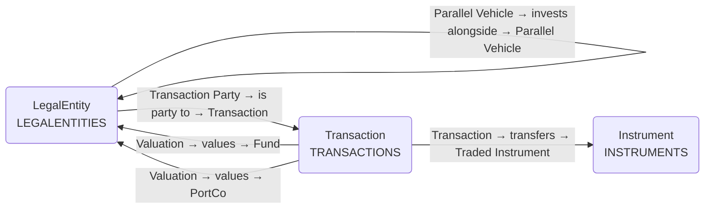
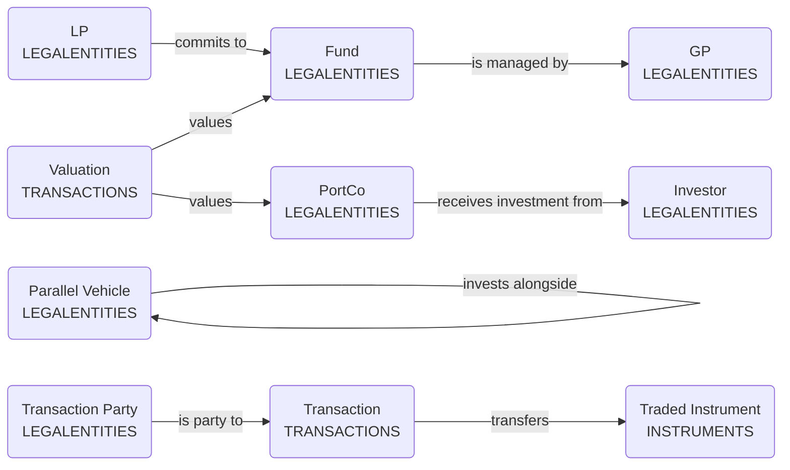
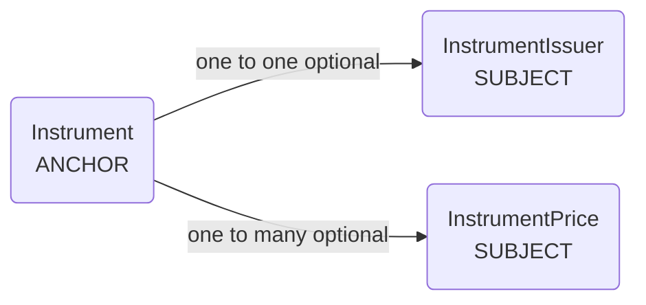
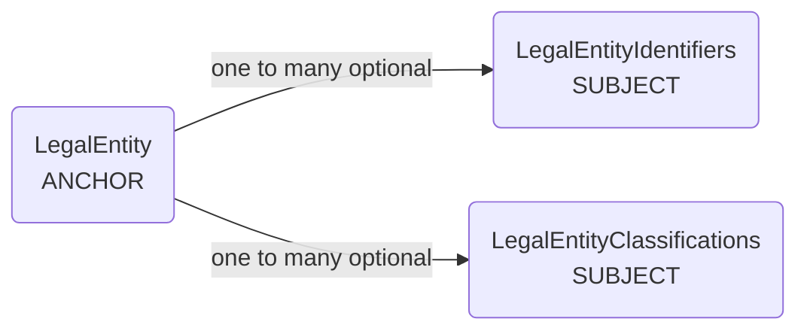
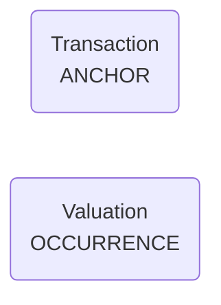

# Private Equity Fund Investment Structure - Data Design Document

## About This Document

This document sets out a data design for one field of business: what it covers, the requirements it serves, and the domains, roles, relationships, concepts and lists of values that make up the model. It is written in plain business English so that the people accountable for each part can read it, agree with it or correct it. Every requirement names its owner and its sources, every part of the model names the requirement it comes from, and every question the design must answer is shown with the route through the model that answers it.

## Version

| Domain | Document date | Package reference | Method version |
|---|---|---|---|
| Private Equity Fund Investment Structure | 2026-11-14 | PE-STRUCT-20261114-01 | 1.0 |

## Table of Contents

- [1 Introduction](#s1)
  - [1.1 About M&A Operating System](#s1-1)
  - [1.2 About the MAOS Practical Data Modelling Approach](#s1-2)
  - [1.3 Summary of Findings](#s1-3)
- [2 Scope](#s2)
  - [2.1 The business](#s2-1)
  - [2.2 In scope](#s2-2)
  - [2.3 Out of scope](#s2-3)
  - [2.4 Shared with other models](#s2-4)
  - [2.5 Assumptions](#s2-5)
  - [2.6 Open questions](#s2-6)
- [3 Business Requirements](#s3)
- [4 Data Requirements](#s4)
- [5 Data Model](#s5)
  - [5.1 Subject Domains](#s5-1)
  - [5.2 Canonical Roles](#s5-2)
  - [5.3 Role-Verb-Role Relationships](#s5-3)
  - [5.4 Concepts](#s5-4)
  - [5.5 Lookups and Values](#s5-5)
  - [5.6 Diagrams](#s5-6)
    - [5.6.1 Domains Data Model](#s5-6-1)
    - [5.6.2 Roles Data Model](#s5-6-2)
    - [5.6.3 Concept Models by Domain](#s5-6-3)
- [10 Outstanding Decisions](#s10)
- [Appendix A - Sources](#appendix-a)
- [Appendix E - Business Test Cases](#appendix-e)

This is the lite edition. The full edition adds source validation, findings on the existing model, conformance to DDA standards, exceptions, the new domains in full, the standards themselves and the data dictionary. Ask for the full edition to receive them.

# 1 Introduction

## 1.1 About M&A Operating System

### M&A Operating System — AI & Data Advisory Practice

**M&A Operating System (MAOS) helps organizations turn data into measurable business outcomes.**

Our **AI & Data Advisory Practice** works with senior business, data, analytics, and technology leaders to improve how their organizations use information to grow revenue, understand customers, make better decisions, reduce operating cost, manage risk, and enable analytics and AI.

Most organizations do not lack data. They struggle to turn the data they already have into information the business can consistently trust and use. Customer information is fragmented, reports disagree, data is repeatedly copied and transformed, and business definitions vary across teams. Analytics and AI initiatives then inherit the same problems.

We start with the business outcome and work backwards to the information, architecture, governance, operating model, and technology changes required to achieve it. That may mean improving customer identity to support segmentation and personalization, creating more reliable management information, simplifying complex data flows, or establishing the trusted business context required for AI.

Our work typically includes:

- Improving customer identity, segmentation, personalization, and revenue-growth capabilities
- Solving complex data management and data content design issues for Legal Entity, Beneficial Owner, People, Securities, Product Definition and transactional data
- Creating more consistent, timely, and trusted information for reporting, analytics, forecasting, and decision-making
- Designing and maintaining business-aligned data models for operational, analytical, and AI needs
- Resolving data quality, reliability, and performance issues caused by complex data flows, fragmented connectivity, duplication, and uncontrolled data propagation
- Establishing trusted views of customers, legal entities, products, accounts, agreements, and other critical business subjects
- Simplifying data architectures and reducing unnecessary movement, duplication, and technology complexity
- Establishing practical data governance, ownership, and AI readiness aligned to business priorities

Our goal is not simply to modernize data technology. It is to make information work better for the business.

**The value of a data program should ultimately be measured by what the business can do better because of it.**

### Find Out More

To learn more about how M&A Operating System can help your organization turn data into measurable business outcomes, visit [maoperatingsystem.com](https://www.maoperatingsystem.com).

For a direct conversation about your data, analytics, or AI priorities, contact [cdao-advisory@maoperatingsystem.com](mailto:cdao-advisory@maoperatingsystem.com).

## 1.2 About the MAOS Practical Data Modelling Approach

### About the M&A Operating System Practical Data Modelling Approach

The **M&A Operating System Practical Data Modelling Approach** is our proprietary, business-led methodology for translating business outcomes and challenges into data requirements and approved logical data models.

We engage business stakeholders and data-consuming groups to understand what they expect data services to make possible. Their needs are captured as plain-English business requirements, then translated through a controlled, traceable sequence of analysis and design activities. The methodology deliberately avoids overly technical terminology and modelling techniques, presenting the information in a business-readable, plain-English form. The resulting data modelling document follows the same sequence, allowing business stakeholders and data practitioners to understand, challenge, and approve the design.

### The Five-Step Process

#### Step 1 — Gather and Approve Business Requirements

We identify the outcomes stakeholders expect, the challenges they need to solve, and the business activities that data services must support. These are documented as plain-English requirements and approved as the scope and source of knowledge for the design.

#### Step 2 — Identify Actors, Objects, and Roles

Using **Subject-Based Data Modelling**, we identify the actors, roles, and objects in the business lifecycle and map them to domains representing the immutable subjects of the data. Domains describe the enduring people, organizations, things, places, and other subjects the business needs to understand—not the specific reason they appear in a single process.

Actors and objects are aligned to their underlying mastered subjects. Roles describe the capacity in which a subject participates in a relationship, process, or context. The same subject can perform several roles without being modelled repeatedly.

#### Step 3 — Identify Relationships

We identify the relationships between actors and objects and express them as clear business verbs—such as owns, manages, supplies, purchases, or is party to. This makes their meaning understandable and reviewable by business and data stakeholders.

#### Step 4 — Identify Lifecycle Events

We identify the events that actors, roles, and objects pass through as they live their natural lives and interact within business processes. These events include when an object is created, changed, activated, transferred, or retired; a subject assumes or ceases a role; or a relationship is established, modified, or ended. This determines what data must be captured at each stage.

#### Step 5 — Design Logical Data Models

The approved requirements, subjects, roles, relationships, and lifecycle events form the logical data model, documented through four connected components:

- **Data Domains** — governed groupings representing the immutable subjects of the data
- **Data Concepts** — the unique logical elements that make up the data known and recorded about each subject
- **Data Relationships** — the business connections between concepts, including the roles they perform
- **Data Attributes** — the individual data elements that describe each concept or relationship

Each component remains traceable to the requirement that established its need. The completed document provides the shared record business stakeholders and data practitioners use to review and approve the data requirements and model design.

## 1.3 Summary of Findings

The design represents a private equity sponsor's funds, vehicles, investors, portfolio companies and the ownership between them, from both the manager's side and the investor's side, using three shared domains that DDA already holds, Legal Entities, Instruments and Transactions, with two new concepts in the third, Transaction as its anchor and Valuation beside it. Fund, GP, LP, Investor and PortCo are roles that follow from the relationships, so a company that invests in one fund and is held by another is held once. Commitments, stakes, capital calls, distributions, acquisitions and exits carry their own dates and amounts, and every party to a transaction is recorded once, with whether it paid or received. Positions, unfunded commitments, look-through ownership and the fair value of a holding are worked out from them and never stored, while the price of an instrument and the value of a fund or company, stated on a named measure such as net asset value, equity value or enterprise value, are recorded as at their dates. Five design questions remain open: how a reported ownership percentage is reconciled with units held, whether the start and end dates on the limited partner commitment are kept, how the management company is linked to the sponsor's holding company, where the amount of each party to a transaction is held, and where a valuation sits in the Transactions domain.

| Item | Count |
|---|---|
| Business requirements | 13 |
| Data requirements | 8 |
| Subject domains | 3 |
| Canonical roles | 10 |
| Relationships | 8 |
| Concepts | 8 |
| Attributes | 38 |
| Lookups | 15 |
| Business test cases | 27 |
| Sources | 16 |

# 2 Scope

## 2.1 The business

A sponsor, held through a holding company, runs several private equity funds. Each fund is a partnership managed by a general partner, funded by commitments from limited partners, and invests in portfolio companies, directly or through holding vehicles. The same portfolio company may be held by more than one fund. The model serves both the sponsor's view (funds, vehicles, investments, ownership) and the investor's view (commitments, calls, distributions, the value of what is held).

| ID | Subgroup | Primary |
|---|---|---|
| SCG001 | Sponsor and fund family (GP view) | Yes |
| SCG002 | Investors and commitments (LP view) | No |
| SCG003 | Holding structure and ownership | No |

## 2.2 In scope

The design covers the following.

| ID | Statement |
|---|---|
| SCI001 | Sponsor and fund family: the holding company, management company, general partner, funds, and parallel, alternative-investment and co-investment vehicles. |
| SCI002 | Investors and commitments: limited partners, the capital each commits to each fund, the calls made against it and the distributions paid from it. |
| SCI003 | Holding structure: holding vehicles, tax blockers and special purpose vehicles, the ownership chain from fund to portfolio company, and control. |
| SCI004 | Portfolio companies and investments: acquisitions, follow-on investments and full or partial exits, the instruments held, cost, the fair value of an instrument as at a date, and the value of a fund or portfolio company as at a date on a named measure. |
| SCI005 | Cross-fund exposure and look-through: the shares in which several funds hold the same portfolio company, and ownership traced through the chain. |

## 2.3 Out of scope

The following belong to other models.

| ID | Statement | Owning model |
|---|---|---|
| SCO001 | Fee and carried-interest waterfall calculation and fund accounting ledgers. | Fund accounting model |
| SCO002 | Deal pipeline and prospect tracking. | Deal sourcing model |
| SCO003 | Portfolio company operating KPIs and ESG metrics. | Portfolio monitoring model |
| SCO004 | Investor marketing, fundraising pipeline and investor contact management. | Investor relations model |
| SCO005 | Tax filings and the production of regulatory returns. | Regulatory reporting model |

## 2.4 Shared with other models

These domains are shared with other models and are held once in DDA.

| ID | Shared domain | DDA |
|---|---|---|
| SCS001 | Legal Entities | [DMD000000012](https://datadesign.maoperatingsystem.com/models/domains/DMD000000012) |
| SCS002 | Instruments | [DMD000000015](https://datadesign.maoperatingsystem.com/models/domains/DMD000000015) |
| SCS003 | Transactions | [DMD000000022](https://datadesign.maoperatingsystem.com/models/domains/DMD000000022) |

## 2.5 Assumptions

The design rests on these assumptions.

| ID | Assumption |
|---|---|
| SCA001 | A portfolio company may be held by several funds, and a holding vehicle may be shared by several funds. |
| SCA002 | Every limited partner in a fund, including an individual or a principal making the general partner commitment, invests through a legal entity, so the People domain is not used. |
| SCA003 | Ownership is held per investor and investee for a period; the share looked through to the sponsor is worked out by following the chain. |
| SCA004 | Fair value is a price per unit of an instrument as at a date, shared by every fund holding that instrument. The value of a whole fund or company is a valuation as at a date on a named measure, and is never confused with a holding's fair value. |
| SCA005 | The model aligns to the ILPA templates and to legal entity identifiers (LEI); no ontology such as FIBO is adopted. |

## 2.6 Open questions

These questions have no answer yet.

| ID | Question |
|---|---|
| SCQ001 | Which account each transaction is booked to is recorded in the Accounts model (relationship AccountTransactionBooking, DMR000000038) and is not yet part of this design. Should the booking link be shown here as the connection to the Accounts and Corporate Banking models? |

# 3 Business Requirements

Each requirement states what the business needs in plain terms, names who owns it, and links to the sources that support it.

| ID | Category | Business requirement | Owner | Subgroup | Sources |
|---|---|---|---|---|---|
| REQ001 | Fund family | The business must know which general partner or manager runs each fund, and for what period, so that the funds of one sponsor can be listed and a change of manager is not lost. | Chief Financial Officer of the funds | Sponsor and fund family (GP view) | [SRC012](https://alterdomus.com/insight/private-equity-fund-structure/), [SRC004](https://ilpa.org/wp-content/uploads/2019/06/ILPA-Principles-3.0_2019.pdf), [SRC008](https://www.esma.europa.eu/sites/default/files/library/2015/11/2014-869.pdf) |
| REQ002 | Fund family | The business must hold the descriptive facts of each fund: its vintage year, strategy, reporting currency, country of domicile, target size, final close date and the end of its investment period. | Chief Financial Officer of the funds | Sponsor and fund family (GP view) | [SRC003](https://www.citco.com/insights/ilpa-reporting-and-new-performance-template), [SRC008](https://www.esma.europa.eu/sites/default/files/library/2015/11/2014-869.pdf), [SRC009](https://www.proskauer.com/alert/sec-adopts-private-fund-risk-reporting) |
| REQ003 | Fund family | The business must link each fund to the parallel, alternative-investment and co-investment vehicles that invest alongside it, and say which kind each is. | General Counsel (fund formation) | Sponsor and fund family (GP view) | [SRC013](https://aztec.group/wp-content/uploads/2022/07/Parallel-Fund-Structures-Article-_FINAL-1.pdf), [SRC009](https://www.proskauer.com/alert/sec-adopts-private-fund-risk-reporting), [SRC014](https://www.mayerbrown.com/ja/insights/publications/2024/07/subscription-credit-facilities-understanding-shared-blockers) |
| REQ006 | Holding structure | The business must record the stake each fund or vehicle holds in each company or vehicle below it, with the economic share, the voting share and whether it controls, for the period the stake was held, so the route from a fund to a portfolio company can be followed. | Head of Portfolio Management | Holding structure and ownership | [SRC010](https://gleif.org/en/lei-data/access-and-use-lei-data/level-2-data-who-owns-whom/roc-policy-on-level-2-data), [SRC011](https://www.gleif.org/about-lei/common-data-file-format/relationship-record-cdf-format), [SRC012](https://alterdomus.com/insight/private-equity-fund-structure/), [SRC008](https://www.esma.europa.eu/sites/default/files/library/2015/11/2014-869.pdf) |
| REQ007 | Holding structure | The business must show a portfolio company held by more than one fund with each fund's share, and must be able to work out what the whole sponsor holds in it by following the chain of holding vehicles. | Head of Compliance | Holding structure and ownership | [SRC004](https://ilpa.org/wp-content/uploads/2019/06/ILPA-Principles-3.0_2019.pdf), [SRC010](https://gleif.org/en/lei-data/access-and-use-lei-data/level-2-data-who-owns-whom/roc-policy-on-level-2-data), [SRC014](https://www.mayerbrown.com/ja/insights/publications/2024/07/subscription-credit-facilities-understanding-shared-blockers) |
| REQ011 | Holding structure | The business must say what each vehicle in the structure is for - management company, holding company, special purpose vehicle, tax blocker, fund vehicle or operating company. | General Counsel (fund formation) | Holding structure and ownership | [SRC012](https://alterdomus.com/insight/private-equity-fund-structure/), [SRC014](https://www.mayerbrown.com/ja/insights/publications/2024/07/subscription-credit-facilities-understanding-shared-blockers) |
| REQ010 | Identification | The business must identify every fund, vehicle and portfolio company by its legal entity identifier and other recognised identifiers, so the structure ties to regulatory filings and to published ownership data. | Head of Compliance | Holding structure and ownership | [SRC010](https://gleif.org/en/lei-data/access-and-use-lei-data/level-2-data-who-owns-whom/roc-policy-on-level-2-data), [SRC011](https://www.gleif.org/about-lei/common-data-file-format/relationship-record-cdf-format), [SRC009](https://www.proskauer.com/alert/sec-adopts-private-fund-risk-reporting), [SRC008](https://www.esma.europa.eu/sites/default/files/library/2015/11/2014-869.pdf) |
| REQ013 | Identification | A company that is a limited partner in one fund and a portfolio company of another must be held once, with each position derived from what it does, not from a second record. | Chief Data Officer | Holding structure and ownership | [SRC010](https://gleif.org/en/lei-data/access-and-use-lei-data/level-2-data-who-owns-whom/roc-policy-on-level-2-data), [SRC012](https://alterdomus.com/insight/private-equity-fund-structure/) |
| REQ008 | Investments | The business must record each acquisition, follow-on investment and full or partial exit: its date, the instrument involved, and the amount and number of units paid or received by each fund or counterparty. | Chief Financial Officer of the funds | Holding structure and ownership | [SRC003](https://www.citco.com/insights/ilpa-reporting-and-new-performance-template), [SRC015](https://www.acaglobal.com/insights/regulatory-considerations-continuation-funds), [SRC004](https://ilpa.org/wp-content/uploads/2019/06/ILPA-Principles-3.0_2019.pdf) |
| REQ012 | Investments | The business must record a transfer of a holding from one fund to a continuation vehicle of the same sponsor as one event with both funds on it, and show the limited partners' commitments to the continuation vehicle as such. | General Counsel (fund formation) | Holding structure and ownership | [SRC015](https://www.acaglobal.com/insights/regulatory-considerations-continuation-funds) |
| REQ004 | Investors and commitments | The business must record the capital each limited partner, including the general partner itself, commits to each fund, its type, its status and the period it runs, so the register of limited partners and each limited partner's share of a fund can be stated for any date. | Head of Investor Relations | Investors and commitments (LP view) | [SRC001](https://ilpa.org/resources-tools/resource-library/capital-call-distribution-template/), [SRC004](https://ilpa.org/wp-content/uploads/2019/06/ILPA-Principles-3.0_2019.pdf), [SRC016](https://www.allocations.com/insights/gp-commitment-in-funds-and-spvs), [SRC015](https://www.acaglobal.com/insights/regulatory-considerations-continuation-funds) |
| REQ005 | Investors and commitments | The business must record every capital call and every distribution, with the amount each investor paid or received split by purpose, so each notice can be reproduced and each limited partner's unfunded commitment worked out. | Chief Financial Officer of the funds | Investors and commitments (LP view) | [SRC001](https://ilpa.org/resources-tools/resource-library/capital-call-distribution-template/), [SRC002](https://katten.com/ilpa-updates-capital-call-distribution-template-implications-for-gps-and-lps) |
| REQ009 | Valuation | The business must record the fair value per unit of each instrument held, as at each reporting date, with its level in the fair value hierarchy, and the value of each fund and portfolio company as at a date, stated on a named measure such as net asset value, equity value or enterprise value. | Head of Portfolio Valuation | Investors and commitments (LP view) | [SRC005](https://www.bvca.co.uk/Policy/Key-Policy-Areas/Accounting/IPEV-Valuation-Guidelines), [SRC006](https://www.redwoodvaluation.com/blog/asc-820-private-equity), [SRC007](https://www.klgates.com/thought-leadership/A-First-Look-at-the-CFA-Institutes-Final-2020-GIPS-Standards-07-01-2019), [SRC003](https://www.citco.com/insights/ilpa-reporting-and-new-performance-template) |

# 4 Data Requirements

Each data requirement says what must be recorded, what must be answerable, whether answers are asked as at a date, and what must be prevented. "As at a date" means some questions ask for the position on a past date, so history is kept; "Current" means only the present position is asked for. The last column shows what in the model prevents it.

| ID | Must record | Must answer | As at | Must prevent | Business requirements | Prevented by |
|---|---|---|---|---|---|---|
| DRQ001 | The general partner or manager of each fund, with the period it manages Each fund's vintage year, strategy, reporting currency, domicile, target size, final close date and investment period end | Which general partner manages fund F as at a date? Which funds does general partner G manage? Which funds have a given vintage year and strategy? | As at a date | A fund having two managers at the same time A fund strategy outside the agreed list | [REQ001](#req001), [REQ002](#req002) | relationship [LegalEntityFundManagedBy](#rel001) (5.3) list [LegalEntityFundStrategyTypes](#lkp001) (5.5) |
| DRQ002 | What each legal entity is for in the structure Each legal entity's identifiers, including its legal entity identifier, with the period each is valid | Which vehicles in the structure are tax blockers? What is the legal entity identifier of entity E? | As at a date | A vehicle purpose outside the agreed list An identifier of unknown kind | [REQ010](#req010), [REQ011](#req011), [REQ013](#req013) | list [LegalEntityClassificationTypes3](#lkp009) (5.5) list [LegalEntityIdentifierTypes](#lkp014) (5.5) |
| DRQ003 | Which vehicles invest alongside each fund, the kind of each, and the period | Which vehicles invest alongside fund F? | As at a date | A kind of side-by-side vehicle outside the agreed list | [REQ003](#req003) | list [LegalEntityFundParallelTypes](#lkp003) (5.5) |
| DRQ004 | Each investor's commitment to each fund: amount, type, status, start and end | What is limited partner L's commitment to fund F as at a date? Who are the limited partners in fund F? What is the general partner's own commitment to fund F? | As at a date | A limited partner being limited to one fund or a fund to one limited partner A commitment type outside the agreed list | [REQ004](#req004), [REQ012](#req012) | relationship [LegalEntityFundLPCommitment](#rel002) (5.3) list [LegalEntityFundLPCommitmentTypes](#lkp010) (5.5) |
| DRQ005 | Each capital call and distribution: type, date, currency The amount each limited partner or other party paid or received, split by purpose | How much did limited partner L pay in call C and for what purposes? What was distributed to limited partner L in a year and of what kind? What is limited partner L's unfunded commitment to fund F as at a date? | As at a date | A call or distribution amount left blank A purpose outside the agreed list A party recorded without saying whether it paid or received | [REQ005](#req005) | mandatory field LegalEntityTransactionPartyAmount list [UniversalTransactionComponentTypes](#lkp005) (5.5) mandatory field LegalEntityTransactionPartySide |
| DRQ006 | The stake each investor holds in each investee: economic share, voting share, control type, and the period | What share of portfolio company P does each holder own as at a date? Through which vehicles does fund F hold portfolio company P? What does the whole sponsor hold in portfolio company P, looking through the chain? Which funds hold the same portfolio company, and in what shares? | As at a date | A stake with no share recorded A control type outside the agreed list A vehicle or investor being limited to a single holder or stake | [REQ006](#req006), [REQ007](#req007), [REQ013](#req013) | mandatory field LegalEntityPEInvestorOwnershipPercentage list [LegalEntityPEInvestorControlTypes](#lkp002) (5.5) relationship [LegalEntityPEInvestor](#rel003) (5.3) |
| DRQ007 | Each acquisition, follow-on, partial exit, full exit and continuation transfer: type, date, currency The instrument involved and its issuer The amount and the number of units paid or received by each party | What did fund F pay for portfolio company P and when? Which funds took part in the follow-on investment and for how much each? What were the proceeds of a partial exit, and who received them? How many units of instrument I does fund F hold as at a date? Which transfer moved portfolio company P from fund F to a continuation vehicle? | As at a date | A single transaction covering two different instruments A transaction type outside the agreed list | [REQ008](#req008), [REQ012](#req012), [REQ007](#req007) | relationship [TransactionInstrumentTraded](#rel007) (5.3) list [TransactionTypes](#lkp004) (5.5) |
| DRQ008 | The fair value per unit of an instrument as at a date, its price type and its fair value hierarchy level The value of a fund or portfolio company as at a date, on a named measure of value | What was the fair value per unit of instrument I as at a date, and at which hierarchy level? What was fund F's net asset value as at a date? What was portfolio company P's enterprise value as at a date? What is the fair value of fund F's holding in portfolio company P as at a date? | As at a date | A price with no date A hierarchy level outside the three allowed A valuation with no measure, or a measure outside the agreed list | [REQ009](#req009) | mandatory field InstrumentPriceDate list [InstrumentPriceFairValueLevels](#lkp006) (5.5) list [ValuationMeasures](#lkp008) (5.5) |

# 5 Data Model

## 5.1 Subject Domains

The model uses three existing DDA domains. Everything after this table is said in their terms: a role is played by a domain, a relationship runs between two, a concept hangs under one.

| Domain ID | Domain | DDA | Anchor concept | Definition | Shared | Roles | Concepts |
|---|---|---|---|---|---|---|---|
| DOM002 | Instruments | [DMD000000015](https://datadesign.maoperatingsystem.com/models/domains/DMD000000015) | Instrument | The Instruments (aka Securities, Investable Assets) Domain contains records describing tradable asset such as an Equity, Debt/Credit, Warrant, Right, Option, Index, Fund, Spot Rate, a Point on an interest rate curve, Loan or FX/Currencies etc.  Often issued by a Government or Company Entity. An instrument can be listed on an exchange or privately traded between two or more entities. | Yes | [1](#s5-2) | [3](#s5-4) |
| DOM001 | LegalEntities | [DMD000000012](https://datadesign.maoperatingsystem.com/models/domains/DMD000000012) | LegalEntity | Legal Entities — organisations, funds, and counterparties relevant to M&A and investment activity, including their financial statements, registrations, and compliance status. | Yes | [7](#s5-2) | [3](#s5-4) |
| DOM003 | Transactions | [DMD000000022](https://datadesign.maoperatingsystem.com/models/domains/DMD000000022) | Transaction | Transactions are records of an individual trade/transaction which represents a transfer of ownership or investment usually in return for capital (cash) in a specific security or entity or asset. Generally, transactions result in the change of a position or balance within a record keeping account | Yes | [2](#s5-2) | [2](#s5-4) |

## 5.2 Canonical Roles

A role is what a subject is to another while an arrangement between them holds. Each role is defined once and is never stored on the subject.

| Domain | Role ID | Role | Definition | Also called | Requirements |
|---|---|---|---|---|---|
| Instruments | ROL010 | Traded Instrument (Traded Instruments) | An instrument is a Traded Instrument while a transaction transfers it. It says the instrument was the subject of an event, which is not the same as the instrument's issuer. | Security Traded | [REQ008](#req008) |
| LegalEntities | ROL001 | Fund (Funds) | A legal entity is a Fund while it is managed by another legal entity as a pool of investor capital. It says the body is run by a manager for its investors, which is not the same as being a PortCo, a body in which others hold a stake. | Partnership | [REQ001](#req001), [REQ002](#req002), [REQ004](#req004) |
| LegalEntities | ROL002 | GP (GPs) | A legal entity is a GP while it manages a fund. It says the body runs the fund and answers for it, which is not the same as being an Investor, a body that holds a stake in something. | General Partner, Manager | [REQ001](#req001), [REQ004](#req004) |
| LegalEntities | ROL004 | Investor (Investors) | A legal entity is an Investor while it invests in another legal entity. It says the body owns part of something below it in the structure, which is not the same as being an LP, which has only promised capital to a fund. | Owner, Shareholder | [REQ006](#req006), [REQ007](#req007), [REQ013](#req013) |
| LegalEntities | ROL003 | LP (LPs) | A legal entity is an LP while it commits capital to a fund. It says the body has promised money to a fund and shares in its returns, which is not the same as being an Investor in a company, a body that holds a stake in a company. | Limited Partner, Fund Investor | [REQ004](#req004), [REQ005](#req005) |
| LegalEntities | ROL006 | Parallel Vehicle (Parallel Vehicles) | A legal entity is a Parallel Vehicle while it invests alongside another fund. It says the body takes part in the same investments as a fund, which is not the same as being that fund's investor. | Side Vehicle, Co-invest Vehicle, Alternative Investment Vehicle | [REQ003](#req003) |
| LegalEntities | ROL005 | PortCo (PortCos) | A legal entity is a PortCo while another legal entity invests in it. It covers an operating company and also a holding vehicle set up to hold one, and says something is held in it, which is not the same as being a Fund, a body that is managed for investors. | Portfolio Company, Investee | [REQ006](#req006), [REQ007](#req007), [REQ011](#req011) |
| LegalEntities | ROL008 | Transaction Party (Transaction Parties) | A legal entity is a Transaction Party while it takes part in a transaction as a payer, a payee, a buyer, a seller or an issuer. It says who the money or holdings moved from or to, which is not the same as owning an account the movement passed through. | Payer, Payee, Buyer, Seller, Counterparty | [REQ005](#req005), [REQ008](#req008) |
| Transactions | ROL007 | Transaction (Transactions) | A transaction is a Transaction in a relationship while it is the movement of money, holdings or ownership that the other subject took part in or was recorded against. It is the same role wherever a transaction meets another subject, which is how those subjects join up around it. It is the movement itself, not the parties to it. | Event, Transfer | [REQ005](#req005), [REQ008](#req008) |
| Transactions | ROL011 | Valuation (Valuations) | A valuation is a Valuation in a relationship while it is a judgement of the worth of something on a date, as seen from the thing that was valued. It says the figure is a view taken on a date and not a movement of money, so it is not a transaction. A new valuation does not replace an earlier one; each is kept for its own date. | Appraisal | [REQ009](#req009) |

## 5.3 Role-Verb-Role Relationships

Each row reads as a sentence: the source domain, as the source role, performs the forward verb on the destination domain, as the target role. The inverse verb reads the other way.

| Relationship | Data Req. ID | Source Domain | Source role | Forward verb | Target role | Destination Domain | Inverse verb | Forward view | Mirror view | Cardinality | Dates | DDA |
|---|---|---|---|---|---|---|---|---|---|---|---|---|
| REL001 LegalEntityFundManagedBy | [DRQ001](#drq001) | LegalEntities | [ROL001](#rol001) Fund | Is Managed By | [ROL002](#rol002) GP | LegalEntities | Manages | LegalEntityGPs | LegalEntityFunds | Many to One | Yes | [DMR000000001](https://datadesign.maoperatingsystem.com/models/relationships/DMR000000001) |
| REL002 LegalEntityFundLPCommitment | [DRQ004](#drq004) | LegalEntities | [ROL003](#rol003) LP | Commits To | [ROL001](#rol001) Fund | LegalEntities | Receives Commitment From | LegalEntityLPFundCommitments | LegalEntityLPs | Many to Many | Yes | [DMR000000004](https://datadesign.maoperatingsystem.com/models/relationships/DMR000000004) |
| REL004 LegalEntityFundParallels | [DRQ003](#drq003) | LegalEntities | [ROL006](#rol006) Parallel Vehicle | Invests Alongside | [ROL006](#rol006) Parallel Vehicle | LegalEntities | Invests Alongside | LegalEntityParallelVehicles | LegalEntityParallelVehicles | Many to Many | Yes | NEW |
| REL003 LegalEntityPEInvestor | [DRQ006](#drq006) | LegalEntities | [ROL005](#rol005) PortCo | Receives Investment From | [ROL004](#rol004) Investor | LegalEntities | Invests In | LegalEntityInvestors | LegalEntityPortCos | Many to Many | Yes | [DMR000000002](https://datadesign.maoperatingsystem.com/models/relationships/DMR000000002) |
| REL005 LegalEntityTransactionParty | [DRQ005](#drq005), [DRQ007](#drq007) | LegalEntities | [ROL008](#rol008) Transaction Party | Is Party To | [ROL007](#rol007) Transaction | Transactions | Has Party | LegalEntityTransactions | TransactionLegalEntityParties | Many to Many | No | [DMR000000037](https://datadesign.maoperatingsystem.com/models/relationships/DMR000000037) |
| REL007 TransactionInstrumentTraded | [DRQ007](#drq007) | Transactions | [ROL007](#rol007) Transaction | Transfers | [ROL010](#rol010) Traded Instrument | Instruments | Is Transferred By | TransactionTradedInstruments | InstrumentTransactions | Many to One | No | NEW |
| REL008 ValuationPrivateEquityFundValued | [DRQ008](#drq008) | Transactions | [ROL011](#rol011) Valuation | Values | [ROL001](#rol001) Fund | LegalEntities | Is Valued By | ValuationPrivateEquityFund | PrivateEquityFundValuations | Many to One | No | [DMR000000039](https://datadesign.maoperatingsystem.com/models/relationships/DMR000000039) |
| REL009 ValuationPrivateEquityPortCoValued | [DRQ008](#drq008) | Transactions | [ROL011](#rol011) Valuation | Values | [ROL005](#rol005) PortCo | LegalEntities | Is Valued By | ValuationPrivateEquityPortCo | PrivateEquityPortCoValuations | Many to One | No | [DMR000000050](https://datadesign.maoperatingsystem.com/models/relationships/DMR000000050) |

What each relationship means:

| Relationship | Definition |
|---|---|
| REL001 LegalEntityFundManagedBy | A fund is managed by a general partner or manager for as long as the arrangement lasts, and a fund has one manager at a time, so the periods of its managers do not overlap. It holds the facts about the fund that belong to neither body alone: its vintage year, strategy, reporting currency, domicile, target size, final close date and the end of its investment period. If the manager of a fund is replaced, these facts are repeated on the new arrangement. It is not the fund's limited partners, who are linked by commitments. |
| REL002 LegalEntityFundLPCommitment | A limited partner has committed capital to a fund for as long as the commitment runs. A limited partner may commit to several funds and a fund has many limited partners, and a second purchase of an existing interest is a further commitment of its own type. The amount, type and status belong to the commitment. It is not the money called or paid out, which is recorded as transactions. |
| REL003 LegalEntityPEInvestor | A fund or vehicle holds a stake in a portfolio company or a holding vehicle for as long as it holds it. Several investors may hold one company and one investor may hold several. The economic share, voting share and control type belong to the stake. It is not what was paid for the stake, which is recorded as transactions. |
| REL004 LegalEntityFundParallels | Two funds or vehicles invest side by side, for example a main fund and its parallel fund, an alternative investment vehicle or a co-investment vehicle, for as long as they do. The kind of vehicle belongs to the link. It is not an investor's commitment to a fund. |
| REL005 LegalEntityTransactionParty | A legal entity takes part in a transaction as a party to it, whether it pays or receives: the limited partner paying into a capital call, the fund receiving it, the fund paying for an acquisition, or the seller receiving the price. A transaction has several parties and a legal entity takes part in many transactions. Each party's record says whether it paid or received, the amount for each stated purpose and, where an instrument changed hands, the number of units. The date and currency belong to the transaction. It does not say which account the money passed through. |
| REL007 TransactionInstrumentTraded | A transaction concerns one instrument, and many transactions may concern the same instrument. It names what was bought or sold. A capital call or distribution concerns no instrument. |
| REL008 ValuationPrivateEquityFundValued | A valuation judges the worth of one fund on a date and on a named measure, such as its net asset value. A fund is valued many times, once for each date and measure, and each valuation is about one fund. The date, amount, measure and currency belong to the valuation. It does not cover the value of a company the fund holds, which is linked to that company, nor the value of an instrument, which is held with the instrument's price, and it is not a transaction, because nothing is paid or received. |
| REL009 ValuationPrivateEquityPortCoValued | A valuation judges the worth of one portfolio company on a date and on a named measure, such as its equity value or enterprise value. A company is valued many times, once for each date and measure, and each valuation is about one company. The date, amount, measure and currency belong to the valuation. It does not cover the value of a fund, which is linked to the fund, nor the value of an instrument, which is held with the instrument's price, and it is not a transaction, because nothing is paid or received. |

## 5.4 Concepts

Every concept in scope appears here, whether DDA already holds it or it is to be created. The definition says what there is one of.

| Domain | Concept ID | Concept | DDA | Definition | Parent | Cardinality to parent | Kind | Mastery | From |
|---|---|---|---|---|---|---|---|---|---|
| Instruments | SBJ005 | Instrument | [DMC000000121](https://datadesign.maoperatingsystem.com/models/concepts/DMC000000121) | There is one of these for each security or other tradable holding right that can be bought, held or sold, such as the ordinary shares of a portfolio company or a shareholder loan note. If you need to say what a fund bought or sold, this is what you go by. It is not the company that issued it, and not the number of units a fund holds, which is worked out from transactions. |  |  | Subject | Mastered | [DRQ007](#drq007), [DRQ008](#drq008) |
| Instruments | SBJ006 | InstrumentIssuer | [DMC000000125](https://datadesign.maoperatingsystem.com/models/concepts/DMC000000125) | There is one of these for each instrument, naming the legal entity that issued it. If you need to know which portfolio company or vehicle an instrument is a claim on, this is what you go by. It is not a stake held by a fund, which is recorded between the fund and the company. | Instrument | One To One Optional | Subject | Mastered | [DRQ007](#drq007) |
| Instruments | SBJ007 | InstrumentPrice | [DMC000000128](https://datadesign.maoperatingsystem.com/models/concepts/DMC000000128) | There is one of these for each price of an instrument as at a date and of a given price type. In this structure it holds the fair value per unit of a private holding, with its level in the fair value hierarchy. If you need to value any fund's holding of an instrument, multiply the units it holds by this. It is not the amount a fund paid, which is held on the transaction. | Instrument | One To Many Optional | Subject | Mastered | [DRQ008](#drq008) |
| LegalEntities | SBJ001 | LegalEntity | [DMC000000106](https://datadesign.maoperatingsystem.com/models/concepts/DMC000000106) | There is one of these for each company, partnership, fund or other body that can hold rights and owe duties in its own name. If you need to know who a fund, a general partner, an investor, a holding vehicle or a portfolio company is, this is what you go by. What a body is to another - manager, investor, portfolio company - is not stored here; it comes from the relationships between them. |  |  | Subject | Mastered | [DRQ001](#drq001), [DRQ002](#drq002), [DRQ004](#drq004), [DRQ005](#drq005), [DRQ006](#drq006), [DRQ007](#drq007) |
| LegalEntities | SBJ003 | LegalEntityClassifications | [DMC000000110](https://datadesign.maoperatingsystem.com/models/concepts/DMC000000110) | There is one of these for each classification applied to a legal entity. In this structure it names what a vehicle is for: management company, holding company, special purpose vehicle, tax blocker, fund vehicle or operating company. If you need to know which vehicles in a structure are tax blockers, this is what you go by. It is not a statement of what a body is to another, which comes from relationships. | LegalEntity | One To Many Optional | Subject | Mastered | [DRQ002](#drq002) |
| LegalEntities | SBJ002 | LegalEntityIdentifiers | [DMC000000023](https://datadesign.maoperatingsystem.com/models/concepts/DMC000000023) | There is one of these for each identifier a legal entity is known by, such as its legal entity identifier, a registration number or a number used inside the firm. If you need to match a fund, vehicle or portfolio company to a regulatory filing or to published ownership data, this is what you go by. It does not say which identifier is preferred. | LegalEntity | One To Many Optional | Subject | Mastered | [DRQ002](#drq002) |
| Transactions | SBJ008 | Transaction | NEW | There is one of these for each time money or a holding moved between parties in a single event, such as a capital call, a distribution, an acquisition, a follow-on investment, a partial or full exit, or a transfer to a continuation vehicle. If you need to know what happened on a date, what kind of event it was and who paid or received what, this is what you go by. It does not hold a fund's position, which is worked out from all of its transactions. |  |  | Occurrence | Mastered | [DRQ005](#drq005), [DRQ007](#drq007) |
| Transactions | SBJ009 | Valuation | NEW | There is one of these for each valuation of a legal entity as at a date and on a named measure of value. In this structure it holds the net asset value of a fund and the equity value or enterprise value of a portfolio company or vehicle. If you need the value of a fund or a company at a reporting date, this is what you go by. A new valuation does not replace an earlier one, because each is kept for its own date. It is a view taken on a date and not a movement of money, so it is not a transaction. It is the value of the whole body and not the value of one fund's holding in it, which is the price per unit multiplied by the units held, and it is not the fair value of a single instrument, which is held with the instrument's price. |  |  | Occurrence | Mastered | [DRQ008](#drq008) |

## 5.5 Lookups and Values

Each lookup is a governed list of business terms. Lists shared across models come first.

#### LKP013 MasterStatusTypes

| Lookup ID | Lookup | Scope | Definition | Used by | DDA | From |
|---|---|---|---|---|---|---|
| LKP013 | MasterStatusTypes | Universal | The standard life-cycle states of a record: active, draft and inactive. The data standards owner decides what goes on it. | LegalEntityFundLPCommitmentStatus, TransactionStatus | [DLT000000067](https://datadesign.maoperatingsystem.com/models/lookup-types/DLT000000067) | [DRQ004](#drq004), [DRQ007](#drq007) |

| Value code | Name | Definition |
|---|---|---|
| ACTIVE | Active | In force and in good standing. |
| DRAFT | Draft | Still being agreed and not yet in force. |
| INACTIVE | Inactive | Ended and not in force. |

#### LKP012 UniversalCountryCodes

| Lookup ID | Lookup | Scope | Definition | Used by | DDA | From |
|---|---|---|---|---|---|---|
| LKP012 | UniversalCountryCodes | Universal | The standard list of countries used across all models. The data standards owner decides what goes on it. | LegalEntityFundManagedByDomicile | [DLT000000071](https://datadesign.maoperatingsystem.com/models/lookup-types/DLT000000071) | [DRQ001](#drq001) |

| Value code | Name | Definition |
|---|---|---|
| ALB | Albania | Albania(ALB) |
| DZA | Algeria | Algeria(DZA) |
| ASM | American Samoa | American Samoa(ASM) |
| AND | Andorra | Andorra(AND) |
| AGO | Angola | Angola(AGO) |
| AIA | Anguilla | Anguilla(AIA) |
| ATA | Antarctica | Antarctica(ATA) |
| ATG | Antigua and Barbuda | Antigua and Barbuda(ATG) |
| ARG | Argentina | Argentina(ARG) |
| ARM | Armenia | Armenia(ARM) |
| ABW | Aruba | Aruba(ABW) |
| AUS | Australia | Australia(AUS) |
| AUT | Austria | Austria(AUT) |
| AZE | Azerbaijan | Azerbaijan(AZE) |
| BHS | Bahamas (the) | Bahamas (the)(BHS) |
| BHR | Bahrain | Bahrain(BHR) |
| BGD | Bangladesh | Bangladesh(BGD) |
| BRB | Barbados | Barbados(BRB) |
| BLR | Belarus | Belarus(BLR) |
| BEL | Belgium | Belgium(BEL) |
| BLZ | Belize | Belize(BLZ) |
| BEN | Benin | Benin(BEN) |
| BMU | Bermuda | Bermuda(BMU) |
| BTN | Bhutan | Bhutan(BTN) |
| BOL | Bolivia (Plurinational State of) | Bolivia (Plurinational State of)(BOL) |
| BES | Bonaire, Sint Eustatius and Saba | Bonaire, Sint Eustatius and Saba(BES) |
| BIH | Bosnia and Herzegovina | Bosnia and Herzegovina(BIH) |
| BWA | Botswana | Botswana(BWA) |
| BVT | Bouvet Island | Bouvet Island(BVT) |
| BRA | Brazil | Brazil(BRA) |
| IOT | British Indian Ocean Territory (the) | British Indian Ocean Territory (the)(IOT) |
| BRN | Brunei Darussalam | Brunei Darussalam(BRN) |
| BGR | Bulgaria | Bulgaria(BGR) |
| BFA | Burkina Faso | Burkina Faso(BFA) |
| BDI | Burundi | Burundi(BDI) |
| CPV | Cabo Verde | Cabo Verde(CPV) |
| KHM | Cambodia | Cambodia(KHM) |
| CMR | Cameroon | Cameroon(CMR) |
| CAN | Canada | Canada(CAN) |
| CYM | Cayman Islands (the) | Cayman Islands (the)(CYM) |
| CAF | Central African Republic (the) | Central African Republic (the)(CAF) |
| TCD | Chad | Chad(TCD) |
| CHL | Chile | Chile(CHL) |
| CHN | China | China(CHN) |
| CXR | Christmas Island | Christmas Island(CXR) |
| CCK | Cocos (Keeling) Islands (the) | Cocos (Keeling) Islands (the)(CCK) |
| COL | Colombia | Colombia(COL) |
| COM | Comoros (the) | Comoros (the)(COM) |
| COD | Congo (the Democratic Republic of the) | Congo (the Democratic Republic of the)(COD) |
| COG | Congo (the) | Congo (the)(COG) |
| COK | Cook Islands (the) | Cook Islands (the)(COK) |
| CRI | Costa Rica | Costa Rica(CRI) |
| HRV | Croatia | Croatia(HRV) |
| CUB | Cuba | Cuba(CUB) |
| CUW | Curaçao | Curaçao(CUW) |
| CYP | Cyprus | Cyprus(CYP) |
| CZE | Czechia | Czechia(CZE) |
| CIV | Côte d'Ivoire | Côte d'Ivoire(CIV) |
| DNK | Denmark | Denmark(DNK) |
| DJI | Djibouti | Djibouti(DJI) |
| DMA | Dominica | Dominica(DMA) |
| DOM | Dominican Republic (the) | Dominican Republic (the)(DOM) |
| ECU | Ecuador | Ecuador(ECU) |
| EGY | Egypt | Egypt(EGY) |
| SLV | El Salvador | El Salvador(SLV) |
| GNQ | Equatorial Guinea | Equatorial Guinea(GNQ) |
| ERI | Eritrea | Eritrea(ERI) |
| EST | Estonia | Estonia(EST) |
| SWZ | Eswatini | Eswatini(SWZ) |
| ETH | Ethiopia | Ethiopia(ETH) |
| FLK | Falkland Islands (the) [Malvinas] | Falkland Islands (the) [Malvinas](FLK) |
| FRO | Faroe Islands (the) | Faroe Islands (the)(FRO) |
| FJI | Fiji | Fiji(FJI) |
| FIN | Finland | Finland(FIN) |
| FRA | France | France(FRA) |
| GUF | French Guiana | French Guiana(GUF) |
| PYF | French Polynesia | French Polynesia(PYF) |
| ATF | French Southern Territories (the) | French Southern Territories (the)(ATF) |
| GAB | Gabon | Gabon(GAB) |
| GMB | Gambia (the) | Gambia (the)(GMB) |
| GEO | Georgia | Georgia(GEO) |
| DEU | Germany | Germany(DEU) |
| GHA | Ghana | Ghana(GHA) |
| GIB | Gibraltar | Gibraltar(GIB) |
| GRC | Greece | Greece(GRC) |
| GRL | Greenland | Greenland(GRL) |
| GRD | Grenada | Grenada(GRD) |
| GLP | Guadeloupe | Guadeloupe(GLP) |
| GUM | Guam | Guam(GUM) |
| GTM | Guatemala | Guatemala(GTM) |
| GGY | Guernsey | Guernsey(GGY) |
| GIN | Guinea | Guinea(GIN) |
| GNB | Guinea-Bissau | Guinea-Bissau(GNB) |
| GUY | Guyana | Guyana(GUY) |
| HMD | Heard Island and McDonald Islands | Heard Island and McDonald Islands(HMD) |
| VAT | Holy See (the) | Holy See (the)(VAT) |
| HND | Honduras | Honduras(HND) |
| HKG | Hong Kong | Hong Kong(HKG) |
| HUN | Hungary | Hungary(HUN) |
| ISL | Iceland | Iceland(ISL) |
| IND | India | India(IND) |
| IDN | Indonesia | Indonesia(IDN) |
| IRN | Iran (Islamic Republic of) | Iran (Islamic Republic of)(IRN) |
| IRQ | Iraq | Iraq(IRQ) |
| IRL | Ireland | Ireland(IRL) |
| IMN | Isle of Man | Isle of Man(IMN) |
| ISR | Israel | Israel(ISR) |
| ITA | Italy | Italy(ITA) |
| JAM | Jamaica | Jamaica(JAM) |
| JPN | Japan | Japan(JPN) |
| JEY | Jersey | Jersey(JEY) |
| JOR | Jordan | Jordan(JOR) |
| KAZ | Kazakhstan | Kazakhstan(KAZ) |
| KEN | Kenya | Kenya(KEN) |
| KIR | Kiribati | Kiribati(KIR) |
| PRK | Korea (the Democratic People's Republic of) | Korea (the Democratic People's Republic of)(PRK) |
| KOR | Korea (the Republic of) | Korea (the Republic of)(KOR) |
| KWT | Kuwait | Kuwait(KWT) |
| KGZ | Kyrgyzstan | Kyrgyzstan(KGZ) |
| LAO | Lao People's Democratic Republic (the) | Lao People's Democratic Republic (the)(LAO) |
| LVA | Latvia | Latvia(LVA) |
| LBN | Lebanon | Lebanon(LBN) |
| LSO | Lesotho | Lesotho(LSO) |
| LBR | Liberia | Liberia(LBR) |
| LBY | Libya | Libya(LBY) |
| LIE | Liechtenstein | Liechtenstein(LIE) |
| LTU | Lithuania | Lithuania(LTU) |
| LUX | Luxembourg | Luxembourg(LUX) |
| MAC | Macao | Macao(MAC) |
| MDG | Madagascar | Madagascar(MDG) |
| MWI | Malawi | Malawi(MWI) |
| MYS | Malaysia | Malaysia(MYS) |
| MDV | Maldives | Maldives(MDV) |
| MLI | Mali | Mali(MLI) |
| MLT | Malta | Malta(MLT) |
| MHL | Marshall Islands (the) | Marshall Islands (the)(MHL) |
| MTQ | Martinique | Martinique(MTQ) |
| MRT | Mauritania | Mauritania(MRT) |
| MUS | Mauritius | Mauritius(MUS) |
| MYT | Mayotte | Mayotte(MYT) |
| MEX | Mexico | Mexico(MEX) |
| FSM | Micronesia (Federated States of) | Micronesia (Federated States of)(FSM) |
| MDA | Moldova (the Republic of) | Moldova (the Republic of)(MDA) |
| MCO | Monaco | Monaco(MCO) |
| MNG | Mongolia | Mongolia(MNG) |
| MNE | Montenegro | Montenegro(MNE) |
| MSR | Montserrat | Montserrat(MSR) |
| MAR | Morocco | Morocco(MAR) |
| MOZ | Mozambique | Mozambique(MOZ) |
| MMR | Myanmar | Myanmar(MMR) |
| NAM | Namibia | Namibia(NAM) |
| NRU | Nauru | Nauru(NRU) |
| NPL | Nepal | Nepal(NPL) |
| NLD | Netherlands (the) | Netherlands (the)(NLD) |
| NCL | New Caledonia | New Caledonia(NCL) |
| NZL | New Zealand | New Zealand(NZL) |
| NIC | Nicaragua | Nicaragua(NIC) |
| NER | Niger (the) | Niger (the)(NER) |
| NGA | Nigeria | Nigeria(NGA) |
| BLM | Saint Barthélemy | Saint Barthélemy(BLM) |
| SHN | Saint Helena, Ascension and Tristan da Cunha | Saint Helena, Ascension and Tristan da Cunha(SHN) |
| KNA | Saint Kitts and Nevis | Saint Kitts and Nevis(KNA) |
| LCA | Saint Lucia | Saint Lucia(LCA) |
| MAF | Saint Martin (French part) | Saint Martin (French part)(MAF) |
| SPM | Saint Pierre and Miquelon | Saint Pierre and Miquelon(SPM) |
| VCT | Saint Vincent and the Grenadines | Saint Vincent and the Grenadines(VCT) |
| WSM | Samoa | Samoa(WSM) |
| SMR | San Marino | San Marino(SMR) |
| STP | Sao Tome and Principe | Sao Tome and Principe(STP) |
| SAU | Saudi Arabia | Saudi Arabia(SAU) |
| SEN | Senegal | Senegal(SEN) |
| SRB | Serbia | Serbia(SRB) |
| SYC | Seychelles | Seychelles(SYC) |
| SLE | Sierra Leone | Sierra Leone(SLE) |
| SGP | Singapore | Singapore(SGP) |
| SVN | Slovenia | Slovenia(SVN) |
| SLB | Solomon Islands | Solomon Islands(SLB) |
| SOM | Somalia | Somalia(SOM) |
| ZAF | South Africa | South Africa(ZAF) |
| SGS | South Georgia and the South Sandwich Islands | South Georgia and the South Sandwich Islands(SGS) |
| SSD | South Sudan | South Sudan(SSD) |
| ESP | Spain | Spain(ESP) |
| LKA | Sri Lanka | Sri Lanka(LKA) |
| SDN | Sudan (the) | Sudan (the)(SDN) |
| SUR | Suriname | Suriname(SUR) |
| SJM | Svalbard and Jan Mayen | Svalbard and Jan Mayen(SJM) |
| SWE | Sweden | Sweden(SWE) |
| CHE | Switzerland | Switzerland(CHE) |
| SYR | Syrian Arab Republic | Syrian Arab Republic(SYR) |
| TWN | Taiwan (Province of China) | Taiwan (Province of China)(TWN) |
| TJK | Tajikistan | Tajikistan(TJK) |
| TZA | Tanzania, United Republic of | Tanzania, United Republic of(TZA) |
| THA | Thailand | Thailand(THA) |
| TLS | Timor-Leste | Timor-Leste(TLS) |
| TGO | Togo | Togo(TGO) |
| TKL | Tokelau | Tokelau(TKL) |
| TON | Tonga | Tonga(TON) |
| TTO | Trinidad and Tobago | Trinidad and Tobago(TTO) |
| TUN | Tunisia | Tunisia(TUN) |
| TUR | Turkey | Turkey(TUR) |
| TKM | Turkmenistan | Turkmenistan(TKM) |
| TCA | Turks and Caicos Islands (the) | Turks and Caicos Islands (the)(TCA) |
| TUV | Tuvalu | Tuvalu(TUV) |
| UGA | Uganda | Uganda(UGA) |
| UKR | Ukraine | Ukraine(UKR) |
| ARE | United Arab Emirates (the) | United Arab Emirates (the)(ARE) |
| GBR | United Kingdom of Great Britain and Northern Ireland (the) | United Kingdom of Great Britain and Northern Ireland (the)(GBR) |
| UMI | United States Minor Outlying Islands (the) | United States Minor Outlying Islands (the)(UMI) |
| USA | United States of America (the) | United States of America (the)(USA) |
| URY | Uruguay | Uruguay(URY) |
| UZB | Uzbekistan | Uzbekistan(UZB) |
| VUT | Vanuatu | Vanuatu(VUT) |
| VEN | Venezuela (Bolivarian Republic of) | Venezuela (Bolivarian Republic of)(VEN) |
| VNM | Viet Nam | Viet Nam(VNM) |
| VGB | Virgin Islands (British) | Virgin Islands (British)(VGB) |
| VIR | Virgin Islands (U.S.) | Virgin Islands (U.S.)(VIR) |
| WLF | Wallis and Futuna | Wallis and Futuna(WLF) |
| ESH | Western Sahara | Western Sahara(ESH) |
| YEM | Yemen | Yemen(YEM) |
| ZMB | Zambia | Zambia(ZMB) |
| ZWE | Zimbabwe | Zimbabwe(ZWE) |
| ALA | Åland Islands | Åland Islands(ALA) |
| AFG | Afghanistan | Afghanistan(AFG) |
| NIU | Niue | Niue(NIU) |
| NFK | Norfolk Island | Norfolk Island(NFK) |
| MNP | Northern Mariana Islands (the) | Northern Mariana Islands (the)(MNP) |
| NOR | Norway | Norway(NOR) |
| OMN | Oman | Oman(OMN) |
| PAK | Pakistan | Pakistan(PAK) |
| PLW | Palau | Palau(PLW) |
| PSE | Palestine, State of | Palestine, State of(PSE) |
| PAN | Panama | Panama(PAN) |
| PNG | Papua New Guinea | Papua New Guinea(PNG) |
| PRY | Paraguay | Paraguay(PRY) |
| PER | Peru | Peru(PER) |
| PHL | Philippines (the) | Philippines (the)(PHL) |
| PCN | Pitcairn | Pitcairn(PCN) |
| POL | Poland | Poland(POL) |
| PRT | Portugal | Portugal(PRT) |
| PRI | Puerto Rico | Puerto Rico(PRI) |
| QAT | Qatar | Qatar(QAT) |
| MKD | Republic of North Macedonia | Republic of North Macedonia(MKD) |
| ROU | Romania | Romania(ROU) |
| RUS | Russian Federation (the) | Russian Federation (the)(RUS) |
| RWA | Rwanda | Rwanda(RWA) |
| REU | Réunion | Réunion(REU) |
| SXM | Sint Maarten (Dutch part) | Sint Maarten (Dutch part)(SXM) |
| SVK | Slovakia | Slovakia(SVK) |
| HTI | Haiti | Haiti(HTI) |

#### LKP011 UniversalCurrencyCodes

| Lookup ID | Lookup | Scope | Definition | Used by | DDA | From |
|---|---|---|---|---|---|---|
| LKP011 | UniversalCurrencyCodes | Universal | The standard list of currencies used across all models. The data standards owner decides what goes on it. | InstrumentPriceCurrency, LegalEntityFundManagedByCurrency, TransactionCurrency, ValuationCurrency | [DLT000000072](https://datadesign.maoperatingsystem.com/models/lookup-types/DLT000000072) | [DRQ005](#drq005), [DRQ007](#drq007), [DRQ008](#drq008) |

| Value code | Name | Definition |
|---|---|---|
| AFN | Afghani | Afghani |
| EUR | Euro | Euro |
| ALL | Lek | Lek |
| DZD | Algerian Dinar | Algerian Dinar |
| USD | US Dollar | US Dollar |
| AOA | Kwanza | Kwanza |
| XCD | East Caribbean Dollar | East Caribbean Dollar |
| XAD | Arab Accounting Dinar | Arab Accounting Dinar |
| ARS | Argentine Peso | Argentine Peso |
| AMD | Armenian Dram | Armenian Dram |
| AWG | Aruban Florin | Aruban Florin |
| AUD | Australian Dollar | Australian Dollar |
| AZN | Azerbaijan Manat | Azerbaijan Manat |
| BSD | Bahamian Dollar | Bahamian Dollar |
| BHD | Bahraini Dinar | Bahraini Dinar |
| BDT | Taka | Taka |
| BBD | Barbados Dollar | Barbados Dollar |
| BYN | Belarusian Ruble | Belarusian Ruble |
| BZD | Belize Dollar | Belize Dollar |
| XOF | CFA Franc BCEAO | CFA Franc BCEAO |
| BMD | Bermudian Dollar | Bermudian Dollar |
| INR | Indian Rupee | Indian Rupee |
| BTN | Ngultrum | Ngultrum |
| BOB | Boliviano | Boliviano |
| BOV | Mvdol | Mvdol |
| BAM | Convertible Mark | Convertible Mark |
| BWP | Pula | Pula |
| NOK | Norwegian Krone | Norwegian Krone |
| BRL | Brazilian Real | Brazilian Real |
| BND | Brunei Dollar | Brunei Dollar |
| BGN | Bulgarian Lev | Bulgarian Lev |
| BIF | Burundi Franc | Burundi Franc |
| CVE | Cabo Verde Escudo | Cabo Verde Escudo |
| KHR | Riel | Riel |
| XAF | CFA Franc BEAC | CFA Franc BEAC |
| CAD | Canadian Dollar | Canadian Dollar |
| KYD | Cayman Islands Dollar | Cayman Islands Dollar |
| CLP | Chilean Peso | Chilean Peso |
| CLF | Unidad de Fomento | Unidad de Fomento |
| CNY | Yuan Renminbi | Yuan Renminbi |
| COP | Colombian Peso | Colombian Peso |
| COU | Unidad de Valor Real | Unidad de Valor Real |
| KMF | Comorian Franc | Comorian Franc |
| CDF | Congolese Franc | Congolese Franc |
| NZD | New Zealand Dollar | New Zealand Dollar |
| CRC | Costa Rican Colon | Costa Rican Colon |
| CUP | Cuban Peso | Cuban Peso |
| XCG | Caribbean Guilder | Caribbean Guilder |
| CZK | Czech Koruna | Czech Koruna |
| DKK | Danish Krone | Danish Krone |
| DJF | Djibouti Franc | Djibouti Franc |
| DOP | Dominican Peso | Dominican Peso |
| EGP | Egyptian Pound | Egyptian Pound |
| SVC | El Salvador Colon | El Salvador Colon |
| ERN | Nakfa | Nakfa |
| SZL | Lilangeni | Lilangeni |
| ETB | Ethiopian Birr | Ethiopian Birr |
| FKP | Falkland Islands Pound | Falkland Islands Pound |
| FJD | Fiji Dollar | Fiji Dollar |
| XPF | CFP Franc | CFP Franc |
| GMD | Dalasi | Dalasi |
| GEL | Lari | Lari |
| GHS | Ghana Cedi | Ghana Cedi |
| GIP | Gibraltar Pound | Gibraltar Pound |
| GTQ | Quetzal | Quetzal |
| GBP | Pound Sterling | Pound Sterling |
| GNF | Guinean Franc | Guinean Franc |
| GYD | Guyana Dollar | Guyana Dollar |
| HTG | Gourde | Gourde |
| HNL | Lempira | Lempira |
| HKD | Hong Kong Dollar | Hong Kong Dollar |
| HUF | Forint | Forint |
| ISK | Iceland Krona | Iceland Krona |
| IDR | Rupiah | Rupiah |
| XDR | SDR (Special Drawing Right) | SDR (Special Drawing Right) |
| IRR | Iranian Rial | Iranian Rial |
| IQD | Iraqi Dinar | Iraqi Dinar |
| ILS | New Israeli Sheqel | New Israeli Sheqel |
| JMD | Jamaican Dollar | Jamaican Dollar |
| JPY | Yen | Yen |
| JOD | Jordanian Dinar | Jordanian Dinar |
| KZT | Tenge | Tenge |
| KES | Kenyan Shilling | Kenyan Shilling |
| KPW | North Korean Won | North Korean Won |
| KRW | Won | Won |
| KWD | Kuwaiti Dinar | Kuwaiti Dinar |
| KGS | Som | Som |
| LAK | Lao Kip | Lao Kip |
| LBP | Lebanese Pound | Lebanese Pound |
| LSL | Loti | Loti |
| ZAR | Rand | Rand |
| LRD | Liberian Dollar | Liberian Dollar |
| LYD | Libyan Dinar | Libyan Dinar |
| CHF | Swiss Franc | Swiss Franc |
| MOP | Pataca | Pataca |
| MGA | Malagasy Ariary | Malagasy Ariary |
| MWK | Malawi Kwacha | Malawi Kwacha |
| MYR | Malaysian Ringgit | Malaysian Ringgit |
| MVR | Rufiyaa | Rufiyaa |
| MRU | Ouguiya | Ouguiya |
| MUR | Mauritius Rupee | Mauritius Rupee |
| XUA | ADB Unit of Account | ADB Unit of Account |
| MXN | Mexican Peso | Mexican Peso |
| MXV | Mexican Unidad de Inversion (UDI) | Mexican Unidad de Inversion (UDI) |
| MDL | Moldovan Leu | Moldovan Leu |
| MNT | Tugrik | Tugrik |
| MAD | Moroccan Dirham | Moroccan Dirham |
| MZN | Mozambique Metical | Mozambique Metical |
| MMK | Kyat | Kyat |
| NAD | Namibia Dollar | Namibia Dollar |
| NPR | Nepalese Rupee | Nepalese Rupee |
| NIO | Cordoba Oro | Cordoba Oro |
| NGN | Naira | Naira |
| MKD | Denar | Denar |
| OMR | Rial Omani | Rial Omani |
| PKR | Pakistan Rupee | Pakistan Rupee |
| PAB | Balboa | Balboa |
| PGK | Kina | Kina |
| PEN | Sol | Sol |
| PHP | Philippine Peso | Philippine Peso |
| PLN | Zloty | Zloty |
| QAR | Qatari Rial | Qatari Rial |
| RUB | Russian Ruble | Russian Ruble |
| RWF | Rwanda Franc | Rwanda Franc |
| SHP | Saint Helena Pound | Saint Helena Pound |
| WST | Tala | Tala |
| STN | Dobra | Dobra |
| SAR | Saudi Riyal | Saudi Riyal |
| RSD | Serbian Dinar | Serbian Dinar |
| SCR | Seychelles Rupee | Seychelles Rupee |
| SLE | Leone | Leone |
| SGD | Singapore Dollar | Singapore Dollar |
| XSU | Sucre | Sucre |
| SBD | Solomon Islands Dollar | Solomon Islands Dollar |
| SOS | Somali Shilling | Somali Shilling |
| SSP | South Sudanese Pound | South Sudanese Pound |
| LKR | Sri Lanka Rupee | Sri Lanka Rupee |
| SDG | Sudanese Pound | Sudanese Pound |
| SRD | Surinam Dollar | Surinam Dollar |
| SEK | Swedish Krona | Swedish Krona |
| CHE | WIR Euro | WIR Euro |
| CHW | WIR Franc | WIR Franc |
| SYP | Syrian Pound | Syrian Pound |
| TWD | New Taiwan Dollar | New Taiwan Dollar |
| TJS | Somoni | Somoni |
| TZS | Tanzanian Shilling | Tanzanian Shilling |
| THB | Baht | Baht |
| TOP | Pa�anga | Pa�anga |
| TTD | Trinidad and Tobago Dollar | Trinidad and Tobago Dollar |
| TND | Tunisian Dinar | Tunisian Dinar |
| TRY | Turkish Lira | Turkish Lira |
| TMT | Turkmenistan New Manat | Turkmenistan New Manat |
| UGX | Uganda Shilling | Uganda Shilling |
| UAH | Hryvnia | Hryvnia |
| AED | UAE Dirham | UAE Dirham |
| USN | US Dollar (Next day) | US Dollar (Next day) |
| UYU | Peso Uruguayo | Peso Uruguayo |
| UYI | Uruguay Peso en Unidades Indexadas (UI) | Uruguay Peso en Unidades Indexadas (UI) |
| UYW | Unidad Previsional | Unidad Previsional |
| UZS | Uzbekistan Sum | Uzbekistan Sum |
| VUV | Vatu | Vatu |
| VES | Bol�var Soberano | Bol�var Soberano |
| VED | Bol�var Soberano | Bol�var Soberano |
| VND | Dong | Dong |
| YER | Yemeni Rial | Yemeni Rial |
| ZMW | Zambian Kwacha | Zambian Kwacha |
| ZWG | Zimbabwe Gold | Zimbabwe Gold |
| RON | Romanian Leu | Romanian Leu |
| PYG | Guarani | Guarani |

#### LKP005 UniversalTransactionComponentTypes

| Lookup ID | Lookup | Scope | Definition | Used by | DDA | From |
|---|---|---|---|---|---|---|
| LKP005 | UniversalTransactionComponentTypes | Universal | The list of purposes for which an amount is paid or received in a transaction: investment, management fee, fund expense, return of capital, realised gain, income, and recallable amount. The chief financial officer of the funds decides what goes on it. | LegalEntityTransactionPartyComponent | NEW | [DRQ005](#drq005), [DRQ007](#drq007) |

| Value code | Name | Definition |
|---|---|---|
| INVESTMENT | Investment | Money used to buy a holding. |
| MANAGEMENT_FEE | Management Fee | Money used to pay the manager. |
| FUND_EXPENSE | Fund Expense | Money used to pay the fund's costs. |
| RETURN_OF_CAPITAL | Return of Capital | Money returning invested capital. |
| REALISED_GAIN | Realised Gain | Money that is a gain on a sale. |
| INCOME | Income | Money received as dividends or interest. |
| RECALLABLE | Recallable Amount | Money that the fund may call again. |

#### LKP006 InstrumentPriceFairValueLevels

| Lookup ID | Lookup | Scope | Definition | Used by | DDA | From |
|---|---|---|---|---|---|---|
| LKP006 | InstrumentPriceFairValueLevels | Concept | The three levels of the fair value hierarchy: Level 1 uses quoted prices, Level 2 uses other observable inputs, Level 3 uses unobservable inputs. The head of portfolio valuation decides what goes on it. | InstrumentPriceFairValueLevel | NEW | [DRQ008](#drq008) |

| Value code | Name | Definition |
|---|---|---|
| L1 | Level 1 | Quoted prices in active markets for the same instrument. |
| L2 | Level 2 | Other inputs observable for the instrument. |
| L3 | Level 3 | Inputs that cannot be observed. |

#### LKP007 InstrumentPriceTypes

| Lookup ID | Lookup | Scope | Definition | Used by | DDA | From |
|---|---|---|---|---|---|---|
| LKP007 | InstrumentPriceTypes | Concept | The list of kinds of price held for an instrument: a closing price and a fair value assessed at a reporting date. The head of portfolio valuation decides what goes on it. | InstrumentPriceType | NEW | [DRQ008](#drq008) |

| Value code | Name | Definition |
|---|---|---|
| CLOSING | Closing Price | The last price of a trading day. |
| FAIR_VALUE | Fair Value | The value assessed at a reporting date. |

#### LKP009 LegalEntityClassificationTypes3

| Lookup ID | Lookup | Scope | Definition | Used by | DDA | From |
|---|---|---|---|---|---|---|
| LKP009 | LegalEntityClassificationTypes3 | Concept | The most detailed level of the list of classifications applied to a legal entity. Here it carries what a vehicle is for. The general counsel decides the vehicle purposes on it. | LegalEntityClassificationsType | [DLT000000054](https://datadesign.maoperatingsystem.com/models/lookup-types/DLT000000054) | [DRQ002](#drq002) |

| Value code | Name | Definition |
|---|---|---|
| MANAGEMENT_COMPANY | Management Company | Employs the people who manage the funds. |
| HOLDING_COMPANY | Holding Company | Holds the sponsor's interests. |
| SPV | Special Purpose Vehicle | Set up to hold one investment. |
| TAX_BLOCKER | Tax Blocker | A corporate vehicle through which an investor holds an investment. |
| FUND_VEHICLE | Fund Vehicle | A pooled vehicle managed for investors. |
| OPERATING_COMPANY | Operating Company | A company that trades. |

#### LKP010 LegalEntityFundLPCommitmentTypes

| Lookup ID | Lookup | Scope | Definition | Used by | DDA | From |
|---|---|---|---|---|---|---|
| LKP010 | LegalEntityFundLPCommitmentTypes | Concept | The list of kinds of commitment an investor makes to a fund, such as primary, secondary, general partner commitment and continuation vehicle. The head of investor relations decides what goes on it. | LegalEntityFundLPCommitmentTypes | [DLT000000102](https://datadesign.maoperatingsystem.com/models/lookup-types/DLT000000102) | [DRQ004](#drq004) |

| Value code | Name | Definition |
|---|---|---|
| PRIMARY | Primary | A commitment made directly to the fund. |
| SECONDARY | Secondary | A commitment from buying an existing investor's interest. |
| GP_COMMITMENT | GP Commitment | Capital committed by the general partner or its principals. |
| CO_INVESTMENT | Co-Investment | Capital committed alongside the fund. |
| RECYCLED | Recycled | Returned capital recalled by the fund. |
| STAPLED | Stapled | A commitment required for access to another fund. |
| CONTINUATION_VEHICLE | Continuation Vehicle | A commitment to a continuation fund. |

#### LKP003 LegalEntityFundParallelTypes

| Lookup ID | Lookup | Scope | Definition | Used by | DDA | From |
|---|---|---|---|---|---|---|
| LKP003 | LegalEntityFundParallelTypes | Concept | The list of kinds of vehicle that invest alongside a fund: a parallel fund, an alternative investment vehicle and a co-investment vehicle. The general counsel decides what goes on it. | LegalEntityFundParallelsType | NEW | [DRQ003](#drq003) |

| Value code | Name | Definition |
|---|---|---|
| PARALLEL | Parallel Fund | Invests side by side with the main fund on the same terms. |
| AIV | Alternative Investment Vehicle | Takes an investment the main fund cannot hold directly. |
| CO_INVEST | Co-investment Vehicle | Lets selected investors take a further share of one investment. |

#### LKP001 LegalEntityFundStrategyTypes

| Lookup ID | Lookup | Scope | Definition | Used by | DDA | From |
|---|---|---|---|---|---|---|
| LKP001 | LegalEntityFundStrategyTypes | Concept | The list of investment strategies a fund can follow, as the sponsor's investors and regulators describe them. The chief financial officer of the funds decides what goes on it. It is not a classification of industries. | LegalEntityFundManagedByStrategyType | NEW | [DRQ001](#drq001) |

| Value code | Name | Definition |
|---|---|---|
| BUYOUT | Buyout | Acquires control of established companies. |
| GROWTH | Growth | Takes minority or control stakes in growing companies. |
| VENTURE | Venture | Invests in early-stage companies. |
| CREDIT | Private Credit | Lends to companies. |
| INFRASTRUCTURE | Infrastructure | Invests in infrastructure assets. |
| REAL_ESTATE | Real Estate | Invests in property assets. |
| SECONDARIES | Secondaries | Buys existing interests in funds or assets. |
| FUND_OF_FUNDS | Fund of Funds | Invests in other funds. |

#### LKP014 LegalEntityIdentifierTypes

| Lookup ID | Lookup | Scope | Definition | Used by | DDA | From |
|---|---|---|---|---|---|---|
| LKP014 | LegalEntityIdentifierTypes | Concept | The list of schemes and authorities under which a legal entity is identified, such as the legal entity identifier, a company registration number or a tax number. The head of compliance decides what goes on it. | LegalEntityIdentifiersType | [DLT000000064](https://datadesign.maoperatingsystem.com/models/lookup-types/DLT000000064) | [DRQ002](#drq002) |

| Value code | Name | Definition |
|---|---|---|
| LEI | LEI | The legal entity identifier issued under ISO 17442 through the Global LEI Foundation. |
| CIK | CIK | The Central Index Key kept by the SEC. |
| DUNS | DUNS | The Dun and Bradstreet identifier. |
| EIN | EIN | The employer identification number used for US tax. |
| UKCH | UKCH | The Companies House number in the United Kingdom. |
| BIC | BIC | The bank identifier code kept by SWIFT. |
| PREQUIN | PREQUIN | The identifier used by Preqin. |
| TICKER | TICKER | An exchange symbol. |

#### LKP002 LegalEntityPEInvestorControlTypes

| Lookup ID | Lookup | Scope | Definition | Used by | DDA | From |
|---|---|---|---|---|---|---|
| LKP002 | LegalEntityPEInvestorControlTypes | Concept | The list of ways a holder relates to a company in which it has a stake: control, joint control, significant influence or a minority holding. The head of portfolio management decides what goes on it. It sits alongside the list LegalEntityRelationshipTypes and does not repeat it. | LegalEntityPEInvestorControlType | NEW | [DRQ006](#drq006) |

| Value code | Name | Definition |
|---|---|---|
| CONTROL | Control | The holder directs the company on its own. |
| JOINT_CONTROL | Joint Control | The holder directs the company together with others. |
| SIGNIFICANT_INFLUENCE | Significant Influence | The holder influences the company without directing it. |
| MINORITY | Minority | A passive holding with no influence. |

#### LKP015 LegalEntityTransactionPartySides

| Lookup ID | Lookup | Scope | Definition | Used by | DDA | From |
|---|---|---|---|---|---|---|
| LKP015 | LegalEntityTransactionPartySides | Concept | The list saying which side of a transaction a party was on: it paid or it received. The chief financial officer of the funds decides what goes on it. | LegalEntityTransactionPartySide | NEW | [DRQ005](#drq005), [DRQ007](#drq007) |

| Value code | Name | Definition |
|---|---|---|
| PAID | Paid | The party gave money, and received the holding if there was one. |
| RECEIVED | Received | The party took money, and gave up the holding if there was one. |

#### LKP004 TransactionTypes

| Lookup ID | Lookup | Scope | Definition | Used by | DDA | From |
|---|---|---|---|---|---|---|
| LKP004 | TransactionTypes | Concept | The list of kinds of transaction in the fund structure: capital call, distribution, acquisition, follow-on investment, partial exit, full exit and transfer to a continuation vehicle. The chief financial officer of the funds decides what goes on it. | TransactionType | NEW | [DRQ007](#drq007) |

| Value code | Name | Definition |
|---|---|---|
| CAPITAL_CALL | Capital Call | Investors pay money into a fund. |
| DISTRIBUTION | Distribution | A fund pays money to its investors. |
| ACQUISITION | Acquisition | A fund buys its first holding in a company. |
| FOLLOW_ON | Follow-on Investment | A fund adds to an existing holding. |
| PARTIAL_EXIT | Partial Exit | A fund sells part of a holding. |
| FULL_EXIT | Full Exit | A fund sells all of a holding. |
| CONTINUATION_TRANSFER | Continuation Transfer | A holding moves from one fund to a continuation vehicle. |

#### LKP008 ValuationMeasures

| Lookup ID | Lookup | Scope | Definition | Used by | DDA | From |
|---|---|---|---|---|---|---|
| LKP008 | ValuationMeasures | Concept | The list of measures on which a legal entity is valued: net asset value, equity value and enterprise value. The head of portfolio valuation decides what goes on it. | ValuationMeasure | NEW | [DRQ008](#drq008) |

| Value code | Name | Definition |
|---|---|---|
| NET_ASSET_VALUE | Net Asset Value | The value of a fund's assets less its liabilities. |
| EQUITY_VALUE | Equity Value | The value of the owners' interest in a company or vehicle. |
| ENTERPRISE_VALUE | Enterprise Value | The value of the whole business, being the owners' interest plus net debt. |

## 5.6 Diagrams

### 5.6.1 Domains Data Model

Each domain appears once; each edge is a relationship shown as its role, verb and role.

### 5.6.2 Roles Data Model

Each role appears once; each edge is a relationship labelled with its forward verb.

### 5.6.3 Concept Models by Domain

**Instruments**

**LegalEntities**

**Transactions**

# 10 Outstanding Decisions

These design questions are open.

| ID | Question | Options |
|---|---|---|
| DEC001 | Should the reported ownership percentage on a stake be reconciled against units held and units issued, and who decides which prevails when they differ? | The reported percentage prevails and a quality rule flags differences; Units held prevail and the percentage is derived |
| DEC002 | Should the start and end dates held as separate attributes on the limited partner commitment relationship be retired, since every dated relationship already carries business start and end dates? | Retire them; Keep them with a stated difference in meaning |
| DEC003 | Should the management company be linked to the sponsor's holding company through the stake relationship, or through a dedicated relationship? | The stake relationship; A dedicated relationship |
| DEC004 | This design holds the amount, purpose, units and side of each party on the transaction party relationship, because every party to one transaction pays or receives a different amount. The DDA description of that relationship (DMR000000037) says the date and amount belong to the transaction. Which is right, and what changes in DDA? | Amounts stay per party on the relationship and the DDA description is corrected; Amounts move to a concept for each party's share of a transaction |
| DEC005 | Valuation is held in the Transactions domain beside Transaction and is not a child of it, because a valuation is not a movement of money. Is a concept with no parent acceptable in a domain, or should Valuation hang under a new parent concept? | Allow a concept with no parent beside the anchor; Create a parent concept for things recorded about a date in the domain |

## Appendix A - Sources

| ID | Source | Organisation | Type | What it establishes | Used by |
|---|---|---|---|---|---|
| SRC001 | [ILPA Capital Call and Distribution Template](https://ilpa.org/resources-tools/resource-library/capital-call-distribution-template/) | Institutional Limited Partners Association | standard | A standard notice format that fund managers send investors for each capital call and distribution. | LKP004, LKP005, LKP010, LKP011, LKP013, LKP015, REL002, REL005, REQ004, REQ005, ROL003, ROL007, ROL008, SBJ008 |
| SRC002 | [ILPA Updates Capital Call and Distribution Template: Implications for GPs and LPs](https://katten.com/ilpa-updates-capital-call-distribution-template-implications-for-gps-and-lps) | Katten Muchin Rosenman | practitioner | How the current template splits a call by purpose (investments, fees, expenses) and a distribution by component (return of capital, gains, income, recallable amounts). | LKP004, LKP005, LKP015, REL005, REQ005, ROL007, ROL008, SBJ008 |
| SRC003 | [ILPA Reporting and New Performance Template](https://www.citco.com/insights/ilpa-reporting-and-new-performance-template) | Citco | practitioner | The ILPA reporting and performance templates ask for fund cash flows, net asset value and investment-level cost and value. | LKP005, LKP008, LKP015, REL005, REL007, REQ002, REQ008, REQ009, ROL007, ROL010, SBJ005, SBJ006, SBJ008 |
| SRC004 | [ILPA Principles 3.0](https://ilpa.org/wp-content/uploads/2019/06/ILPA-Principles-3.0_2019.pdf) | Institutional Limited Partners Association | standard | Investor expectations for fund governance and transparency, including how commitments, follow-on investments by successor funds and cross-fund investments are disclosed. | REL001, REL002, REQ001, REQ004, REQ007, REQ008, ROL001, ROL002, ROL003, SBJ001 |
| SRC005 | [IPEV Valuation Guidelines](https://www.bvca.co.uk/Policy/Key-Policy-Areas/Accounting/IPEV-Valuation-Guidelines) | British Private Equity and Venture Capital Association | standard | Industry guidelines for fair value measurement of private capital investments at a reporting date. The page establishes the guidelines' existence and scope only. | LKP006, LKP007, LKP008, REL008, REL009, REQ009, ROL011, SBJ007, SBJ009 |
| SRC006 | [ASC 820 and private equity valuation](https://www.redwoodvaluation.com/blog/asc-820-private-equity) | Redwood Valuation | practitioner | ASC 820 requires fair value to be classified in a three-level hierarchy according to the observability of its inputs. | LKP006, LKP007, LKP008, REL008, REL009, REQ009, ROL011, SBJ007, SBJ009 |
| SRC007 | [A First Look at the CFA Institute's Final 2020 GIPS Standards](https://www.klgates.com/thought-leadership/A-First-Look-at-the-CFA-Institutes-Final-2020-GIPS-Standards-07-01-2019) | K&L Gates | practitioner | The 2020 GIPS standards apply to private market fund performance and rest on dated cash flows and valuations. | REL008, REL009, REQ009, ROL011, SBJ007, SBJ009 |
| SRC008 | [Guidelines on reporting obligations under Articles 3(3)(d) and 24(1), (2) and (4) of the AIFMD](https://www.esma.europa.eu/sites/default/files/library/2015/11/2014-869.pdf) | European Securities and Markets Authority | regulatory | Alternative investment fund managers report to their regulator on each fund they manage, including master-feeder structures, domicile and principal exposures. | LKP001, LKP012, REL001, REQ001, REQ002, REQ006, REQ010, SBJ002 |
| SRC009 | [SEC Adopts Private Fund Risk Reporting (Form PF)](https://www.proskauer.com/alert/sec-adopts-private-fund-risk-reporting) | Proskauer Rose | regulatory | Private fund advisers report fund-level information to the SEC, including how funds are structured and invest through parallel and feeder funds. | LKP001, LKP003, LKP014, REL004, REQ002, REQ003, REQ010, ROL006, SBJ002 |
| SRC010 | [Level 2 data: who owns whom](https://gleif.org/en/lei-data/access-and-use-lei-data/level-2-data-who-owns-whom/roc-policy-on-level-2-data) | Global Legal Entity Identifier Foundation | standard | Level 2 data records the direct and ultimate accounting-consolidation parents of a legal entity identified by a legal entity identifier. | LKP002, LKP014, REL003, REQ006, REQ007, REQ010, REQ013, ROL004, ROL005, SBJ001, SBJ002, SBJ006 |
| SRC011 | [Relationship record common data file format](https://www.gleif.org/about-lei/common-data-file-format/relationship-record-cdf-format) | Global Legal Entity Identifier Foundation | standard | A relationship between two identified entities is published with its start and end dates, a status and a relationship type. | LKP002, REL003, REQ006, REQ010, ROL004 |
| SRC012 | [Private equity fund structure](https://alterdomus.com/insight/private-equity-fund-structure/) | Alter Domus | practitioner | A fund is a partnership managed by a general partner through a management company, and holds portfolio companies through holding vehicles. | LKP009, REL001, REL003, REQ001, REQ006, REQ011, REQ013, ROL001, ROL002, ROL004, ROL005, SBJ001, SBJ003 |
| SRC013 | [Parallel Fund Structures](https://aztec.group/wp-content/uploads/2022/07/Parallel-Fund-Structures-Article-_FINAL-1.pdf) | Aztec Group | practitioner | Parallel funds invest side by side with a main fund on the same terms and in the same investments, and exist to meet the needs of particular investors. | LKP003, REL004, REQ003, ROL006 |
| SRC014 | [Subscription Credit Facilities: Understanding Shared Blockers](https://www.mayerbrown.com/ja/insights/publications/2024/07/subscription-credit-facilities-understanding-shared-blockers) | Mayer Brown | practitioner | A blocker is a corporate vehicle through which several investors, or several funds, may hold an investment. | LKP009, REQ003, REQ007, REQ011, ROL005, SBJ003 |
| SRC015 | [Regulatory considerations for continuation funds](https://www.acaglobal.com/insights/regulatory-considerations-continuation-funds) | ACA Group | practitioner | A continuation fund buys one or more assets from an existing fund of the same sponsor, and existing investors may sell or roll their interest. | LKP004, LKP010, REL007, REQ004, REQ008, REQ012, ROL010, SBJ005, SBJ008 |
| SRC016 | [GP commitment in funds and SPVs](https://www.allocations.com/insights/gp-commitment-in-funds-and-spvs) | Allocations | practitioner | The general partner and its principals commit their own capital to the fund alongside outside investors. | LKP010, REL002, REQ004, ROL003 |

## Appendix E - Business Test Cases

Each case is a question the model must answer, with the route through the model that answers it. Answers marked as worked out are calculated from the recorded facts and never stored.

| REQ ID | Case ID | Question | Kind | As at | Walked through | Result | Note |
|---|---|---|---|---|---|---|---|
| [REQ001](#req001) | SCN001 | Which general partner manages fund F as at a date? | Designed | As at a date | [LegalEntity](#sbj001) → [LegalEntityFundManagedBy](#rel001) → [LegalEntity](#sbj001) | Pass |  |
| [REQ001](#req001) | SCN002 | Which funds does general partner G manage? | Designed | Current | [LegalEntity](#sbj001) → [LegalEntityFundManagedBy](#rel001) → [LegalEntity](#sbj001) | Pass |  |
| [REQ001](#req001) | SCN003 | Which funds have a given vintage year and strategy? | Designed | Current | [LegalEntity](#sbj001) → [LegalEntityFundManagedBy](#rel001) → LegalEntityFundManagedByVintageYear → LegalEntityFundManagedByStrategyType | Pass |  |
| [REQ001](#req001) | SCN025 | Which general partner managed fund F before its manager was replaced? | Awkward | As at a date | [LegalEntity](#sbj001) → [LegalEntityFundManagedBy](#rel001) → [LegalEntity](#sbj001) | Pass | The relationship carries business start and end dates, so the earlier manager is still answerable. |
| [REQ002](#req002) | SCN001 | Which general partner manages fund F as at a date? | Designed | As at a date | [LegalEntity](#sbj001) → [LegalEntityFundManagedBy](#rel001) → [LegalEntity](#sbj001) | Pass |  |
| [REQ002](#req002) | SCN002 | Which funds does general partner G manage? | Designed | Current | [LegalEntity](#sbj001) → [LegalEntityFundManagedBy](#rel001) → [LegalEntity](#sbj001) | Pass |  |
| [REQ002](#req002) | SCN003 | Which funds have a given vintage year and strategy? | Designed | Current | [LegalEntity](#sbj001) → [LegalEntityFundManagedBy](#rel001) → LegalEntityFundManagedByVintageYear → LegalEntityFundManagedByStrategyType | Pass |  |
| [REQ002](#req002) | SCN025 | Which general partner managed fund F before its manager was replaced? | Awkward | As at a date | [LegalEntity](#sbj001) → [LegalEntityFundManagedBy](#rel001) → [LegalEntity](#sbj001) | Pass | The relationship carries business start and end dates, so the earlier manager is still answerable. |
| [REQ003](#req003) | SCN006 | Which vehicles invest alongside fund F? | Designed | As at a date | [LegalEntity](#sbj001) → [LegalEntityFundParallels](#rel004) → LegalEntityFundParallelsType | Pass |  |
| [REQ004](#req004) | SCN007 | What is limited partner L's commitment to fund F as at a date? | Designed | As at a date | [LegalEntity](#sbj001) → [LegalEntityFundLPCommitment](#rel002) → LegalEntityFundLPCommitmentAmount | Pass |  |
| [REQ004](#req004) | SCN008 | Who are the limited partners in fund F? | Designed | Current | [LegalEntity](#sbj001) → [LegalEntityFundLPCommitment](#rel002) → [LegalEntity](#sbj001) | Pass |  |
| [REQ004](#req004) | SCN009 | What is the general partner's own commitment to fund F? | Designed | As at a date | [LegalEntity](#sbj001) → [LegalEntityFundLPCommitment](#rel002) → LegalEntityFundLPCommitmentTypes → LegalEntityFundLPCommitmentAmount | Pass |  |
| [REQ005](#req005) | SCN010 | How much did limited partner L pay in call C and for what purposes? | Designed | Current | [Transaction](#sbj008) → [LegalEntityTransactionParty](#rel005) → [LegalEntity](#sbj001) → LegalEntityTransactionPartySide → LegalEntityTransactionPartyAmount → LegalEntityTransactionPartyComponent | Pass |  |
| [REQ005](#req005) | SCN011 | What was distributed to limited partner L in a year and of what kind? | Designed | Current | [Transaction](#sbj008) → TransactionType → TransactionDate → [LegalEntityTransactionParty](#rel005) → [LegalEntity](#sbj001) → LegalEntityTransactionPartySide → LegalEntityTransactionPartyAmount → LegalEntityTransactionPartyComponent | Pass |  |
| [REQ005](#req005) | SCN012 | What is limited partner L's unfunded commitment to fund F as at a date? | Designed | As at a date | [LegalEntity](#sbj001) → [LegalEntityFundLPCommitment](#rel002) → LegalEntityFundLPCommitmentAmount → [Transaction](#sbj008) → [LegalEntityTransactionParty](#rel005) → LegalEntityTransactionPartySide → LegalEntityTransactionPartyAmount → TransactionDate | Pass |  |
| [REQ006](#req006) | SCN013 | What share of portfolio company P does each holder own as at a date? | Designed | As at a date | [LegalEntity](#sbj001) → [LegalEntityPEInvestor](#rel003) → LegalEntityPEInvestorOwnershipPercentage → LegalEntityPEInvestorVotingPercentage | Pass |  |
| [REQ006](#req006) | SCN014 | Through which vehicles does fund F hold portfolio company P? | Designed | As at a date | [LegalEntity](#sbj001) → [LegalEntityPEInvestor](#rel003) → [LegalEntity](#sbj001) → [LegalEntityPEInvestor](#rel003) → [LegalEntity](#sbj001) | Pass |  |
| [REQ006](#req006) | SCN015 | What does the whole sponsor hold in portfolio company P, looking through the chain? | Awkward | As at a date | [LegalEntity](#sbj001) → [LegalEntityPEInvestor](#rel003) → LegalEntityPEInvestorOwnershipPercentage → [LegalEntity](#sbj001) → [LegalEntityPEInvestor](#rel003) → LegalEntityPEInvestorOwnershipPercentage → [LegalEntity](#sbj001) → [LegalEntityPEInvestor](#rel003) → LegalEntityPEInvestorOwnershipPercentage | Pass | Worked out by multiplying the ownership percentage along each route and adding the routes; no figure is stored. |
| [REQ006](#req006) | SCN016 | Which funds hold the same portfolio company, and in what shares? | Designed | As at a date | [LegalEntity](#sbj001) → [LegalEntityPEInvestor](#rel003) → LegalEntityPEInvestorOwnershipPercentage → LegalEntityPEInvestorControlType | Pass |  |
| [REQ006](#req006) | SCN026 | Is a company that invests in one fund and is a portfolio company of another held once? | Awkward | Current | [LegalEntity](#sbj001) → [LegalEntityFundLPCommitment](#rel002) → [LegalEntityPEInvestor](#rel003) → [LegalEntity](#sbj001) | Pass | One legal entity takes part in both relationships; the roles LP and PortCo are derived, not stored. |
| [REQ007](#req007) | SCN013 | What share of portfolio company P does each holder own as at a date? | Designed | As at a date | [LegalEntity](#sbj001) → [LegalEntityPEInvestor](#rel003) → LegalEntityPEInvestorOwnershipPercentage → LegalEntityPEInvestorVotingPercentage | Pass |  |
| [REQ007](#req007) | SCN014 | Through which vehicles does fund F hold portfolio company P? | Designed | As at a date | [LegalEntity](#sbj001) → [LegalEntityPEInvestor](#rel003) → [LegalEntity](#sbj001) → [LegalEntityPEInvestor](#rel003) → [LegalEntity](#sbj001) | Pass |  |
| [REQ007](#req007) | SCN015 | What does the whole sponsor hold in portfolio company P, looking through the chain? | Awkward | As at a date | [LegalEntity](#sbj001) → [LegalEntityPEInvestor](#rel003) → LegalEntityPEInvestorOwnershipPercentage → [LegalEntity](#sbj001) → [LegalEntityPEInvestor](#rel003) → LegalEntityPEInvestorOwnershipPercentage → [LegalEntity](#sbj001) → [LegalEntityPEInvestor](#rel003) → LegalEntityPEInvestorOwnershipPercentage | Pass | Worked out by multiplying the ownership percentage along each route and adding the routes; no figure is stored. |
| [REQ007](#req007) | SCN016 | Which funds hold the same portfolio company, and in what shares? | Designed | As at a date | [LegalEntity](#sbj001) → [LegalEntityPEInvestor](#rel003) → LegalEntityPEInvestorOwnershipPercentage → LegalEntityPEInvestorControlType | Pass |  |
| [REQ007](#req007) | SCN017 | What did fund F pay for portfolio company P and when? | Designed | Current | [Transaction](#sbj008) → [LegalEntityTransactionParty](#rel005) → [LegalEntity](#sbj001) → LegalEntityTransactionPartySide → LegalEntityTransactionPartyAmount → TransactionDate → [TransactionInstrumentTraded](#rel007) → [Instrument](#sbj005) → [InstrumentIssuer](#sbj006) | Pass |  |
| [REQ007](#req007) | SCN018 | Which funds took part in the follow-on investment and for how much each? | Awkward | Current | [Transaction](#sbj008) → TransactionType → [LegalEntityTransactionParty](#rel005) → [LegalEntity](#sbj001) → LegalEntityTransactionPartySide → LegalEntityTransactionPartyAmount | Pass | Two funds pay for one transaction, so there are two paying parties with their own amounts and units. |
| [REQ007](#req007) | SCN019 | What were the proceeds of a partial exit, and who received them? | Designed | Current | [Transaction](#sbj008) → TransactionType → [LegalEntityTransactionParty](#rel005) → [LegalEntity](#sbj001) → LegalEntityTransactionPartySide → LegalEntityTransactionPartyAmount | Pass |  |
| [REQ007](#req007) | SCN020 | How many units of instrument I does fund F hold as at a date? | Designed | As at a date | [Instrument](#sbj005) → [TransactionInstrumentTraded](#rel007) → [Transaction](#sbj008) → TransactionDate → [LegalEntityTransactionParty](#rel005) → LegalEntityTransactionPartySide → LegalEntityTransactionPartyQuantity | Pass | Worked out as units received less units given up across the transactions to the date, using the side on each party; no figure is stored. |
| [REQ007](#req007) | SCN021 | Which transfer moved portfolio company P from fund F to a continuation vehicle? | Awkward | Current | [Transaction](#sbj008) → TransactionType → [LegalEntityTransactionParty](#rel005) → [LegalEntity](#sbj001) → LegalEntityTransactionPartySide → LegalEntityTransactionPartyQuantity | Pass | The continuation vehicle is a party that paid and fund F a party that received, in one transaction. |
| [REQ007](#req007) | SCN026 | Is a company that invests in one fund and is a portfolio company of another held once? | Awkward | Current | [LegalEntity](#sbj001) → [LegalEntityFundLPCommitment](#rel002) → [LegalEntityPEInvestor](#rel003) → [LegalEntity](#sbj001) | Pass | One legal entity takes part in both relationships; the roles LP and PortCo are derived, not stored. |
| [REQ008](#req008) | SCN017 | What did fund F pay for portfolio company P and when? | Designed | Current | [Transaction](#sbj008) → [LegalEntityTransactionParty](#rel005) → [LegalEntity](#sbj001) → LegalEntityTransactionPartySide → LegalEntityTransactionPartyAmount → TransactionDate → [TransactionInstrumentTraded](#rel007) → [Instrument](#sbj005) → [InstrumentIssuer](#sbj006) | Pass |  |
| [REQ008](#req008) | SCN018 | Which funds took part in the follow-on investment and for how much each? | Awkward | Current | [Transaction](#sbj008) → TransactionType → [LegalEntityTransactionParty](#rel005) → [LegalEntity](#sbj001) → LegalEntityTransactionPartySide → LegalEntityTransactionPartyAmount | Pass | Two funds pay for one transaction, so there are two paying parties with their own amounts and units. |
| [REQ008](#req008) | SCN019 | What were the proceeds of a partial exit, and who received them? | Designed | Current | [Transaction](#sbj008) → TransactionType → [LegalEntityTransactionParty](#rel005) → [LegalEntity](#sbj001) → LegalEntityTransactionPartySide → LegalEntityTransactionPartyAmount | Pass |  |
| [REQ008](#req008) | SCN020 | How many units of instrument I does fund F hold as at a date? | Designed | As at a date | [Instrument](#sbj005) → [TransactionInstrumentTraded](#rel007) → [Transaction](#sbj008) → TransactionDate → [LegalEntityTransactionParty](#rel005) → LegalEntityTransactionPartySide → LegalEntityTransactionPartyQuantity | Pass | Worked out as units received less units given up across the transactions to the date, using the side on each party; no figure is stored. |
| [REQ008](#req008) | SCN021 | Which transfer moved portfolio company P from fund F to a continuation vehicle? | Awkward | Current | [Transaction](#sbj008) → TransactionType → [LegalEntityTransactionParty](#rel005) → [LegalEntity](#sbj001) → LegalEntityTransactionPartySide → LegalEntityTransactionPartyQuantity | Pass | The continuation vehicle is a party that paid and fund F a party that received, in one transaction. |
| [REQ009](#req009) | SCN022 | What was the fair value per unit of instrument I as at a date, and at which hierarchy level? | Designed | As at a date | [Instrument](#sbj005) → [InstrumentPrice](#sbj007) → InstrumentPriceDate → InstrumentPriceValue → InstrumentPriceFairValueLevel | Pass |  |
| [REQ009](#req009) | SCN023 | What was fund F's net asset value as at a date? | Designed | As at a date | [LegalEntity](#sbj001) → [ValuationPrivateEquityFundValued](#rel008) → [Valuation](#sbj009) → ValuationMeasure → ValuationDate → ValuationAmount | Pass |  |
| [REQ009](#req009) | SCN024 | What is the fair value of fund F's holding in portfolio company P as at a date? | Awkward | As at a date | [Instrument](#sbj005) → [InstrumentPrice](#sbj007) → InstrumentPriceValue → InstrumentPriceDate → [TransactionInstrumentTraded](#rel007) → [Transaction](#sbj008) → [LegalEntityTransactionParty](#rel005) → LegalEntityTransactionPartySide → LegalEntityTransactionPartyQuantity | Pass | Units held, worked out from transactions, multiplied by the price per unit as at the date. |
| [REQ009](#req009) | SCN027 | What was portfolio company P's enterprise value as at a date? | Designed | As at a date | [LegalEntity](#sbj001) → [ValuationPrivateEquityPortCoValued](#rel009) → [Valuation](#sbj009) → ValuationMeasure → ValuationDate → ValuationAmount | Pass |  |
| [REQ010](#req010) | SCN004 | Which vehicles in the structure are tax blockers? | Designed | Current | [LegalEntity](#sbj001) → [LegalEntityClassifications](#sbj003) → LegalEntityClassificationsType | Pass |  |
| [REQ010](#req010) | SCN005 | What is the legal entity identifier of entity E? | Designed | Current | [LegalEntity](#sbj001) → [LegalEntityIdentifiers](#sbj002) → LegalEntityIdentifiersType → LegalEntityIdentifiersValue | Pass |  |
| [REQ011](#req011) | SCN004 | Which vehicles in the structure are tax blockers? | Designed | Current | [LegalEntity](#sbj001) → [LegalEntityClassifications](#sbj003) → LegalEntityClassificationsType | Pass |  |
| [REQ011](#req011) | SCN005 | What is the legal entity identifier of entity E? | Designed | Current | [LegalEntity](#sbj001) → [LegalEntityIdentifiers](#sbj002) → LegalEntityIdentifiersType → LegalEntityIdentifiersValue | Pass |  |
| [REQ012](#req012) | SCN007 | What is limited partner L's commitment to fund F as at a date? | Designed | As at a date | [LegalEntity](#sbj001) → [LegalEntityFundLPCommitment](#rel002) → LegalEntityFundLPCommitmentAmount | Pass |  |
| [REQ012](#req012) | SCN008 | Who are the limited partners in fund F? | Designed | Current | [LegalEntity](#sbj001) → [LegalEntityFundLPCommitment](#rel002) → [LegalEntity](#sbj001) | Pass |  |
| [REQ012](#req012) | SCN009 | What is the general partner's own commitment to fund F? | Designed | As at a date | [LegalEntity](#sbj001) → [LegalEntityFundLPCommitment](#rel002) → LegalEntityFundLPCommitmentTypes → LegalEntityFundLPCommitmentAmount | Pass |  |
| [REQ012](#req012) | SCN017 | What did fund F pay for portfolio company P and when? | Designed | Current | [Transaction](#sbj008) → [LegalEntityTransactionParty](#rel005) → [LegalEntity](#sbj001) → LegalEntityTransactionPartySide → LegalEntityTransactionPartyAmount → TransactionDate → [TransactionInstrumentTraded](#rel007) → [Instrument](#sbj005) → [InstrumentIssuer](#sbj006) | Pass |  |
| [REQ012](#req012) | SCN018 | Which funds took part in the follow-on investment and for how much each? | Awkward | Current | [Transaction](#sbj008) → TransactionType → [LegalEntityTransactionParty](#rel005) → [LegalEntity](#sbj001) → LegalEntityTransactionPartySide → LegalEntityTransactionPartyAmount | Pass | Two funds pay for one transaction, so there are two paying parties with their own amounts and units. |
| [REQ012](#req012) | SCN019 | What were the proceeds of a partial exit, and who received them? | Designed | Current | [Transaction](#sbj008) → TransactionType → [LegalEntityTransactionParty](#rel005) → [LegalEntity](#sbj001) → LegalEntityTransactionPartySide → LegalEntityTransactionPartyAmount | Pass |  |
| [REQ012](#req012) | SCN020 | How many units of instrument I does fund F hold as at a date? | Designed | As at a date | [Instrument](#sbj005) → [TransactionInstrumentTraded](#rel007) → [Transaction](#sbj008) → TransactionDate → [LegalEntityTransactionParty](#rel005) → LegalEntityTransactionPartySide → LegalEntityTransactionPartyQuantity | Pass | Worked out as units received less units given up across the transactions to the date, using the side on each party; no figure is stored. |
| [REQ012](#req012) | SCN021 | Which transfer moved portfolio company P from fund F to a continuation vehicle? | Awkward | Current | [Transaction](#sbj008) → TransactionType → [LegalEntityTransactionParty](#rel005) → [LegalEntity](#sbj001) → LegalEntityTransactionPartySide → LegalEntityTransactionPartyQuantity | Pass | The continuation vehicle is a party that paid and fund F a party that received, in one transaction. |
| [REQ013](#req013) | SCN004 | Which vehicles in the structure are tax blockers? | Designed | Current | [LegalEntity](#sbj001) → [LegalEntityClassifications](#sbj003) → LegalEntityClassificationsType | Pass |  |
| [REQ013](#req013) | SCN005 | What is the legal entity identifier of entity E? | Designed | Current | [LegalEntity](#sbj001) → [LegalEntityIdentifiers](#sbj002) → LegalEntityIdentifiersType → LegalEntityIdentifiersValue | Pass |  |
| [REQ013](#req013) | SCN013 | What share of portfolio company P does each holder own as at a date? | Designed | As at a date | [LegalEntity](#sbj001) → [LegalEntityPEInvestor](#rel003) → LegalEntityPEInvestorOwnershipPercentage → LegalEntityPEInvestorVotingPercentage | Pass |  |
| [REQ013](#req013) | SCN014 | Through which vehicles does fund F hold portfolio company P? | Designed | As at a date | [LegalEntity](#sbj001) → [LegalEntityPEInvestor](#rel003) → [LegalEntity](#sbj001) → [LegalEntityPEInvestor](#rel003) → [LegalEntity](#sbj001) | Pass |  |
| [REQ013](#req013) | SCN015 | What does the whole sponsor hold in portfolio company P, looking through the chain? | Awkward | As at a date | [LegalEntity](#sbj001) → [LegalEntityPEInvestor](#rel003) → LegalEntityPEInvestorOwnershipPercentage → [LegalEntity](#sbj001) → [LegalEntityPEInvestor](#rel003) → LegalEntityPEInvestorOwnershipPercentage → [LegalEntity](#sbj001) → [LegalEntityPEInvestor](#rel003) → LegalEntityPEInvestorOwnershipPercentage | Pass | Worked out by multiplying the ownership percentage along each route and adding the routes; no figure is stored. |
| [REQ013](#req013) | SCN016 | Which funds hold the same portfolio company, and in what shares? | Designed | As at a date | [LegalEntity](#sbj001) → [LegalEntityPEInvestor](#rel003) → LegalEntityPEInvestorOwnershipPercentage → LegalEntityPEInvestorControlType | Pass |  |
| [REQ013](#req013) | SCN026 | Is a company that invests in one fund and is a portfolio company of another held once? | Awkward | Current | [LegalEntity](#sbj001) → [LegalEntityFundLPCommitment](#rel002) → [LegalEntityPEInvestor](#rel003) → [LegalEntity](#sbj001) | Pass | One legal entity takes part in both relationships; the roles LP and PortCo are derived, not stored. |

